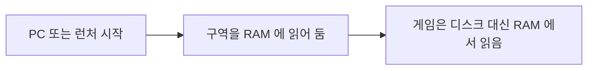

[English](README.md) | **한국어**

<p align="center"></p>

<h1 align="center">AsterCache</h1>

<p align="center">HDD에 설치한 게임의 로딩 시간을 SSD에 가깝게 줄이는 Windows 데스크톱 유틸리티</p>

<p align="center">
  <a href="LICENSE"></a>
  
  
  <a href="https://github.com/DO0OG/AsterCache/actions/workflows/csharp-ci.yml"></a>
  <a href="https://github.com/DO0OG/AsterCache/actions/workflows/kernel-build.yml"></a>
</p>

> **베타.** AsterCache 는 베타 프리릴리스로 배포합니다. 파일 데이터를 실제로 옮기므로 중요한 데이터가 있는 드라이브는 백업한 뒤 쓰십시오. 검증 범위는 SMR 드라이브(WD20EZAZ) 1대와 실제 게임 1종(Frostpunk)이며, CMR 드라이브와 안티치트 게임은 시험하지 않았습니다([알려진 제한](#알려진-제한) 참고).

## 최근 변경

이 변경들은 외부 검토 반영을 포함해 beta.8 이후 `main` 기준입니다. 아직 릴리스가 아닙니다.

- **병렬 재배치.** 시험 HDD에서 병렬 8 읽기로 재배치 작업이 186 s 에서 41 s 로 줄었습니다(4.5배). [docs/RESULTS_SUMMARY.ko.md](docs/RESULTS_SUMMARY.ko.md) 참고.
- **드라이브 회복 판정.** 게임 업데이트 뒤, 또는 SMR 드라이브에서 재배치한 뒤 서비스가 드라이브 회복을 판정하고 다음 작업을 시작합니다(`auto.post_relocate_recovery`).
- **설치 뒤 자동 진행.** `aster status` 와 관리 창 요약에 "발견 → 부트스트랩 계획 → 재배치 완료 → 예열 완료 → 적중률 평균" 한 줄을 보여 줍니다. 게임을 할 것 같은 시간(런처 실행 중이거나 평소 플레이하던 시간대)에는 HDD 가 꺼지지 않게 10 분마다 4 KiB 를 읽습니다(`auto.keep_awake`, 기본 켜짐, 전원 설정은 바꾸지 않음).
- **게임 시작 시 예열 양보.** 같은 물리 디스크에서 게임이 시작되면 예열은 다음 64 MiB 묶음 경계에서 멈춥니다. 같은 디스크인지는 드라이브 문자가 아니라 물리 디스크 번호로 판정하므로, HDD 한 대를 여러 볼륨으로 나눈 PC 에서도 함께 멈춥니다. `auto.keep_stream_on_game_start`(기본 `false`, 실험용. `true` 면 옛 동작)로 바꿉니다.
- **시스템 드라이브가 HDD 인 게임.** Windows 가 있는 드라이브가 HDD 면 게임은 발견과 예열만 합니다. 재배치하거나 티어를 두지 않습니다(상태 "prewarm only (system drive)").
- **지표 이름.** `tier0_probe_ready_ms`(옛 이름 `load_boundary_ms`, 계속 읽음)는 tier0 예열 표본이 RAM 에 적중한 시각입니다. 게임 로딩이 끝난 시간이 아닙니다.

## 목차

- [최근 변경](#최근-변경)
- [무엇을 하는가](#무엇을-하는가)
- [작동 원리](#작동-원리)
- [주요 기능](#주요-기능)
- [실측 결과](#실측-결과)
- [스크린샷](#스크린샷)
- [시스템 요구 사항](#시스템-요구-사항)
- [시작하기](#시작하기)
- [자동 모드](#자동-모드)
- [설정](#설정)
- [안전 장치](#안전-장치)
- [안티치트 호환](#안티치트-호환)
- [알려진 제한](#알려진-제한)
- [문제 해결](#문제-해결)
- [프로젝트 구조](#프로젝트-구조)
- [개발](#개발)
- [라이선스](#라이선스)
- [면책](#면책)

## 무엇을 하는가

AsterCache 는 하드 디스크(HDD)에 설치한 게임의 로딩을 빠르게 해 줍니다. 게임이 로딩할 때 무엇을 읽는지 지켜보고, 그 조각들을 디스크의 한 곳에 나란히 모아 두며, 게임을 켜기 전에 RAM 에 미리 올려 둡니다. 게임 파일의 내용을 바꾸지 않고, 다른 드라이브로 복사하지도 않습니다. 설치한 뒤에는 따로 할 일이 없습니다. 백그라운드에서 알아서 동작합니다([시작하기](#시작하기) 참고).

이 문서의 수치는 실제 게임 1종을 드라이브 1대에서 측정한, 기록한 읽기 패턴의 재생 시간입니다. 게임을 실행한 전체 로딩 시간이 아닙니다. 자세한 내용은 [실측 결과](#실측-결과)와 `VALIDATION_REPORT.md` 를 보십시오.

## 작동 원리

### 문제

하드 디스크는 움직이는 헤드로 데이터를 읽습니다. 레코드 플레이어의 바늘 팔과 비슷합니다. 헤드가 다른 위치로 건너뛸 때마다 기다려야 합니다. 게임이 한 스테이지를 로딩할 때는 디스크 곳곳에 흩어진 조각을 수천 개 읽으므로, 헤드가 읽는 시간보다 건너뛰는 시간이 훨씬 깁니다.

도서관에 비유하면 이렇습니다. 건물 곳곳의 서가에서 책 수백 권을 찾아 오려면 한참 걸립니다. 같은 책이 필요한 순서대로 카트 하나에 쌓여 있다면 금방 가져옵니다. AsterCache 는 그 카트를 만들어 줍니다.

시험한 드라이브에서 흩어진 읽기는 약 39 MiB/s, 끊기지 않는 연속 읽기는 90~110 MB/s 였습니다([docs/RESULTS_SUMMARY.md](docs/RESULTS_SUMMARY.md)). 드라이브마다 다릅니다.

### 장치 1: 기록 (Trace)

게임이 로딩하는 동안 한 번 지켜보며, 어떤 파일의 어느 부분을 어떤 순서로 읽는지 적어 둡니다. 이때 Windows 자체의 이벤트 추적(ETW)을 씁니다. 게임 프로세스는 건드리지 않습니다.


### 장치 2: 재배치 (Relocate)

그 목록대로 조각들을 디스크의 한 구역에, 게임이 읽는 순서대로 나란히 옮깁니다. 파일 내용은 그대로입니다. 디스크 조각 모음 프로그램이 쓰는 NTFS 의 공식 이동 기능을 쓰고, 모든 단계를 저널(기록)로 남기므로 되돌릴 수 있습니다.


### 장치 3: 예열 (Prewarm)

게임을 켜기 전에, 예를 들어 PC 를 켤 때나 게임 런처를 켤 때 그 구역 전체를 RAM(파일 캐시)에 올려 둡니다. 게임이 뜨면 디스크 대신 RAM 에서 읽습니다. 예열이 제때 되지 않았다면 게임이 켜지는 순간 그 구역을 순서대로 읽기 시작합니다(선읽기). 흩어진 원래 상태보다는 훨씬 빠릅니다.



### SSD 유무에 따라

- **SSD 가 있으면(선택, 기본 꺼짐):** 등록된 HDD 게임의 핫 파일을 예산(게임당 기본 8 GiB) 안에서 SSD 에 사본으로 두고, 원본은 `<이름>.aster-orig` 로 남긴 뒤 원래 자리에 심볼릭 링크를 둡니다. 게임은 예전과 같은 경로를 읽습니다.
- **SSD 가 없으면:** 위의 HDD 경로(재배치와 예열)만 씁니다. 예열 적중률은 게임을 켤 때마다 재서 게임별 상태 줄에 "예열 적중 N%"로 표시합니다.

### 결과

측정(Frostpunk, 첫 맵 로딩에서 읽는 2 GB 데이터, SMR HDD)에서 기록한 읽기를 재생하면, 아무것도 하지 않았을 때 24 s, 재배치와 선읽기 뒤 약 12 s, 예열 뒤 약 0.5 s 였습니다. 같은 읽기를 NVMe SSD 에서 콜드로 하면 3.8 s 였습니다. 예열 자체는 선읽기와 비슷한 시간이 걸리므로, 게임을 켜기 전에 끝나 있을 때 가장 효과가 큽니다. 게임 1종, 드라이브 1대의 재생 시간이며 전체 게임 로딩 시간이 아닙니다.

### AsterCache 가 하지 않는 일

- 게임 파일의 내용을 바꾸지 않습니다. 옮기기 전후의 SHA-256 검사로 확인합니다.
- 게임 프로세스에 손대지 않습니다. 주입, 후킹, 드라이버를 쓰지 않습니다.
- 기본으로는 게임을 SSD 로 복사하지 않습니다. 선택 기능인 SSD 보조 저장(기본 꺼짐)은 고른 핫 파일만 복사합니다. [SSD 보조 저장 (선택)](#ssd-보조-저장-선택)을 보십시오.
- RAM 은 예열과 첫 실행의 선행 읽기에만 쓰며, 예산 안에서만 씁니다. 기본은 물리 RAM 의 4분의 1 이하이고(선행 읽기는 기본 4 GiB 이하로 제한), 가용 RAM 이 `prewarm.min_free_ram_mib`(기본 4 GB) 이상 남을 때만 씁니다. 예열한 데이터는 일반 파일 캐시라서, 다른 프로그램이 메모리를 필요로 하면 Windows 가 비워 갑니다.

## 주요 기능

- **드라이브 목록.** HDD/SSD 구분, 용량, 모델, 등록된 게임 수를 보여 줍니다.
- **게임 등록.** 게임 이름, exe 이름, 설치 폴더, 허용 폴더, 볼륨 레이블을 정하고 예열 트리거 프로그램을 지정합니다.
- **트레이스 수집.** 게임을 한 번 실행해 첫 맵까지 로딩하면 읽기 블록을 ETW 실시간 세션으로 기록합니다(관리자 권한).
- **계획, 재배치, 되돌리기.** 기록으로 배치 계획을 만들고 적용합니다. 적용 기록(저널)을 거꾸로 적용해 예전 배치로 되돌릴 수 있습니다.
- **사전 예열.** 자동(서비스 시작, 트리거 프로그램 실행)으로 또는 "지금 예열"로 실행합니다.
- **자동 모드(기본 켬).** 지원 런처 라이브러리와 게임 시작 감지로 HDD 게임을 찾아 첫 실행을 트레이스하고, PC 가 쉬는 동안 재배치합니다. [자동 모드](#자동-모드) 를 보십시오.
- **서비스.** 게임 시작을 감지해 동시 선읽기를 실행하고, 예열과 재적용을 관리합니다. Windows 서비스(LocalSystem, 자동 시작)로 상주합니다.
- **상태와 로그.** 서비스와 감시기 상태, 마지막 예열 결과, 게임별 배치 상태, 로그를 탭에서 확인합니다.
- **측정.** 게임별로 재배치 전후 콜드 재생 시간을 잽니다.
- **프로필 내보내기/가져오기.** 기록한 트레이스를 `aster profile export`·`aster profile import` 로 다른 PC 와 주고받습니다. 가져올 때는 파일 크기와 표본 해시가 같을 때만 받습니다.
- **관리 창.** 관리자 권한이 없으면 상단 안내 띠가 나타나며, 관리자 권한으로 다시 실행할 수 있습니다.
- **명령행 `aster`.** 관리 창의 같은 작업을 명령으로 실행합니다. 자동화에 씁니다.
- **한국어·영어 화면.** 관리 창과 명령행이 두 언어를 지원합니다([언어](#언어) 참고).

## 실측 결과

수치는 추적한 읽기 패턴을 재생한 시간입니다. 게임을 실행한 전체 로딩 시간이 아닙니다.

| 대상 | 측정 | 결과 |
|---|---|---|
| 합성 데이터셋 2.1 GiB | HDD 콜드 읽기 → 재배치 후 선읽기 | 17.1 s → 1.14 s (재배치 10시간 뒤에도 유지) |
| 합성 데이터셋 2.1 GiB | 같은 조건 SSD 콜드 읽기 | 0.76~1.22 s |
| Frostpunk, 첫 맵 로딩 읽기 2.02 GB | HDD 콜드 재생 → 재배치 후 동시 선읽기 | 24.3 s → 11.93 s (3회 중앙값, 각주 참고) |
| Frostpunk | 사전 예열 뒤 재생 | 0.48 s |
| Frostpunk, 같은 읽기 패턴 | NVMe SSD 콜드 재생 | 3.8 s |
| Frostpunk, 1.9 GB 로딩 읽기 | HDD 콜드 → SSD 보조 저장 콜드(웜) | 12.90 s → 2.81 s (웜 0.48 s) |
| Frostpunk 트레이스를 본뜬 흩어진 배치 vs 연속 배치 (2.02 GB) | 같은 읽기 패턴 직접 재생, 선행 읽기 꺼짐, 중앙값 | 흩어진 배치 41.0~55.3 s → 연속 배치 19.3~20.5 s ([결과 폴더](results/csharp_e7c_gen/README.md)) |
| 서비스 | 게임 시작 감지 지연 (폴링, p95) | 58 ms |

- HDD 는 WD20EZAZ(SATA, D:), SSD 는 NVMe(C:)입니다. 측정 환경은 Windows 11 Pro 10.0.26200, 메모리 32 GiB 입니다.
- Frostpunk 결과는 게임 1종을 1회 추적한 뒤 재생한 값입니다. 반복 로딩의 p50·p95 는 아직 없습니다.
- 합성 데이터셋의 SSD 값과 Frostpunk 의 NVMe 값은 데이터와 방법이 달라 직접 비교하지 않습니다.
- 사전 예열이 SSD 콜드보다 빠르려면 예열이 게임 시작보다 15 s 이상 앞서 끝나야 합니다. 메모리 압박이 있으면 효과가 줄어듭니다.
- 11.93 s 값은 E6 실험에서 나왔습니다. 재배치가 이제 기본으로 핫 데이터를 전부 한 존으로 옮깁니다(보존 끔). 8 MiB 이상 연속 구간을 제자리에 두던 이전 방식의 값은 15.1 s 였습니다. [docs/research_cold_limit.md](docs/research_cold_limit.md) 를 보십시오.
- 더 많은 표와 해석은 `docs/RESULTS_SUMMARY.md` 와 `VALIDATION_REPORT.md` 에 있습니다.
- 게임 밖 일반 HDD I/O 연구 노트: [docs/research_hdd_general.md](docs/research_hdd_general.md).

## 스크린샷

관리 창(게임 탭)과 상태 탭입니다. `AsterCache.Tray.exe --smoke --screenshot <png>` 로 만든 예시 화면이라 드라이브와 게임 정보는 샘플 값입니다.

<p align="center"></p>
<p align="center"></p>

## 시스템 요구 사항

- Windows 11 x64. 검증 환경은 Windows 11 Pro 10.0.26200 입니다.
- 직접 빌드할 때는 .NET 10 SDK 가 필요합니다. 저장소의 `csharp/global.json` 은 SDK 10.0.400 을 씁니다(latestPatch).
- 트레이스 수집(ETW), 재배치(`apply`, `revert`), 서비스 설치에는 관리자 권한이 필요합니다.
- 재배치 대상은 NTFS 볼륨이어야 합니다. 원본과 캐시를 비교하려면 서로 다른 물리 장치가 필요합니다.

## 시작하기

### 1. 설치

1. [GitHub Releases](https://github.com/DO0OG/AsterCache/releases) 에서 `AsterCache-v<버전>-win-x64-setup.exe` 를 받습니다(프리릴리스, 예: v0.9.0-beta.6).
2. 실행해서 언어(English 또는 한국어)를 고릅니다.
3. 기본 선택(바탕화면·시작 메뉴 바로가기, Windows 시작 시 실행, 서비스 설치)을 그대로 두고 끝날 때까지 다음을 누릅니다.

설치 프로그램이 싫다면 같은 릴리스의 zip `AsterCache-0.9.0-beta.6-win-x64.zip` 을 쓸 수 있습니다. 압축을 풀고 `AsterCache.Tray.exe` 를 관리자 권한으로 실행한 뒤, 설정 탭에서 서비스를 설치하고 시작합니다.

새 설치본을 다시 실행하면 기존 설치를 업그레이드합니다. 제거하면 먼저 SSD 보조 저장의 링크를 되돌린 뒤(`aster tier revert --all`, 사본은 tier 폴더에 남음) 프로그램과 서비스를 지웁니다. 데이터 폴더 `%ProgramData%\AsterCache` 는 남습니다. 설치 프로그램에는 코드 서명이 없어 Windows SmartScreen 경고가 뜰 수 있습니다.

### 2. 끝입니다: 자동 모드

설치하고 나면 더 할 일이 없습니다. [자동 모드](#자동-모드)가 기본으로 켜져 있습니다. 요약하면 설치 → 자동 발견 → 예열(작은 게임은 폴더 전체, 큰 게임은 엔진 프로필, 기록 없이도) → 첫 실행 때 읽기 기록 → 게임을 끈 뒤 약 30초 뒤 재배치 → 옮긴 구역 바로 예열 → 두 번째 실행부터 최대 효과입니다. 첫 실행 선행 읽기는 기본으로 꺼져 있습니다. 눌러야 할 버튼은 없습니다. 시간이 지나면서 이런 일이 일어납니다.

| 언제 | AsterCache 가 하는 일 |
|---|---|
| 설치 직후 | 백그라운드 서비스가 시작됩니다. |
| 약 10초 뒤(그 뒤 1시간마다) | Steam, Epic, GOG, Ubisoft, Riot 라이브러리와 Windows 제거 목록을 훑어 HDD 에 설치된 게임을 등록합니다. |
| 등록된 게임, 첫 실행 전 (서비스 시작·런처 실행·게임 종료 뒤) | 설치 폴더가 RAM 예산 이하인 작은 게임은 폴더 전체를, 더 큰 게임은 엔진(Unity, Unreal, Source) 프로필만 예열합니다. 기록이 없어도 합니다. 기록이 없는 게임의 배치 정보는 이 순서로 찾습니다: 공유 프로필(저장소 준비 중이라 아직 없으면 건너뜀) → Windows 프리페치 기록 → 엔진 프로필 → 폴더 전체. 이 예열의 효과는 아직 측정하지 않았습니다. |
| 등록된 게임을 처음 플레이할 때 | 게임이 읽는 내용을 기록(트레이스)합니다. 첫 실행 선행 읽기는 실험 기능이라 기본 꺼짐(E7~E7f 측정에서 이득 없음, `auto.learn.enabled`)이므로, 이번 실행은 기록만 합니다. 효과는 두 번째 실행부터 납니다. |
| 게임을 끄고, 게임 드라이브 처리량이 30초 동안 4 MiB/s 미만이며, AC 전원(또는 배터리 50% 이상)일 때 | 게임의 조각을 한 구역으로 옮긴 뒤 곧바로 그 구역을 예열합니다. 한 번에 게임 하나씩이며 몇 분 걸립니다(2 GB 당 약 5분). 그 사이 게임을 켜면 멈췄다가 나중에 이어서 합니다. |
| PC 를 켤 때, 런처를 켤 때마다 | 예산 안에서 그 구역을 RAM 에 예열합니다. |
| 두 번째 실행부터 | 최대 효과가 납니다(수치는 [실측 결과](#실측-결과) 참고. 게임 전체 로딩 시간은 아직 측정하지 않았습니다). |

"한가하다"는 옮길 게임과 같은 드라이브에 설치된 등록 게임이 돌지 않고(다른 드라이브의 게임은 보지 않습니다), 게임 드라이브 처리량이 30초 동안 4 MiB/s 미만이고, AC 전원이 연결된(또는 배터리 50% 이상) 상태입니다. CPU 사용률은 보지 않습니다. 재배치는 낮은 I/O 우선순위로 대상 드라이브에만 영향을 주므로, 백그라운드 작업이 있는 PC 도 재배치합니다. 6시간을 넘게 한가하지 않으면 `service.log` 에 이유(`game running`, `on battery`, `disk busy`) 한 줄을 남깁니다. 게임마다 지금 어느 단계인지는 관리 창(트레이 아이콘 또는 바탕화면 바로가기)의 **상태** 탭과 **게임** 탭의 단계 열에서 볼 수 있습니다.

### 3. 직접 하려면(선택)

단계를 직접 다루고 싶거나, 자동 모드가 건너뛴 게임을 시험할 때 씁니다. 관리 창을 관리자 권한으로 열고 **게임** 탭에서 아래 버튼을 순서대로 누릅니다.

| 순서 | 버튼 | 하는 일 |
|---|---|---|
| 1 | 등록 | exe 파일을 골라 게임을 추가합니다. |
| 2 | 트레이스 수집 | 게임을 실행해 첫 맵까지 로딩하고 끕니다. 읽기 순서를 기록합니다. |
| 3 | 계획 만들기 | 조각을 어디에 둘지 정합니다. |
| 4 | 재배치 실행 | 조각을 옮깁니다. 저널이 남습니다. |
| 5 | 지금 예열 | 그 구역을 바로 RAM 에 올립니다. |
| 6 | 측정 | 구역을 한 번 읽는 시간을 잽니다. |

같은 단계를 명령행(`aster`)으로도 할 수 있습니다. 예를 들면 다음과 같습니다.

```bat
aster discover
aster tier status
aster trace --live --exe Frostpunk.exe --origin-root D:\Games\Frostpunk --out trace.json --seconds 180
aster plan --trace trace.json --origin-root D:\Games\Frostpunk --zone-mib 1536 --out plan.json
aster apply --plan plan.json --allowed-root D:\Games --require-volume-label GAMES --dry-run
aster apply --plan plan.json --allowed-root D:\Games --require-volume-label GAMES --execute
aster prewarm --plan plan.json --origin-root D:\Games\Frostpunk
```

- `discover` 는 런처 라이브러리에서 찾은 게임 목록을 읽기 전용으로 보여 줍니다.
- `tier status` 는 SSD 보조 저장 상태를 보여 줍니다. `tier apply --game <이름>`, `tier revert --game <이름>` 또는 `--all`, `tier clean` 은 관리자 권한이 필요합니다.
- `trace --live`, `apply --execute` 는 관리자 PowerShell 에서 실행합니다.
- `--dry-run` 은 아무것도 옮기지 않고 계획만 보여 줍니다. `--require-volume-label` 이 실제 볼륨 레이블과 다르면 아무것도 옮기지 않습니다.
- `--zone-mib` 값은 예시입니다. 게임의 핫 데이터 크기에 맞춰 정하십시오. 전역 옵션 `--lang ko|en` 으로 출력 언어를 정합니다([언어](#언어) 참고).
- 모든 명령과 옵션은 [csharp/README.ko.md](csharp/README.ko.md) 에 있습니다.

### 4. 끄기와 되돌리기

- **자동 모드 끄기.** **설정** 탭에서 **자동 모드 사용** 체크를 풀고 **자동 모드 적용**을 누릅니다. 또는 `%ProgramData%\AsterCache\config.json` 에 `"auto": {"enabled": false}` 를 씁니다. 게임 하나만 빼려면 그 exe 를 `auto.ignore_exes` 에 넣습니다. [자동 모드](#자동-모드)를 보십시오.
- **게임 되돌리기.** **게임** 탭에서 게임을 고르고 **되돌리기**를 누릅니다. 저널을 따라 예전 디스크 배치로 복원합니다. 파일 내용은 처음부터 바뀌지 않았습니다.
- **제거.** Windows 설치된 앱에서 지웁니다. 데이터 폴더 `%ProgramData%\AsterCache` 는 남으며, `cs_service.ps1 -Action uninstall -PurgeData` 를 실행했을 때만 지웁니다.

### 자주 묻는 질문

**SSD 에 설치한 게임도 되나요?**
아니요. HDD 에 있는 게임만 대상입니다. SSD 에 있는 게임은 필요가 없으므로 건너뜁니다. Windows 가 있는 드라이브가 HDD 이면 그 게임은 발견과 예열만 하고(상태 "prewarm only (system drive)"), 재배치하거나 티어를 두지 않습니다.

**안티치트 게임에서 안전한가요?**
AsterCache 는 게임 프로세스에 손대지 않습니다. 자기 프로세스에서 파일을 읽고, Windows 이벤트 추적으로 파일 읽기를 관찰하며, 게임이 종료된 뒤에만 파일을 옮깁니다. 다만 안티치트 게임에서는 아직 시험하지 않았습니다. 그런 게임은 먼저 자동 모드를 끄거나 `auto.ignore_exes` 에 넣으십시오. 자세한 내용은 [안티치트 호환](#안티치트-호환)을 보십시오.

**RAM 을 얼마나 쓰나요?**
구역 크기만큼입니다. 구역은 게임이 읽는 데이터 묶음이며 기본 상한은 2 GiB 입니다. 예열 뒤에도 가용 RAM 이 4 GB 이상 남을 때만 실행하고, 다른 프로그램이 메모리를 필요로 하면 Windows 가 캐시를 회수합니다.

**게임 업데이트 뒤에는 어떻게 되나요?**
패치로 파일이 바뀌면 저장해 둔 계획과 맞지 않을 수 있습니다. AsterCache 는 옮기기 전에 계획을 확인해 바뀐 파일은 건너뛰고, 게임이 꺼져 있는 동안 5분마다 배치가 흐트러졌는지 보고 흐트러졌으면 계획을 다시 적용합니다. 큰 패치 뒤에는 트레이스 수집, 계획 만들기, 재배치 실행을 다시 하십시오. 실제 게임 업데이트로는 아직 시험하지 않았습니다.

**SMR 인지 CMR 인지가 중요한가요?**
SMR 드라이브(WD20EZAZ) 1대만 측정했고 CMR 은 측정하지 않았습니다. 헤드 이동을 줄이는 것이므로 둘 다 도움이 될 것으로 보지만 검증하지 않았습니다. SMR 은 처음 한 번 옮길 때 쓰기가 느려질 수 있습니다.

**첫 실행이 꼭 필요한가요?**
재배치에는 게임이 실제로 읽는 기록(트레이스)이 필요합니다. 첫 실행에서 기록이 생기기 전에는 공유 프로필(`auto.shared_profiles`)을 먼저 찾고, 그다음 게임의 Windows 프리페치 기록을 봅니다. 프리페치 기록과 공유 프로필은 부트 트레이스가 되어 첫 실행 전에도 재배치를 시작할 수 있습니다. 공유 프로필 저장소(https://github.com/DO0OG/AsterCache-profiles)는 준비 중이라 아직 없으며, 없으면 조용히 건너뜁니다. 기록이 없어도 예열은 합니다. 설치 폴더 전체가 RAM 예산(물리 RAM 의 4분의 1과 가용 RAM 에서 `prewarm.min_free_ram_mib` 을 뺀 값 중 작은 쪽) 이하인 게임은 폴더 전체를 예열하며(`auto.full_prewarm`, 기본 켬, 예산은 `auto.full_prewarm_max_mib` 로 바꿀 수 있습니다), 더 큰 게임은 엔진(Unity, Unreal, Source)을 감지해 로딩 초반에 거의 반드시 읽는 파일만 예열합니다(`auto.engine_profiles`, 기본 켬). 두 예열의 효과는 아직 측정하지 않았습니다. 다른 PC 에서 만든 기록은 `aster profile import` 로 가져올 수 있습니다(`aster profile export` 참고). 가져온 기록은 `plans\<이름>.boot.trace.json` 으로 저장되어 첫 실행 없이도 재배치와 예열이 시작되고, 첫 실행은 그대로 기록되어 그 기록으로 계획을 다시 만들고, 옛 계획은 `.stale` 로 남깁니다(같은 존을 먼저 시도).

**처음 실행도 빨라지나요?**
첫 실행 선행 읽기는 실험 기능이며 기본 꺼짐입니다(E7~E7f 측정에서 이득 없음, `auto.learn.enabled`). 첫 실행은 읽기 기록만 하고, 최대 효과는 재배치와 예열이 끝난 두 번째 실행부터입니다. 런처 라이브러리가 아니라 실행 감지로만 찾은 게임은 그 다음 실행부터 기록을 시작합니다. 측정 과정은 [docs/RESULTS_SUMMARY.ko.md](docs/RESULTS_SUMMARY.ko.md#e7-첫-실행-선행-읽기) 에 있습니다. 예열(폴더 전체 또는 엔진 프로필)은 기록 없이도 돌지만 효과는 아직 측정하지 않았습니다.

**파일이 망가질 수 있나요?**
옮길 때마다 SHA-256 으로 검증하고, 되돌릴 수 있는 저널에 기록합니다. 그래도 실제 데이터를 옮기는 베타이므로 중요한 드라이브는 먼저 백업하십시오. [안전 장치](#안전-장치)를 보십시오.

## 자동 모드

자동 모드는 기본으로 켜져 있습니다. 보통은 게임을 등록하거나 따로 설정할 필요가 없습니다. 각 부분은 설정 탭의 **자동 모드** 묶음이나 `config.json` 에서 끌 수 있습니다.

### 첫 실행 전에 쓰는 자료

기록이 없는 게임은 아래 자료 중 해당하는 첫 번째 것으로 처음 배치 정보를 얻습니다. 첫 실행에서 실제 기록(트레이스)이 생기면 그것으로 만든 계획이 앞의 계획을 대신하고, 옛 계획은 `.stale` 로 남깁니다.

1. **공유 프로필** (`auto.shared_profiles`, 기본 켬). 주 1회 공유 프로필 묶음 zip 하나를 HTTPS 로 받고, Steam 앱 ID와 디포 매니페스트 ID, Epic 앱 이름과 버전, 또는 exe 크기와 표본 SHA-256 으로 게임을 찾습니다. 이 PC 의 파일 크기와 표본 해시가 맞을 때만 씁니다. 오프라인이거나 404 면 조용히 건너뜁니다. 내려받기는 64 MiB 로 제한합니다. 공유 저장소는 아직 준비 중입니다.
2. **Windows 프리페치 기록** (`C:\Windows\Prefetch\*.pf`). SysMain 서비스가 돌고 `EnablePrefetcher` 의 응용 프로그램 비트가 켜져 있을 때 씁니다. 서비스는 게임의 `.pf` 파일만 읽고, 설치 폴더 안의 파일로 부트 트레이스를 만듭니다. "미리 읽지 않음" 표시가 있는 파일은 뺍니다. 기록이 참조한 범위와 그 앞뒤 64 MiB(겹치면 합침, 파일 크기 상한 없음)를 물리 순서로 구역에 모읍니다. 구역이 플레이에서 읽은 양의 30% 미만만 덮으면 상태 detail 에 `partial (N%)` 로 표시합니다. 관리 창에는 "재배치됨(프리페치)"로 표시됩니다.
3. **엔진 프로필** (Unity, Unreal, Source). 기록 없이 예열합니다.
4. **폴더 전체.** 폴더가 RAM 예산 안에 들면 기록 없이 예열합니다.

### 단계

1. **발견.** 서비스가 시작한 10초 뒤와 그 뒤 1시간마다 지원 런처 라이브러리(아래)를 읽습니다. HDD(회전 디스크) 볼륨에 설치된 게임은 `"source": "auto"` 로 자동 등록합니다. 볼륨 레이블이 비었거나 32자를 넘으면 등록하지 않고 로그를 남기며, 같은 exe 이름이나 겹치는 폴더가 이미 등록되어 있으면 건너뜁니다. 게임 목록 상한은 32개입니다. 가득 차면 런처 발견은 멈추고, 실제로 실행되어 잡힌 게임이 가장 오래 쓰지 않은 자동 항목을 밀어냅니다.
2. **트레이스.** 트레이스가 없는 등록 게임이 시작되면 서비스가 `AsterCacheAutoTrace` 라는 실시간 ETW 세션으로 읽기를 기록합니다. 게임 종료, 600초(`trace_cap_seconds`), 6144 MiB(`trace_cap_mib`) 중 먼저 오는 때 멈춥니다. 결과는 `plans\<이름>.trace.json` 에 저장되며, 수동 **트레이스 수집** 버튼이 만드는 것과 같은 파일입니다. 이후 플레이도 `trace_runs`(기본 3)번이 모일 때까지 같은 방식으로 기록해 `plans\<이름>.trace.runN.json` 으로 저장하고, `trace.json` 은 그 블록들의 합집합(첫 번째 플레이의 접근 순서 뒤에 이후 플레이에서 처음 본 블록)으로 한 번에 바꿔 씁니다. 병합한 핫 집합이 계획보다 `trace_merge_min_mib`(기본 64) 이상 커졌고 게임이 꺼져 있으면 존을 제자리에서 확장합니다. 이미 존에 있는 블록은 옮기지 않고 새 블록만 뒤에 붙이며, `max_zone_mib` 안에서 앞선 플레이의 블록을 우선하고, 유휴·일일 상한·쓰기 예산 검사는 일반 재배치와 같습니다. 존 뒤가 비어 있지 않으면 확장을 건너뛰고 이전 계획을 유지하며, 새 플레이로 트레이스가 바뀔 때만 다시 시도합니다(로그의 `zone extension blocked: ...`). 플레이를 더 모으는 동안 상태 열에 `trace 2/3` 처럼 표시합니다. 시작을 감지한 실행은 이미 로딩이 시작된 뒤이므로, 트레이스는 다음 실행부터 기록합니다. 이 기록과 함께 서비스는 첫 실행 학습(선행 읽기)을 할 수 있습니다. 이 기능은 실험 기능이라 기본으로 꺼져 있습니다(`auto.learn.enabled` 가 `false`, E7~E7f 측정에서 이득 없음). 켜면, 게임이 파일을 순차로 읽는 경우에만 읽습니다. 같은 파일에서 직전 읽기 끝과 간격 4 MiB 이하로 앞으로 이어지는 읽기가 6회 연속이고 게임이 그 파일을 8 MiB 이상 읽었으면 순차로 판정합니다. 그런 파일은 게임 읽기의 틈을 기다리지 않고 현재 위치부터 16 MiB 단위로 `auto.learn.window_mib`(기본 512 MiB)까지 앞서 읽으며, 게임이 읽는 중에도 멈추지 않습니다(`auto.learn.mode` `"stream"`, 기본). `"gap"` 이면 게임 읽기가 100 ms 동안 조용할 때만 1 MiB 씩 읽습니다. 읽기는 서비스 자기 프로세스에서 하며 읽기 스레드는 1개, 선행 읽기 I/O 는 낮은 우선순위, 방금 읽힌 파일부터입니다. 게임이 배타적으로 연 파일은 건너뜁니다. 총량은 게임 읽기량 × 1.5 + 64 MiB 를 넘지 않고, `auto.learn.max_total_mib`(0 이면 물리 RAM 의 4분의 1과 4096 MiB 중 작은 값)을 넘지 않고, 가용 RAM 여유(`min_free_ram_mib`)를 지킵니다. HDD 이면서 시스템 드라이브가 아닌 드라이브의 게임만 대상입니다. 게임 프로세스는 열지 않고 ETW 로만 봅니다.
3. **계획과 재배치.** 트레이스가 생기고 게임이 꺼져 있으며 PC 가 `idle_seconds`(기본 30초) 동안 연속으로 쉬고 있으면, 한 번에 게임 하나씩 처리합니다. 존을 계획하고(핫 데이터 × 1.1, `max_zone_mib` 를 넘지 않음), 수동 재배치와 같은 Applier 로 옮기며(저널과 SHA-256 표본 검사), 배치를 확인합니다. 쉬고 있다는 뜻은 게임 드라이브 처리량 4 MiB/s 미만이고 AC 전원이거나 배터리 50% 이상입니다. 24시간에 최대 `max_relocations_per_day`(기본 4)번만 재배치하며, 게임마다 자동 첫 재배치는 한 번입니다. 이후 유지는 기존 주기 검사가 맡습니다. 이동 중 게임이 시작되면 이동 중이던 조각을 끝내고 멈추며, 나중에 저널로 이어갑니다. 게임이 꺼진 상태에서 데이터 검사가 실패하거나 오류가 나면 저널대로 되돌리고 실패로 기록합니다. 옮긴 뒤에는(기록이 있으면 실패했어도) 곧바로 그 구역을 예열합니다. 옮기는 I/O 에는 낮은 I/O 우선순위 힌트(`FileIoPriorityHintInfo` Low)를 걸었습니다. 문서가 커널의 이동 복사 I/O 에 이 힌트가 적용된다고 보장하지 않으며, 아직 측정하지 않았습니다. 재배치 뒤 게임 파일의 크기나 수정 시각이 바뀌면(게임 업데이트), 트레이스와 계획을 `.stale` 로 치우고(10분마다 확인) 단계를 발견으로 되돌려, 다음 실행 때 이전 존 위치를 먼저 시도하며 다시 트레이스·재배치합니다.
4. **예열.** 서비스가 시작할 때, 지원 런처가 뜰 때, 게임이 끝난 뒤에 최근에 플레이한 게임부터 예열합니다. 최근에 자주, 지금 시간대에 자주 한 게임부터 예열합니다. `prewarm_recent` 가 기본값 0 이면 예산(물리 RAM 의 4분의 1과 가용 RAM 에서 `min_free_ram_mib` 을 뺀 값 중 작은 값) 안에서 가능한 만큼 예열하고, 1~32 면 그 개수만큼만 예열합니다. 예열을 유지하기 위해 `rewarm_minutes`(기본 10, 0이면 끔)마다 존의 8곳(접근 순서 앞 4곳과 균등한 4곳)을 1 MiB씩 읽어 잽니다. 그중 2곳 이상이 2 ms 를 넘으면 파일 캐시에서 밀려난 것이므로, `min_free_ram_mib` 여유를 지키며 다시 예열합니다. 예열한 게임과 같은 드라이브의 게임이 실행 중이면 하지 않습니다. 예열은 64 MiB 묶음으로 읽습니다. 다른 게임이 시작되면 묶음 경계에서 멈추고, 지금 예열 중인 게임이 시작되어도 같은 경계에서 멈춰 게임에 양보합니다(`auto.keep_stream_on_game_start`, 기본 `false`, 실험용. `true` 면 옛 동작대로 끝까지 읽습니다). 관리 창에 `예열 중 x/y MB` 가 나오고, 예열이 끝나면 트레이 알림을 보냅니다(게임당 하루 1회). 통째 예열은 디스크 물리 위치 순서로 읽습니다. 묶음에 게임이 둘 이상이면 각 게임의 로딩 앞부분(tier0)을 최근 순서로 먼저 올리고, 그다음 게임별 구역 전체를 읽습니다. 게임 업데이트를 감지하면 드라이브가 흩어진 쓰기를 아직 정리하는 중일 수 있어, 그 게임의 재계획·재배치·예열을 `post_update_delay_min` 분(기본 15, 0이면 끔) 미룹니다(E9). SMR 디스크에서는 재배치 뒤 디스크 회복을 확인한 뒤 다음 작업을 합니다(`auto.post_relocate_recovery`, 기본 `"probe"`: 2분마다 짧게 읽어 기준의 90% 이상이 연속 2회면 회복으로 보고, 최대 `post_update_delay_min` × 4분까지 기다림. `"fixed"`는 고정 분, `"off"`는 끔). 0.9.0-beta.14부터 부팅 예열은 최근에 플레이한 게임만 대상으로 하며, 부팅 5분 뒤 디스크가 유휴일 때만 시작합니다. 통째 예열 상한은 기본 1024 MiB입니다(`auto.full_prewarm_max_mib`, 0이면 이제 RAM의 4분의 1 대신 1024 MiB).
5. **고정(선택).** `prewarm.pin` 을 `true` 로 두면(설정에 적지 않으면 물리 RAM 24 GiB 이상에서 자동으로 켜짐, `false` 는 끔, 명시한 `true` 는 RAM 16 GiB 이상에서 동작) 예열한 페이지를 서비스가 읽기 전용 매핑으로 열어 두어 캐시에서 덜 밀려나게 합니다. 가용 RAM 이 여유 아래로 내려가거나 게임·런처가 시작되면 즉시 해제하므로, 런처 업데이트가 파일을 고칠 수 있습니다. 트리거 프로그램으로 뜬 예열은 고정하지 않습니다. 효과 미확인(실험 필요).

### 지원 런처

| 런처 | 게임 목록을 읽는 방법 | 자동 등록 게임의 예열 트리거 |
|---|---|---|
| Steam | `libraryfolders.vdf` 와 `appmanifest` 파일. 실행 파일은 게임 폴더에서 가장 큰 `.exe` 이며, 설치 프로그램·재배포 파일·크래시 도구는 제외합니다 | `steam.exe` |
| Epic Games Store | `%ProgramData%\Epic\EpicGamesLauncher\Data\Manifests\*.item` 의 `LaunchExecutable` | `EpicGamesLauncher.exe` |
| GOG Galaxy | 레지스트리 `HKLM\SOFTWARE\WOW6432Node\GOG.com\Games` | `GalaxyClient.exe` |
| Ubisoft Connect | 레지스트리 `Launcher\Installs` 의 `InstallDir` 값 | `upc.exe`, `UbisoftConnect.exe` |
| Riot Client | `%ProgramData%\Riot Games\Metadata\<제품>.live\*.product_settings.yaml` 의 `product_install_full_path`. 리그 오브 레전드(`LeagueClient.exe`, `League of Legends.exe`)와 전략적 팀 전투는 같은 실행 파일 이름을 쓰며, 같은 폴더면 합칩니다. 발로란트는 `VALORANT.exe`, `VALORANT-Win64-Shipping.exe` 를 씁니다. 그 밖의 제품은 폴더에서 가장 큰 `.exe` 입니다. `.live` 가 아닌 항목(예: PBE)은 제외합니다. Vanguard 안티치트로 표시합니다 | `RiotClientServices.exe` |
| Windows 제거 목록 | HKLM·HKCU 의 `Uninstall` 레지스트리(32비트 포함). 설치 폴더가 HDD(시스템 드라이브가 아님)이고 1 GiB 이상이며, Microsoft·Intel·NVIDIA 등 일반 소프트웨어 게시자가 아니고, 런처 본체 폴더가 아닌 항목을 씁니다. exe 는 폴더에서 가장 큰 `.exe` 입니다. Battle.net·EA·넥슨·호요버스 등 독립 설치 게임이 여기로 잡힙니다. 런처 제외 단어에 걸려 건너뛴 항목은 서비스가 시작할 때 현재 규칙으로 exe 를 다시 고르며, 로그에 한 줄을 남깁니다. 한계: 런처형 폴더는 엉뚱한 exe 가 골라질 수 있고, 게임을 실제로 실행하면 휴리스틱이 실제 exe 를 더합니다 | 없음 |
| Xbox(Microsoft Store) | 각 HDD 의 `XboxGames\<게임>\Content` 폴더. exe 는 가장 큰 `.exe` 입니다. 읽을 수 없는 폴더는 건너뜁니다 | 없음 |

GOG 와 Ubisoft 읽기는 아직 실제 PC 에서 확인하지 않았습니다. Riot 읽기는 이 PC 의 D: (HDD) 에 있는 리그 오브 레전드가 잡히는 것을 확인했습니다. Xbox 읽기는 이 PC 에 해당 폴더가 없어 확인하지 못했습니다.

라이브러리를 읽지 않는 런처: Battle.net, EA 앱. 이들의 게임과 런처 없이 설치한 게임은 위의 Windows 제거 목록에 맞으면 거기서 잡히고, 그 밖은 아래 휴리스틱으로 잡힙니다. 수동으로 등록한 게임과 같은 폴더에 있는 게임은 자동 등록하지 않으며, 로그에 한 줄을 남깁니다. `Battle.net.exe`, `EADesktop.exe` 는 예열 트리거 프로그램으로만 적혀 있으며, 서비스가 이 런처들의 라이브러리를 읽지는 않습니다.

### 휴리스틱 감지

등록되지 않은 프로세스가 HDD 볼륨의 exe 로 시작해 20초 안에 256 MiB 이상을 읽으면 게임으로 보고 등록합니다. 제외 대상은 Windows 폴더, AsterCache 자신, 런처와 도구 프로그램, `auto.ignore_exes` 의 exe 입니다. 또 경로에 `\bin\Debug\`, `\bin\Release\`, `\obj\`, `\.git\`, `\node_modules\`, `\AppData\Local\Temp\` 가 있는 exe 와 내장 도구 exe(`testhost*`, `dotnet`, `msbuild`, `vstest*`, `python*`, `node`, `java*`, `powershell`, `pwsh`, `cmd`, `conhost`, `explorer`, `7z*`, `winrar`)도 제외합니다. 이 고정 목록은 `auto.ignore_exes` 와 별개입니다. 폴더도 게임처럼 보여야 합니다. 256 MiB 이상 파일이 있거나 런처 흔적(`steam_appid.txt`, `.egstore`, `goggame-*.info`, Steam 매니페스트)이 있어야 합니다. 그래서 `AppData\Local\Temp` 아래 설치된 게임은 이 휴리스틱으로 잡히지 않습니다. 시작 부분은 이미 놓쳤으므로 트레이스는 다음 실행부터 기록합니다.

### 설정

```json
{
  "max_zone_mib": 2048,
  "auto": {
    "enabled": true,
    "discover": true,
    "trace": true,
    "relocate": true,
    "full_prewarm": true,
    "full_prewarm_max_mib": 0,
    "engine_profiles": true,
    "shared_profiles": {"enabled": true, "url": "https://github.com/DO0OG/AsterCache-profiles/releases/latest/download/profiles.zip"},
    "learn": {"enabled": false, "mode": "stream", "window_mib": 512, "max_total_mib": 0},
    "prewarm_recent": 0,
    "idle_seconds": 30,
    "trace_cap_seconds": 600,
    "trace_cap_mib": 6144,
    "trace_runs": 3,
    "trace_merge_min_mib": 64,
    "max_relocations_per_day": 2,
    "rewarm_minutes": 10,
    "post_update_delay_min": 15,
    "ignore_exes": [],
    "ssd_tier": {"enabled": false, "budget_gib": 8, "root": "auto"}
  }
}
```

- `"auto": {"enabled": false}` 는 자동 모드 전체를 끕니다. `discover`, `trace`, `relocate` 는 각 단계만 끕니다. `max_zone_mib` 는 `"auto"` 로 줄 수도 있습니다. `"auto": {"learn": {"enabled": true}}` 로 첫 실행의 선행 읽기를 켭니다(실험 기능, 기본은 꺼짐). `mode`(실험 기능)는 `"stream"`(기본), `"gap"`, `"bounded"`, `"adaptive"` 중 하나입니다. `"bounded"` 는 stream 처럼 읽되 총량을 게임 읽기 + 32 MiB 로 제한하고, 게임이 읽은 뒤 50 ms 동안은 새 요청을 내지 않습니다. `"adaptive"` 는 `"bounded"` 에 더해 최근 500 ms 의 게임 읽기 처리량이 `saturation_mbps`(1..10000, 기본 80 MiB/s) 이상이면 쉬고, 우리 요청의 지연이 2 배로 오르면 200 ms 쉽니다. 선행 읽기는 실험 기능이며 기본으로 꺼져 있습니다(E7~E7f 측정에서 이득 없음). `shared_profiles.enabled` 는 주간 내려받기를 끄며, `url` 은 https 여야 합니다. `idle_seconds` 는 예전 `idle_minutes` 를 대신하며, `idle_seconds` 가 없고 `idle_minutes` 만 적혀 있으면 그 값을 씁니다.
- 수동 버튼(등록, 트레이스 수집, 계획 만들기, 재배치 실행, 지금 예열)은 전과 같이 동작합니다.
- 서비스는 상태를 `%ProgramData%\AsterCache\auto_status.json` 에 씁니다. 이 파일은 서비스만 씁니다.
- `"auto": {"ssd_tier": {"enabled": true, "budget_gib": 8, "root": "auto"}}` 는 선택 기능인 SSD 보조 저장을 켭니다(기본 꺼짐). `budget_gib`(1~4096)는 게임 하나가 쓸 수 있는 SSD 용량의 상한입니다. `root` 는 `"auto"`(시스템 드라이브가 SSD 면 그곳, 아니면 여유가 가장 큰 다른 SSD, 폴더는 `AsterCache\tier`) 또는 SSD 위의 절대 경로입니다. [SSD 보조 저장 (선택)](#ssd-보조-저장-선택)을 보십시오.
- 관리 창 상태 탭에는 게임마다 "자동: Frostpunk 발견 → 트레이스 수집 중 → 재배치 대기 → 재배치 중 → [완료]" 형태의 줄이 나오고, 게임 탭에는 출처·단계·안티치트 열이 있습니다. 학습 단계는 "첫 실행: 학습 중 (선행 읽기 n MiB)", 예열 뒤에는 "예열됨" 으로 표시됩니다. 게임별 상태 줄에는 `예열 적중 N%`(마지막 게임 시작 때 잰 적중률)과 `SSD 보조 N GB`(게임의 SSD 사본 크기)도 나옵니다. 트레이 알림은 발견, 재배치 완료, 첫 실행 완료("다음 실행부터 빨라집니다: <게임>") 때 보냅니다.
- `aster status` 출력에 `"auto"` 키가 있고, `aster discover [--json]` 은 런처 게임 목록을 읽기 전용으로, 안티치트 표시와 함께 보여 줍니다.
- 수동 등록 게임도 `auto.relocate` 가 켜져 있으면 트레이스가 생긴 뒤 PC 가 쉴 때 자동으로 재배치됩니다. 원치 않으면 `auto.relocate` 를 끄거나(관리 창 설정 탭에서 "재배치" 체크 해제), 그 게임 exe 를 `auto.ignore_exes` 에 넣으십시오.
- SSD 의 게임은 자동 등록·트레이스·재배치 대상이 아닙니다. Windows 가 있는 드라이브가 HDD 이면 그 게임은 발견과 예열만 하고(상태 "prewarm only (system drive)"), 재배치하거나 티어를 두지 않습니다.
- 관리 창에서 지운 자동 등록 게임은 exe 가 `auto.ignore_exes` 에 들어가 다시 자동 등록되지 않습니다. 목록은 최대 64개이며, 넘으면 오래된 것부터 빠집니다.
- 자동 적용 하루 상한(`max_relocations_per_day`)은 재배치를 시작한 시각부터 24시간 기준으로 셉니다.
- 자동 적용이 실패하면 저널대로 되돌리되, 되돌리는 것은 그 자동 적용분만입니다.

### 효과

자동 모드의 속도 효과는 아직 측정하지 않았습니다. 측정 결과가 나오면 [docs/RESULTS_SUMMARY.md](docs/RESULTS_SUMMARY.md) 에 추가할 예정입니다.

### SSD 보조 저장 (선택)

기본으로 꺼져 있습니다(`auto.ssd_tier.enabled`). 꺼져 있으면 AsterCache 는 파일을 건드리지 않습니다. 다만 이전 실행이 남긴 링크는 되돌립니다.

- **파일 고르기.** 파일마다 핫 바이트(트레이스가 읽은 부분)를 파일 크기로 나눈 값을 매깁니다. 값이 높은 파일부터 예산(`budget_gib`, 게임당 기본 8 GiB) 안에 들어가는 만큼 고릅니다. 게임의 `.exe`·`.dll` 파일과 `allowed_roots` 밖의 파일은 고르지 않습니다.
- **적용.** 파일을 SSD 에 복사하고 크기와 표본 SHA-256 을 확인합니다. 저널에 기록한 뒤 원본을 같은 폴더의 `<이름>.aster-orig` 로 이름을 바꾸고, 그 자리에 심볼릭 링크를 둡니다. 링크로 크기를 다시 확인합니다. 한 파일이 실패하면 그 파일만 되돌립니다.
- **언제 하나.** 한 번에 게임 하나씩, 게임이 꺼져 있고 HDD 이며 시스템 드라이브가 아니고 안티치트 흔적이 없으며 재배치가 끝난(또는 재배치가 꺼진) 게임에만 합니다. 재배치와 같이 한가함을 기다리며, 끝내지 못한 게임은 6시간 뒤에 다시 시도합니다.
- **유지.** 서비스 틱마다 저널을 확인합니다. 사본이 없거나 크기가 다르면 바로 되돌립니다. 파일이 일반 파일로 바뀌었거나 사본이 링크를 통해 바뀌었으면 stale 로 표시하고 그대로 둡니다. SSD 여유가 1 GiB 아래면 새 사본을 만들지 않고, 가장 오래된 게임부터 되돌립니다. 예산이나 폴더 설정을 바꾸면 그 게임을 되돌린 뒤 새 설정으로 다시 적용합니다.
- **되돌리기.** `aster tier revert --game <이름>` 또는 `--all` 은 링크를 지우고 원본 이름을 복구합니다. 사본은 `aster tier clean` 이 쓰지 않는 것을 지울 때까지 tier 폴더에 남습니다. 제거할 때는 모든 게임을 먼저 되돌립니다.
- **저장 위치.** 저널은 `%ProgramData%\AsterCache\tier\<게임>.json` 입니다. 저널을 읽을 수 없으면 그 게임은 아무것도 건드리지 않고 건너뛰며, 로그에 한 줄을 남깁니다.
- **관리 창.** 설정 탭의 자동 모드 항목에 체크박스와 예산이 있고, 게임별 상태 줄에 `SSD 보조 N GB` 가 나옵니다.
- **명령.** `aster tier status`, `aster tier apply --game <이름>`, `aster tier revert --game <이름>` 또는 `--all`, `aster tier clean` 입니다(apply·revert·clean 은 관리자 권한 필요).

## 설정

설정 파일은 `%ProgramData%\AsterCache\config.json` 입니다. 관리 창에서 편집하는 것을 권장합니다. 직접 고칠 때는 JSON 의 백슬래시를 `\\` 로 씁니다.

```json
{
  "language": "auto",
  "watcher": "poll",
  "games": [
    {
      "name": "frostpunk",
      "exe_names": ["Frostpunk.exe"],
      "trace": "C:\\ProgramData\\AsterCache\\plans\\frostpunk.prefetch.json",
      "plan": "C:\\ProgramData\\AsterCache\\plans\\frostpunk.plan.json",
      "origin_root": "D:\\Games\\Frostpunk",
      "allowed_roots": ["D:\\Games"],
      "volume_label": "GAMES",
      "max_stream_mib": 4096,
      "prewarm": {
        "on_service_start": true,
        "trigger_exes": ["Steam.exe"],
        "min_free_ram_mib": 4096,
        "cooldown_min": 30
      }
    }
  ]
}
```

| 키 | 뜻 |
|---|---|
| `language` | 화면 언어. `auto`(기본), `ko`, `en`. `auto` 는 Windows 표시 언어를 따르며 한국어가 아니면 영어를 씁니다. |
| `watcher` | 게임 시작 감지 방식. `poll`(기본) 또는 `etw`. `etw` 는 관리자 권한이 필요하며 실패하면 폴링으로 내려갑니다. |
| `games[].name`, `exe_names` | 게임 이름과 실행 파일 이름 목록 |
| `trace`, `plan` | 추적 파일과 계획 파일 경로 |
| `origin_root` | 게임 설치 폴더 |
| `allowed_roots` | 재배치를 허용하는 폴더 |
| `volume_label` | 대상 볼륨 레이블. 다르면 재배치하지 않습니다. |
| `max_stream_mib` | 한 번의 스트림·예열이 읽는 상한(기본 4096) |
| `prewarm.on_service_start` | 서비스 시작 때 예열 실행(기본 `true`) |
| `prewarm.trigger_exes` | 이 프로그램이 뜨면 예열 실행(예: 런처). 기본은 비어 있음 |
| `prewarm.min_free_ram_mib` | 예열 뒤에도 남겨 둘 가용 RAM(기본 4096) |
| `prewarm.cooldown_min` | 예열 사이의 최소 간격(기본 30분) |
| `auto` | 자동 모드 설정. 생략한 키는 기본값을 씁니다. [자동 모드](#자동-모드) 를 보십시오. |
| `max_zone_mib` | 자동 계획의 존 크기 상한(MiB, 기본 2048), 또는 `"auto"`(물리 RAM ÷ 4, 2048~8192 MiB 사이이며, 디스크 종류를 모르거나 USB 이면 2048 상한). 32 GB PC 는 고정 2048 보다 `"auto"` 를 권장합니다. |
| `games[].source` | 자동으로 찾은 게임은 `auto`, 직접 등록한 게임은 `manual` |
| `games[].anticheat` | 설치 폴더에서 찾은 안티치트 흔적(예: `EasyAntiCheat`). 게임 탭에 표시되며 동작은 바꾸지 않습니다. |
| `auto.ssd_tier` | 선택 기능인 SSD 보조 저장: `enabled`(기본 `false`), `budget_gib`(기본 8), `root`(기본 `"auto"`). [SSD 보조 저장 (선택)](#ssd-보조-저장-선택)을 보십시오. |
| `auto.trace_runs` | 기본 3. 플레이 횟수가 이 값 미만이면 다시 트레이스해 핫셋을 누적하고 존을 확장합니다. |
| `auto.restream_cooldown_min` | 기본 10. 같은 게임의 시작 스트림을 이 시간(분) 안에는 다시 돌리지 않습니다. 게임 프로세스가 이미 실행 중이거나 디스크가 바쁠 때도 건너뜁니다. |
| `auto.rewarm_after_exit_min` | 기본 2. 게임 종료를 감지하면 재예열 점검을 이 시간(분) 뒤로 당깁니다. |
| `auto.load_boundary` | 기본 `false`. `true` 면 게임 시작 때 로딩 앞부분(tier0)이 RAM 에 들어온 시각을 잽니다. 디스크를 읽으므로 게임이 끝나면 멈춥니다. |
| `auto.max_relocate_gib_per_day` | 기본 8. 하루에 재배치로 쓸 수 있는 최대 GiB(0 = 무제한, 0~1048576). 8 은 기본값으로 취급되어 SMR 디스크는 여전히 2 GiB 를 씁니다. |
| `prewarm.pin` | 예열한 데이터를 서비스가 읽기 전용 매핑으로 열어 둡니다. 설정에 적지 않으면 물리 RAM 24 GiB 이상에서 자동으로 켜지고, `false` 는 끕니다. 명시한 `true` 는 RAM 16 GiB 이상에서 동작합니다. 효과 미확인(실험 필요). [안티치트 호환](#안티치트-호환) 을 보십시오. |

서비스는 `config.json` 전체를 5초마다 다시 읽습니다(크기나 수정 시각이 바뀔 때). 그래서 게임을 등록·제거하거나 감시기를 바꿔도 다시 시작하지 않아도 반영됩니다. 새 설정이 검증이나 폴더 권한 검사에 실패하면 옛 설정을 유지하고 이유를 로그에 남깁니다.

| 감시기 | 방식 | 권한 | 감지 지연 (S4 실측) | 부담 | 권장 |
|---|---|---|---|---|---|
| `poll` | 50 ms 마다 PID 목록만 받고 새 PID 의 이름만 조회 | 관리자 불필요 | 중앙값 27 ms, p95 58 ms | 유휴 때 한 코어의 약 1% | 기본·권장 |
| `etw` | 커널 프로세스 이벤트를 실시간 세션으로 구독하고, 50 ms 마다 `FlushTrace` 로 버퍼를 내림 | 관리자 필요(서비스는 LocalSystem 이라 가능) | p95 119 ms (플러시 전 1.65 초) | 세션 버퍼 메모리 | 실패하면 폴링으로 자동 복귀 |

설정 탭에서 바꾸며, 저장 값은 `poll`/`etw`, 화면 라벨은 `poll (권장)`/`etw` 입니다.

### 언어

관리 창과 `aster` 명령행은 한국어와 영어로 쓸 수 있습니다.

- 언어는 `config.json` 의 `"language"` 로 정합니다. `"auto"`(기본, Windows 표시 언어를 따르며 한국어가 아니면 영어), `"ko"`, `"en"` 입니다. 관리 창 **설정 탭의 언어** 항목에서도 바꿀 수 있습니다.
- 명령행은 전역 옵션 `--lang ko|en` 과 환경변수 `ASTER_LANG` 을 받습니다. 우선순위는 `--lang` > `ASTER_LANG` > `config.json` > OS 언어 입니다.
- JSON 출력은 언어와 무관합니다.

## 안전 장치

- **내용 검증.** 재배치 전후 SHA-256 을 비교합니다. 내용이 다르면 실패로 기록합니다.
- **저널과 되돌리기.** 이동한 조각마다 저널(JSON Lines)을 남기며, `revert` 로 예전 물리 배치로 되돌립니다. 데이터 내용은 바뀌지 않습니다.
- **허용 폴더와 볼륨 고정.** `allowed_roots` 밖의 파일과 `volume_label` 이 다른 볼륨은 건드리지 않습니다.
- **중단 처리.** 재배치 중 게임이 시작되면 이동 중이던 한 조각만 끝내고 멈춥니다. 저널에 재개 지점을 남기고, 게임이 끝난 뒤 같은 계획으로 이어갑니다.
- **데이터 폴더 권한.** `%ProgramData%\AsterCache` 는 SYSTEM 과 Administrators 만 쓸 수 있고, 일반 사용자는 읽기만 합니다. 서비스를 제거해도 데이터 폴더는 남으며, `cs_service.ps1 -Action uninstall -PurgeData` 를 명시했을 때만 지웁니다.
- **권한 확인.** 관리자 권한이 없으면 재배치와 되돌리기는 아무것도 바꾸지 않고 `not_admin` 으로 끝납니다.

## 안티치트 호환

요즘 게임 대부분은 커널 수준 안티치트를 씁니다. 이 절은 AsterCache 가 하는 일과 하지 않는 일을 적어, 게임에 쓸지 판단할 수 있게 합니다. 안티치트 정책은 게임마다 다르고 바뀔 수 있습니다. AsterCache 는 아직 어떤 안티치트 게임에서도 시험하지 않았습니다.

### 하는 일

- 서비스가 자기 프로세스 안에서 게임 파일을 읽기 전용, 공유 모드(읽기·쓰기·삭제 공유)로 읽거나 매핑만 합니다.
- 첫 실행의 선행 읽기도 서비스 자기 프로세스의 파일 읽기입니다. 게임 프로세스에는 손대지 않고, ETW 로 읽기를 관찰만 합니다.
- 실시간 ETW 커널 세션으로 파일 읽기 이벤트를 관찰합니다. 게임 프로세스에 대한 핸들은 필요하지 않습니다.
- Windows 프리페치 기록(`C:\Windows\Prefetch\*.pf`)을 읽기 전용으로 읽고, 공유 프로필 zip 을 주 1회 HTTPS 로 내려받습니다. 둘 다 게임 프로세스에는 손대지 않습니다.
- 게임이 완전히 종료된 뒤에만 NTFS 조각 모음 API(`FSCTL_MOVE_FILE`)로 클러스터 위치를 옮깁니다. 파일 내용·크기·수정 시각은 바뀌지 않으며, 옮기기 전에 계획의 지문(크기와 수정 시각)을 확인합니다.

### 하지 않는 일

- 게임 프로세스에 코드 주입, 스레드 생성, 메모리 읽기·쓰기, 디버그 권한, 후킹, 오버레이, 핸들 복제를 하지 않습니다.
- 게임 프로세스는 `PROCESS_QUERY_LIMITED_INFORMATION`(조회 전용)으로만 열어 이름·경로·읽은 바이트를 봅니다. 보호된 프로세스가 이것마저 거부하면 ETW 이벤트로만 판정하고, 그 프로세스를 다시 열지 않습니다. 이 경우 거부가 확인된 뒤 20초 동안의 읽기로 판정하며, 앞 20초의 읽기는 세지 않습니다.
- 커널 드라이버를 쓰지 않습니다.

### 건너뛰거나 표시하는 파일

- 게임이 배타적으로 연 파일은 건너뜁니다.
- 자동 발견 때 설치 폴더 아래 깊이 4까지의 파일·폴더 이름만 봅니다. EasyAntiCheat, BattlEye, Vanguard(`vgc`, `vgk`), Ricochet 는 인식하고, 그 밖에 anticheat, xigncode, nprotect, gameguard 가 들어간 이름은 `unknown` 으로 표시합니다. 그런 이름이 있는 게임은 게임 탭과 `anticheat` 설정에 표시되고 로그 한 줄이 남습니다. 동작은 달라지지 않습니다. 이 PC 의 `aster discover` 에서는 Steam 게임 The Outlast Trials 가 `eac` 로 표시되었습니다.

### 속도 기능별로 안전하다고 보는 이유

아래는 각 기능을 안전하다고 보는 이유이며, 검증된 결과가 아닙니다.

- **예열:** 서비스 자기 프로세스에서 일반 파일 읽기를 합니다.
- **예열 유지:** 1 MiB 일반 파일 읽기 표본을 잽니다.
- **고정:** 서비스 자기 프로세스의 읽기 전용 매핑이며, 게임이나 런처가 시작되면 해제합니다.
- **재배치:** 게임이 종료된 뒤에만 하며, 파일 내용은 바뀌지 않습니다.
- **프리페치 기록과 공유 프로필:** `.pf` 파일은 서비스만 읽고, 내려받기는 주 1회 파일 하나입니다.
- **감지:** 조회 전용 프로세스 핸들 또는 ETW 이벤트로 합니다.

### 서명

실행 파일에는 코드 서명이 없어 SmartScreen 경고가 뜰 수 있습니다. 지금까지 확인된 영향은 이 경고뿐입니다. 서명 여부와 안티치트 판정의 관계는 확인하지 않았습니다.

### 한계와 권고

- 자동 모드는 기본으로 켜져 있습니다. 안티치트가 있는 게임은 플레이 전에 설정 탭에서 자동 모드를 끄거나, 그 게임의 exe 를 `auto.ignore_exes` 에 넣으십시오.
- 자동 트레이스도 수동 방식과 같은 종류의 ETW 수집을 씁니다. 그래서 [안내서](docs/GAME_GUIDE.ko.md)의 Ricochet·Vanguard 주의가 그대로 적용됩니다.
- SSD 보조 저장은 안티치트 폴더가 있는 게임을 건너뛰며, 게임의 exe·dll 파일은 복사하지 않습니다.
- 실제 안티치트 게임에서는 아직 시험하지 않았습니다. 현재 검증 범위 밖입니다.

## 알려진 제한

- 드라이버나 파일 시스템 필터가 아닙니다. 게임의 I/O 경로를 가로채지 않습니다. 커널 미니필터(`kernel/`)는 소스·빌드·정적 분석·INF 검증까지 마쳤지만, 서명·적재·실기기 시험은 하지 않았고 릴리스에 포함되지 않습니다. 부팅 직후 자동 예열은 사용자 모드 서비스가 담당합니다. [kernel/README.ko.md](kernel/README.ko.md) 를 보십시오.
- 추적은 디스크까지 간 읽기만 기록합니다. 이미 캐시에 있던 읽기는 빠질 수 있습니다.
- SSD 보조 저장은 Frostpunk 로딩 읽기 1종만 측정했습니다. 복사 도중 정전, SSD 가득 참, 안티치트 게임은 시험하지 않았습니다.
- 실제 게임은 Frostpunk 1종만 측정했습니다. 안티치트 게임(MW4, LoL 등)은 검증하지 않았습니다.
- 지속성은 재배치 뒤 10시간까지 확인했습니다. 24시간 이후는 측정하지 않았습니다.
- SMR 드라이브(WD20EZAZ) 1대에서만 측정했습니다. CMR 드라이브는 측정하지 않았습니다.
- 콜드 조건은 관리자 권한으로 스탠바이 목록을 비워 만들었습니다. 드라이브 내장 캐시는 비우지 않았습니다.
- 재배치는 파일을 실제로 옮기므로 처음 한 번은 시간이 오래 걸립니다. 이득은 재배치 뒤 반복 로딩에서 나타납니다.
- 정전, SSD 손상, BitLocker, DirectStorage 환경은 시험하지 않았습니다.
- 릴리스 바이너리는 코드 서명이 없어 Windows 가 게시자 미확인 경고를 띄울 수 있습니다.
- 트레이만 갱신되면 서비스는 옛 버전으로 남습니다. 트레이가 버전 차이를 표시하며, 설치 프로그램으로 서비스를 다시 설치해야 합니다.
- Steam 라이브러리의 게임이 아닌 앱(예: Wallpaper Engine, YoloMouse 같은 도구)도 HDD 에 있으면 자동 등록될 수 있습니다. 원치 않으면 `auto.ignore_exes` 에 넣거나 관리 창 게임 탭에서 제거하십시오.
- 자동 트레이스는 세션이 시작되기 전 게임의 첫 읽기 일부를 놓칠 수 있습니다. 자동 트레이스와 자동 재배치는 실제 게임으로 아직 실행해 보지 않았고, 가짜 환경 시험만 했습니다.
- `AppData\Local\Temp` 아래 설치한 게임은 휴리스틱으로 잡히지 않습니다.
- 공유 프로필 저장소는 아직 준비 중입니다. 공유 프로필, Windows 프리페치 부트 트레이스, 엔진·폴더 전체 예열의 효과는 아직 측정하지 않았습니다.

## 문제 해결

**설정을 저장할 권한이 없다고 나옵니다.**
데이터 폴더는 관리자만 쓸 수 있습니다. 관리 창을 관리자 권한으로 다시 실행하십시오.

**게임을 추가하거나 제거했는데 반영되지 않습니다.**
서비스는 `config.json` 을 5초마다 다시 읽으므로 보통 다시 시작하지 않아도 반영됩니다. 새 설정이 검증이나 폴더 권한 검사에 실패하면 옛 설정을 유지하고 이유를 로그에 남깁니다.

**트레이에 "서비스 재설치 필요"가 표시됩니다.**
트레이 갱신은 서비스 실행 파일을 바꾸지 않습니다. 설치 프로그램으로 서비스를 다시 설치하십시오.

**재배치 명령이 `not_admin` 으로 끝납니다.**
재배치, 되돌리기, 볼륨 명령은 관리자 PowerShell 에서 실행하십시오.

**예열이 실행되지 않았습니다.**
건너뛴 이유는 `service.log` 에 남습니다. 가용 RAM 이 부족하거나, 게임이 실행 중이거나, 쿨다운 중이거나, 계획 파일이 없는 경우입니다. `aster status` 의 `prewarm` 항목에서도 확인할 수 있습니다.

## 프로젝트 구조

- `csharp/` — 최종 C# 구현. 명령행 도구 `aster`, 서비스, 관리 창, 설치 프로그램 스크립트, 시험
- `kernel/` — 커널 미니필터 AsterFlt 소스. 실험용이며 적재하지 않습니다.
- `prefetch/`, `relayout/`, `bench/` — Python 참조 구현(선읽기, 재배치, 측정 도구). C# 의 교차 검증 기준입니다. 명령과 구성은 [docs/PYTHON_TOOLS.md](docs/PYTHON_TOOLS.md) 를 보십시오.
- `scripts/` — 참조 구현의 실험용 관리자 PowerShell 스크립트
- `docs/` — 설계 문서, 게임 적용 안내, 측정 결과 요약
- `tests/` — Python 참조 구현의 단위·회귀 시험
- `results/` — 측정 결과 JSON 과 로그
- `.github/workflows/` — C# 빌드와 시험, 커널 빌드 워크플로
- 루트의 `*.py` — 이전 버전과 SQLite 캐시 참조 구현, 시험·측정 스크립트
- `VALIDATION_REPORT.md` — 검증 보고서

## 개발

### 직접 빌드

.NET 10 SDK 로 세 실행 파일을 게시합니다. 게시 결과는 `csharp\publish\` 아래에 생기며 Git 에서 무시합니다.

```bat
dotnet publish csharp\src\AsterCache.Cli\AsterCache.Cli.csproj -c Release -r win-x64 --self-contained -o csharp\publish\cli
dotnet publish csharp\src\AsterCache.Service\AsterCache.Service.csproj -c Release -r win-x64 --self-contained -o csharp\publish\service
dotnet publish csharp\src\AsterCache.Tray\AsterCache.Tray.csproj -c Release -r win-x64 --self-contained -o csharp\publish\gui
```

- `csharp\publish\cli\aster.exe` 는 명령행 도구입니다.
- `csharp\publish\gui\AsterCache.Tray.exe` 는 관리 창입니다.
- 서비스는 관리자 PowerShell 에서 설치합니다.

```powershell
csharp\scripts\cs_service.ps1 -Action install
```

### 설치 프로그램 빌드

릴리스 워크플로가 설치 프로그램을 GitHub 릴리스에 `.exe` 로 첨부합니다. 설치본 정의는 [csharp/README.ko.md](csharp/README.ko.md) 에 있습니다. 직접 빌드할 때는 다음과 같이 합니다.

```bat
ISCC.exe /DAppDir=<관리 창 publish 경로> /DAppVersion=<버전> csharp\packaging\windows\aster.iss
```

### 빌드와 시험

```bat
dotnet build csharp/AsterCache.sln -c Release
dotnet test csharp/AsterCache.sln -c Release --filter "Category!=Live"
dotnet format csharp/AsterCache.sln --verify-no-changes
py -3.12 -m unittest discover -s tests
```

- `Category=Live` 시험은 `D:\AsterBench` 와 Python 참조 구현이 필요하므로 위에서 제외했습니다.
- Python 참조 구현은 Python 3.11 이상이며 외부 패키지가 없습니다. Python 3.11.4 와 3.12.10 에서 검증했습니다. 명령과 구성은 [docs/PYTHON_TOOLS.md](docs/PYTHON_TOOLS.md) 를 보십시오.

## 라이선스

MIT License. 자세한 내용은 [LICENSE](LICENSE) 파일을 보십시오. Copyright (c) 2026 DO0OG.

## 면책

- 안티치트가 적용된 게임과 온라인 계정에 묶인 게임에서는 검증하지 않았습니다.
- 재배치는 파일 데이터를 실제로 옮깁니다. 중요한 데이터가 있는 드라이브에서 쓰기 전에 백업하고, 먼저 테스트 폴더에서 실행하십시오.
- MIT 라이선스에 따라 무보증으로 제공합니다. 측정 수치는 한 PC 에서 얻은 결과입니다.
