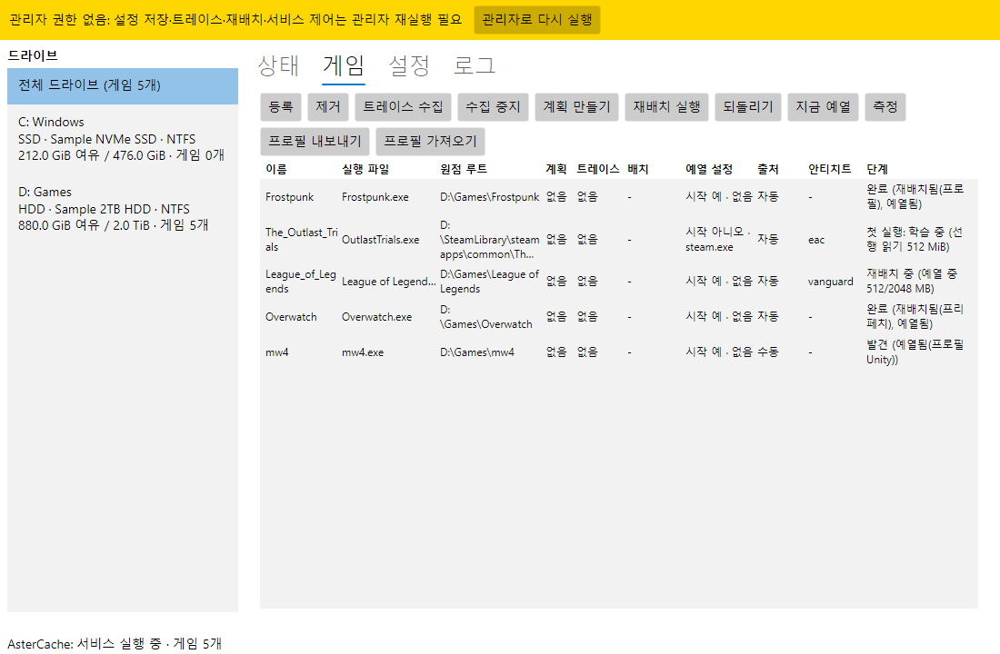
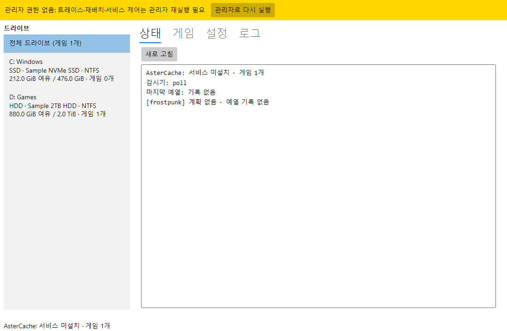
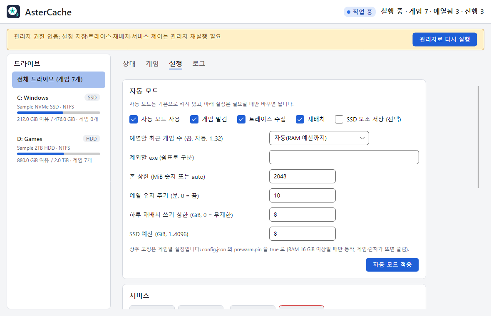
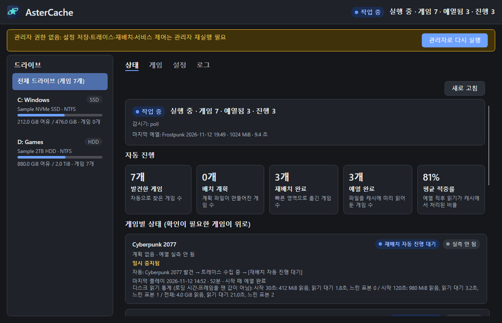

[English](README.md) | **한국어**

<h1 align="center">AsterCache</h1>

HDD에 설치한 게임의 로딩 시간을 SSD에 가깝게 줄이는 Windows 데스크톱 유틸리티

  
  
  
  
  

> **사용 전에 읽으십시오.** AsterCache 는 파일 데이터를 실제로 옮기므로 중요한 데이터가 있는 드라이브는 백업한 뒤 쓰십시오. 검증 범위는 SMR 드라이브(WD20EZAZ) 1대와 실제 게임 1종(Frostpunk)이며, CMR 드라이브는 시험하지 않았습니다. 안티치트 게임은 한 PC 의 사용 기록만 있고 통제된 검증은 하지 않았습니다([안티치트 호환](docs/ANTICHEAT.ko.md)).

## 무엇을 하는가

AsterCache 는 하드 디스크(HDD)에 설치한 게임의 로딩을 빠르게 해 줍니다. 게임이 로딩할 때 무엇을 읽는지 지켜보고, 그 조각들을 디스크의 한 곳에 나란히 모아 두며, 게임을 켜기 전에 RAM 에 미리 올려 둡니다.

- 게임 파일의 내용을 바꾸지 않고, 다른 드라이브로 복사하지도 않습니다(선택 기능인 SSD 보조 저장은 기본 꺼짐이며 유일한 예외입니다).
- 설치한 뒤에는 따로 할 일이 없습니다. 백그라운드에서 알아서 동작합니다.
- 트레이 창은 게임마다 마지막 플레이 요약을 보여 줍니다. 디스크 읽기 통계이며 로딩 시간이나 프레임을 잰 값이 아닙니다. 지원용 진단 ZIP 을 내보낼 수 있고, 그 파일은 이 PC 에만 남습니다.
- 이 문서의 측정 수치는 기록한 읽기 패턴의 재생 시간이며, 게임을 실행한 전체 로딩 시간이 아닙니다.

## 누구에게 맞는가

**잘 맞는 경우**
- HDD(NTFS)에 설치했고 반복해서 실행하는 게임, Windows 11 x64.
- 남는 RAM 이 있는 PC. 검증은 32 GiB 에서 했고, 예열은 기본으로 가용 RAM 4 GB 를 남깁니다.

**맞지 않거나 효과가 없는 경우**
- SSD 에 있는 게임은 건너뜁니다. Windows 가 있는 드라이브가 HDD 이면 그 게임은 예열만 하고 재배치하지 않습니다.
- 게임의 첫 실행은 빨라지지 않습니다. 효과는 두 번째 실행부터 납니다.
- 기록하지 않은 읽기(다른 레벨이나 모드, 플레이 중 텍스처 스트리밍)는 도움을 받지 못합니다.
- 안티치트 게임은 계정 제재 여부를 보증하지 않습니다. 먼저 [안티치트 호환](docs/ANTICHEAT.ko.md)을 읽으십시오.

## 시작하기

### 1. 설치

요구 사항: Windows 11 x64, NTFS 게임 드라이브. 서비스 설치, 트레이스 수집, 재배치에는 관리자 권한이 필요합니다.

1. [GitHub Releases](https://github.com/DO0OG/AsterCache/releases) 에서 `AsterCache-v<버전>-win-x64-setup.exe` 를 받습니다(최신 릴리스).
2. 실행해서 언어(English 또는 한국어)를 고릅니다.
3. 기본 선택(바탕화면·시작 메뉴 바로가기, Windows 시작 시 실행, 서비스 설치)을 그대로 두고 끝날 때까지 다음을 누릅니다.

설치 프로그램이 싫다면 같은 릴리스의 zip `AsterCache-<버전>-win-x64.zip` 을 쓸 수 있습니다. 압축을 풀고 `AsterCache.Tray.exe` 를 관리자 권한으로 실행한 뒤, 설정 탭에서 서비스를 설치하고 시작합니다.

새 설치본을 다시 실행하면 기존 설치를 업그레이드합니다. 제거하면 먼저 SSD 보조 저장의 링크를 되돌린 뒤 프로그램과 서비스를 지웁니다. 데이터 폴더 `%ProgramData%\AsterCache` 는 남습니다. 설치 프로그램에는 코드 서명이 없어 Windows SmartScreen 경고가 뜰 수 있습니다. 소스에서 빌드하려면 [docs/DEVELOPMENT.ko.md](docs/DEVELOPMENT.ko.md)를 보십시오.

### 3. 업데이트

트레이는 시작 5분 뒤와 그 뒤 24시간마다 공식 릴리스를 확인합니다. 기본(`update.mode` = `auto`)은 더 새로운 설치 프로그램을 받아 SHA-256 을 검증한 뒤 조용히 설치합니다. 단, 설치된 복사본을 관리자 권한으로 실행 중이고, 등록된 게임이 실행 중이 아니며, 재배치가 진행 중이 아닐 때만 설치합니다. 그 밖의 경우에는 알림만 하거나 릴리스 페이지를 엽니다. 설정 탭의 업데이트 구역에서 **자동 설치**, **알림만**, **끄기** 가운데 고를 수 있고, 프리릴리스는 따로 켜지 않으면 포함하지 않습니다. 서비스는 네트워크를 쓰지 않습니다. 조용한 설치는 아직 실기기에서 확인하지 않았습니다. 자세한 내용은 [docs/FAQ.ko.md](docs/FAQ.ko.md)를 보십시오.

### 2. 사용: 누를 버튼은 없습니다

[자동 모드](docs/AUTO_MODE.ko.md)가 기본으로 켜져 있습니다. 평소처럼 게임을 하면 됩니다.

| 언제 | AsterCache 가 하는 일 |
|---|---|
| 설치 직후, 그 뒤 1시간마다 | Steam, Epic, GOG, Ubisoft, Riot 라이브러리와 Windows 제거 목록에서 HDD 게임을 찾아 등록합니다. |
| 등록된 게임을 처음 플레이할 때 | 게임이 읽는 내용을 기록합니다. 이번 실행은 기록만 합니다. |
| 게임을 끄고 드라이브가 한가할 때 | 기록한 조각을 한 구역으로 옮기고(2 GB 당 약 5분) 게임 하나씩 처리한 뒤 그 구역을 예열합니다. 그 사이 게임을 켜면 옮기기를 멈춥니다. |
| PC 를 켤 때, 런처를 켤 때마다 | 예산 안에서 그 구역을 RAM 에 예열합니다. |
| 두 번째 실행부터 | 최대 효과가 납니다. |

첫 실행 전에는 기록 없이도, 작은 게임은 폴더 전체를, 큰 게임은 엔진 프로필만 예열합니다. 이 예열의 효과는 아직 측정하지 않았습니다.

진행 상황은 트레이 아이콘을 두 번 눌러 **상태** 탭에서 봅니다. 자동 모드 끄기, 게임 되돌리기, 단계를 직접 실행하는 방법은 [docs/USAGE.ko.md](docs/USAGE.ko.md), 자주 묻는 질문과 문제 해결은 [docs/FAQ.ko.md](docs/FAQ.ko.md)에 있습니다.

## 작동 원리

하드 디스크는 움직이는 헤드로 읽습니다. 레코드 플레이어의 바늘 팔과 비슷합니다. 게임이 한 스테이지를 로딩할 때는 디스크 곳곳에 흩어진 조각을 수천 개 읽으므로, 헤드가 읽는 시간보다 건너뛰는 시간이 훨씬 깁니다. 도서관에서 건물 곳곳의 서가에 흩어진 책 수백 권을 찾아 오려면 한참 걸리지만, 필요한 순서대로 카트 하나에 쌓여 있으면 금방 가져옵니다. AsterCache 는 그 카트를 만들어 줍니다. 시험한 드라이브에서 흩어진 읽기는 약 39 MiB/s, 끊기지 않는 연속 읽기는 90~110 MB/s 였습니다([docs/RESULTS_SUMMARY.ko.md](docs/RESULTS_SUMMARY.ko.md)). 드라이브마다 다릅니다.

1. **발견.** 백그라운드 서비스가 런처 라이브러리와 게임 시작 감지로 HDD 게임을 찾습니다.
2. **기록.** 첫 플레이에서 Windows 이벤트 추적(ETW)으로 어떤 파일의 어느 부분을 어떤 순서로 읽는지 적어 둡니다. 게임 프로세스는 건드리지 않습니다.
3. **재배치.** 게임이 꺼져 있고 드라이브가 한가할 때, 조각들을 디스크의 한 구역에 읽는 순서대로 나란히 옮깁니다. 디스크 조각 모음 프로그램이 쓰는 NTFS 의 공식 이동 기능을 쓰며, 파일 내용은 그대로이고 모든 단계를 저널로 남기므로 되돌릴 수 있습니다.
4. **예열.** PC 를 켜거나 런처를 켤 때 그 구역을 RAM(파일 캐시)에 올려 둡니다. 게임은 RAM 에서 읽습니다. 예열이 제때 끝나지 않았다면 게임이 켜지는 순간 그 구역을 순서대로 읽기 시작하며, 흩어진 원래 상태보다는 훨씬 빠릅니다.
5. **유지.** 캐시가 식으면 다시 예열하고, 배치가 흐트러지면(예: 게임 업데이트 뒤) 서비스가 다시 맞춥니다.

**ORBIT: 예열 순서 조정.** 기록이 있는 게임에서, 64 MiB 안팎 구간 단위로 예열 순서를 바꾸면 이득이 있는지 계산합니다. 읽는 데이터의 양과 집합은 그대로이고 순서만 바뀝니다. 기본 모드는 `active` 이며 `aster orbit mode off|shadow|active` 로 바꿉니다. 2026-11-09 Call of Duty 벤치(게임 1종·드라이브 1대·한 세션)에서 가치 가중 준비 시간 중앙값은 18.8% 줄었지만 최악 에피소드 p95 가 13.1초 늘어, 일반화는 이릅니다. [docs/ORBIT.ko.md](docs/ORBIT.ko.md)를 보십시오.

**AsterCache 가 하지 않는 일.**
- 게임 파일의 내용을 바꾸지 않습니다(옮기기 전후의 SHA-256 검사).
- 게임 프로세스에 손대지 않습니다. 주입, 후킹, 드라이버를 쓰지 않습니다.
- 기본으로는 게임을 SSD 로 복사하지 않습니다. 선택 기능인 SSD 보조 저장(기본 꺼짐)은 고른 핫 파일만 복사합니다. [docs/AUTO_MODE.ko.md](docs/AUTO_MODE.ko.md)를 보십시오.
- RAM 은 예열과 첫 실행의 선행 읽기에만, 예산 안에서 씁니다(예열은 기본으로 물리 RAM 의 절반 이하이며 가용 RAM 이 4 GB 이상 남을 때만). 예열한 데이터는 일반 파일 캐시라서, 다른 프로그램이 메모리를 필요로 하면 Windows 가 비워 갑니다.

## 하드디스크에 미치는 영향과 주의사항

요약입니다. 전체 안내는 [docs/GAME_GUIDE.ko.md](docs/GAME_GUIDE.ko.md)에 있습니다.

- **게임 드라이브에 씁니다.** 재배치는 데이터를 물리적으로 옮깁니다. 자동 재배치 한 번에 SMR 드라이브는 최대 1 GiB, 그 밖의 드라이브는 2 GiB 를 씁니다. 하루 상한은 SMR 2 GiB, 그 밖에는 8 GiB(`auto.max_relocate_gib_per_day`)이고, 재배치는 하루 최대 4회(`auto.max_relocations_per_day`)입니다. 재배치 자체는 시간이 걸리며, 이득은 반복 로딩에서 나타납니다.
- **PC 가 한가할 때만 합니다.** 게임이 꺼져 있고, 게임 드라이브 처리량이 30초 동안 4 MiB/s 미만이며, AC 전원(또는 배터리 50% 이상)이어야 합니다. 옮기는 중 게임이 시작되면 이동 중이던 한 조각만 끝내고 멈췄다가 나중에 이어서 합니다.
- **읽기도 합니다.** 예열은 예산 안에서 그 구역을 RAM 에 읽습니다. 캐시 점검은 10분마다 8곳에서 1 MiB 씩 읽습니다. 런처가 떠 있거나 평소 플레이하는 시간대에는 10분마다 4 KiB 를 작게 읽어 HDD 가 꺼지지 않게 합니다(`auto.keep_awake`, 기본 켬, Windows 전원 설정은 바꾸지 않음). 배경 읽기는 같은 디스크에서 게임이 실행 중이면 양보합니다.
- **SMR 드라이브는 쓰기가 느립니다.** 재배치 뒤에는 드라이브가 회복될 때까지 다음 작업을 미룹니다. 검증한 것은 SMR 드라이브 1대뿐이며 CMR 드라이브는 시험하지 않았습니다.
- **게임 드라이브를 Windows 드라이브 최적화에서 빼십시오.** Windows 는 HDD 를 주 1회 조각 모음하므로 옮긴 배치가 되돌려질 수 있습니다. 그 드라이브에 `defrag` 를 직접 실행하지도 마십시오.
- **옮기는 중에는 전원을 끄거나 절전하지 마십시오.** 시험 볼륨에서 중단 뒤 재개는 확인했지만, 실제 게임 데이터로 옮기는 중 정전은 시험하지 않았습니다.
- **측정하지 않은 것:** 드라이브 수명, 온도, 소음에 미치는 영향.
- **모두 되돌릴 수 있습니다.** **게임** 탭에서 게임을 고르고 **되돌리기**를 누르면 저널이 예전 배치로 복원합니다.

안전 검사를 요약하면 이렇습니다. 이동 전후 SHA-256 비교, 이동한 조각마다 저널 기록, `allowed_roots` 밖의 파일과 `volume_label` 이 다른 볼륨은 건드리지 않음, 관리자 권한이 없으면 `not_admin` 으로 끝나고 아무것도 바꾸지 않음. 자세한 내용은 [docs/DEVELOPMENT.ko.md](docs/DEVELOPMENT.ko.md#안전-장치)에 있습니다.

## 실측 결과

합성 데이터셋과 Frostpunk 수치는 추적한 읽기 패턴을 재생한 시간입니다. League of Legends 와 Call of Duty 수치는 한 PC 에서 실제로 플레이하는 동안 서비스가 남긴 로그의 집계(2026-11-02 ~ 2026-11-10)와 예열 목록 읽기 벤치입니다. 어느 것도 게임을 실행한 전체 로딩 시간이 아니며, 사용 로그 행은 통제된 벤치마크가 아닙니다.

| 대상 | 측정 | 결과 |
|---|---|---|
| 합성 데이터셋 2.1 GiB | HDD 콜드 읽기 → 재배치 후 선읽기 | 17.1 s → 1.14 s (재배치 10시간 뒤에도 유지) |
| 합성 데이터셋 2.1 GiB | 같은 조건 SSD 콜드 읽기 | 0.76~1.22 s |
| Frostpunk, 첫 맵 로딩 읽기 2.02 GB | HDD 콜드 재생 → 재배치 후 동시 선읽기 | 24.3 s → 11.93 s (3회 중앙값, 핫 데이터 전부를 한 존으로 옮김) |
| Frostpunk | 사전 예열 뒤 재생 | 0.48 s |
| Frostpunk, 1.9 GB 로딩 읽기 | HDD 콜드 → SSD 보조 저장 콜드(웜) | 12.90 s → 2.81 s (웜 0.48 s) |
| Frostpunk, 같은 읽기 패턴 | NVMe SSD 콜드 재생 | 3.8 s |
| Frostpunk 트레이스를 본뜬 흩어진 배치 vs 연속 배치 (2.02 GB) | 같은 읽기 패턴 직접 재생, 선행 읽기 꺼짐, 중앙값 | 흩어진 배치 41.0\~55.3 s → 연속 배치 19.3\~20.5 s ([결과 폴더](results/csharp_e7c_gen/README.md)) |
| League of Legends, 예열 대상 8,182 MiB | 런처 시작 때 RAM 예열 (사용 로그, 1회) | 8,173 MiB 를 48.4 s (169 MB/s), 예열 직후 적중 100% |
| Call of Duty, 예열 대상 10,218 MiB | 핫 집합 RAM 예열 (사용 로그, 7회) | 9,081\~10,217 MiB 를 128\~416 s (중앙값 249.8 s) |
| Call of Duty | 서비스 시작 때 앞부분 1,023 MiB 예열 (사용 로그, 3회) | 34.7~40.7 s, 예열 직후 적중 75% |
| Call of Duty, 예열 목록 약 9.5 GB | HDD 콜드 읽기, 예열 순서 조정 전후 (ABBA 벤치, 중앙값) | 총 읽기 약 326 s. 순서 조정 시 가치 가중 준비 시간 18.8% 단축, 최악 에피소드 13.1 s 지연 ([ORBIT](docs/ORBIT.ko.md)) |
| 서비스 | 게임 시작 감지 지연 (폴링, p95) | 58 ms |

- 측정 환경: HDD WD20EZAZ(SATA, D:), NVMe SSD(C:), Windows 11 Pro 10.0.26200, 메모리 32 GiB.
- Frostpunk 결과는 게임 1종을 1회 추적한 뒤 재생한 값입니다. 반복 로딩의 p50·p95 는 아직 없습니다. 합성 데이터셋의 SSD 값과 Frostpunk 의 NVMe 값은 데이터와 방법이 달라 직접 비교하지 않습니다.
- 예열이 SSD 콜드보다 빠르려면 게임 시작보다 15 s 이상 앞서 끝나야 합니다. 메모리 압박이 있으면 효과가 줄어듭니다.
- "적중률"은 예열이 끝난 직후 고른 8곳(1 MiB 씩) 중 RAM 파일 캐시에 있던 비율입니다. 게임을 켤 때의 값이 아닙니다.
- 측정 방법, 조건, 수치를 읽는 법, 사용 기록은 [docs/RESULTS_SUMMARY.ko.md](docs/RESULTS_SUMMARY.ko.md)와 [VALIDATION_REPORT.ko.md](VALIDATION_REPORT.ko.md)에 있습니다.

## 알려진 제한

- 드라이버나 파일 시스템 필터가 아니며 게임의 I/O 를 가로채지 않습니다. `kernel/` 의 커널 미니필터는 실험용이고 릴리스에 포함되지 않습니다([kernel/README.ko.md](kernel/README.ko.md)).
- 추적은 디스크까지 간 읽기만 기록합니다. 이미 캐시에 있던 읽기는 빠질 수 있습니다.
- 재생 측정은 SMR 드라이브 1대에서 실제 게임 Frostpunk 1종만 했습니다. 지속성은 재배치 뒤 10시간까지 확인했습니다. Call of Duty 와 League of Legends 는 사용 로그 집계만 있습니다.
- 정전, SSD 손상, BitLocker, DirectStorage 환경은 시험하지 않았습니다.
- 트레이만 갱신되면 서비스는 옛 버전으로 남습니다. 설치 프로그램으로 서비스를 다시 설치하십시오. 자동 업데이트는 설치 프로그램 전체를 실행하므로 서비스도 함께 갱신됩니다.
- Wallpaper Engine 같은 상주 유틸리티는 자동 등록에서 제외됩니다. HDD 에 있는 그 밖의 게임이 아닌 앱은 등록될 수 있으니, 원치 않으면 그 exe 를 `auto.ignore_exes` 에 넣거나 게임 탭에서 제거하십시오.
- `AppData\Local\Temp` 아래 설치한 게임은 휴리스틱으로 잡히지 않습니다. 공유 프로필 저장소는 아직 준비 중입니다.
- 검증한 것과 하지 않은 것의 전체 목록은 [VALIDATION_REPORT.ko.md](VALIDATION_REPORT.ko.md)에 있습니다.

## 스크린샷

관리 창입니다. 위쪽은 게임 탭과 상태 탭, 아래쪽은 설정 탭과 어두운 테마의 상태 탭입니다. 임시 데이터 폴더의 예시 데이터로 찍은 화면이라 드라이브와 게임 정보는 샘플 값입니다. 관리자 권한 없이 찍어서 위쪽에 안내 띠가 보입니다.

 

 

## 최근 변경

- **1.0.2, 전체를 읽던 예열이 메모리가 모자라면 멈추지 않고 줄여 읽음.** 목록 전체를 읽기 시작한 예열이 메모리 검사에 걸리면 아무것도 남기지 않고 취소됐고, 목록이 가용 메모리의 경계 근처에 있는 게임에서는 이것이 되풀이됐습니다. 1.0.1 이 목록에 블록을 더하면서 이런 경우가 늘었습니다. 이제 같은 회에서 한 번, 들어가는 앞부분으로 줄여 읽습니다. 보충 예열은 목록이 늘어난 뒤의 현재 크기를 따릅니다. 메모리 예비량과 캐시 예산은 그대로입니다.
- **1.0.1, 예열에서 빠지던 데이터를 채우고, 게임을 바꿔 켠 직후에도 예열.** 메모리가 모자라 예열 목록을 일부만 읽을 때 게임이 실행 직후에 읽는 범위를 먼저 남기고 먼저 읽으며, 존이 가득 찬 뒤 새로 본 블록은 아무것도 옮기지 않고 예열 목록에 더합니다. 플레이 10분 이후의 읽기가 이제 실제로 기록됩니다. 읽는 도중 메모리가 모자라진 예열은 버리지 않고 읽은 데까지 남긴 뒤 나중에 이어 읽고, 런처가 시작한 예열은 다른 게임을 끈 직후에도 바로 돕니다. 실제 게임에서 로딩 시간이 얼마나 달라지는지는 아직 재지 않았습니다.
- **1.0.0, 첫 정식 릴리스.** 트레이가 AsterCache 를 스스로 업데이트합니다. 공식 릴리스를 확인해 설치 파일을 SHA-256 으로 검증하고, 등록 게임이 실행 중이 아니고 재배치 중이 아닐 때만 조용히 설치합니다(알림만 받거나 끌 수 있습니다). 게임마다 일시 중지하거나 예열만·재배치만·사용 안 함으로 범위를 줄일 수 있고, 재배치를 정한 시간대에만 하게 할 수 있습니다. 이 값들과 표시 이름, 시작 스트림 스위치, 수치 상한을 트레이에서 고칩니다. 상태 탭에 마지막 플레이 요약이, 로그 탭에 진단 ZIP 내보내기가 생겼고, 알림을 끌 수 있으며, 서비스와 트레이가 붙들던 메모리를 줄였고, 아이콘을 새로 그렸습니다.
- **0.9.0-beta.38, 진전 없는 보충 예열을 되풀이하지 않음.** 메모리가 빠듯하면 보충 예열이 더 읽지 못한 채 약 90초마다 같은 앞부분을 다시 읽었습니다. 이제 새로 읽은 것이 없으면 재시도 간격을 기다리고, 메모리가 늘었을 때만 앞당겨 다시 시도합니다.
- beta.25 이후의 변경과 beta.8 이후의 이전 목록(병렬 재배치, 드라이브 회복 판정, 설치 뒤 자동 진행, 게임 시작 시 예열 양보 등)은 [docs/CHANGES.ko.md](docs/CHANGES.ko.md) 에 있습니다.

## 문서

| 문서 | 내용 |
|---|---|
| [docs/USAGE.ko.md](docs/USAGE.ko.md) | 트레이 창과 `aster` 명령 사용법, 예시 |
| [docs/AUTO_MODE.ko.md](docs/AUTO_MODE.ko.md) | 서비스가 스스로 하는 일을 단계별로 |
| [docs/ORBIT.ko.md](docs/ORBIT.ko.md) | 예열 순서 조정(ORBIT) |
| [docs/GAME_GUIDE.ko.md](docs/GAME_GUIDE.ko.md) | 하드디스크에 미치는 영향, 주의사항, 게임 종류별 안내 |
| [docs/ANTICHEAT.ko.md](docs/ANTICHEAT.ko.md) | 안티치트 호환: 하는 일, 하지 않는 일 |
| [docs/CONFIGURATION.ko.md](docs/CONFIGURATION.ko.md) | 기본값이 있는 설정 표, 감시기, 언어 |
| [docs/FAQ.ko.md](docs/FAQ.ko.md) | 자주 묻는 질문과 문제 해결 |
| [docs/RESULTS_SUMMARY.ko.md](docs/RESULTS_SUMMARY.ko.md), [VALIDATION_REPORT.ko.md](VALIDATION_REPORT.ko.md) | 측정 기록과 검증 보고서 |
| [docs/CHANGES.ko.md](docs/CHANGES.ko.md) | 버전별 변경 |
| [docs/DEVELOPMENT.ko.md](docs/DEVELOPMENT.ko.md), [docs/PYTHON_TOOLS.ko.md](docs/PYTHON_TOOLS.ko.md) | 빌드·시험·프로젝트 구조, Python 참조 도구 |
| [csharp/README.ko.md](csharp/README.ko.md), [kernel/README.ko.md](kernel/README.ko.md) | C# 명령과 서비스 동작, 커널 미니필터 |
| [docs/research_cold_limit.md](docs/research_cold_limit.md), [docs/research_hdd_general.md](docs/research_hdd_general.md) | 연구 노트(콜드 한계, 일반 HDD I/O) |

## 라이선스와 면책

MIT License. [LICENSE](LICENSE) 파일을 보십시오. Copyright (c) 2026 DO0OG. 서드파티 고지: THIRD_PARTY_NOTICES.md.

무보증으로 제공합니다. 측정 수치는 한 PC 에서 얻은 결과입니다. 안티치트가 적용된 게임과 온라인 계정에 묶인 게임은 통제된 검증을 하지 않았고 계정 제재 여부를 보증하지 않습니다. 재배치는 파일 데이터를 실제로 옮기므로, 중요한 데이터가 있는 드라이브에서 쓰기 전에 백업하십시오.
