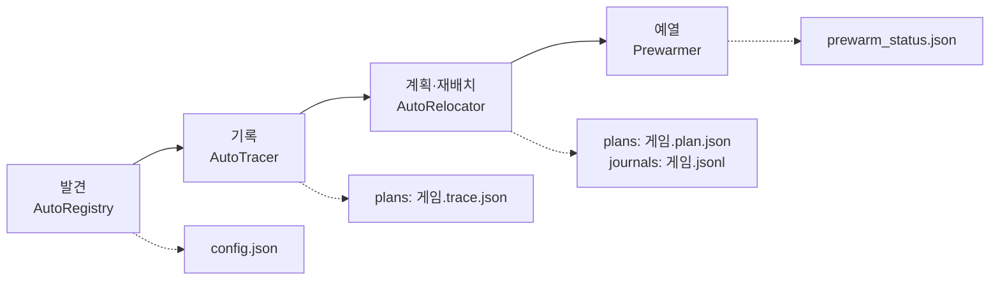

[English](README.md) | **한국어**

<p align="center"></p>

<h1 align="center">AsterCache</h1>

<p align="center">HDD에 설치한 게임의 로딩 시간을 SSD에 가깝게 줄이는 Windows 데스크톱 유틸리티</p>

<p align="center">
  <a href="LICENSE"></a>
  
  
  <a href="https://github.com/DO0OG/AsterCache/actions/workflows/csharp-ci.yml"></a>
  <a href="https://github.com/DO0OG/AsterCache/actions/workflows/kernel-build.yml"></a>
</p>

> **베타.** AsterCache 는 베타 프리릴리스로 배포합니다. 파일 데이터를 실제로 옮기므로 중요한 데이터가 있는 드라이브는 백업한 뒤 쓰십시오. 검증 범위는 SMR 드라이브(WD20EZAZ) 1대와 실제 게임 1종(Frostpunk)이며, CMR 드라이브는 시험하지 않았습니다. 안티치트 게임은 이 PC 의 사용 기록만 있고 통제된 검증은 하지 않았습니다([실사용 기록](#실사용-기록), [알려진 제한](#알려진-제한) 참고).

## 최근 변경

- **0.9.0-beta.35, 막힌 재적용을 자동 재배치로 넘김.** 흐트러진 배치를 다시 맞추다가 존 일부를 다른 파일이 차지해 거절되면, 그 게임을 자동 재배치로 되돌려 남은 부분만 다시 계획합니다. 회당 쓰기 상한에서 멈춘 재적용은 하루 뒤가 아니라 드라이브가 회복되는 대로 이어 갑니다.
- **0.9.0-beta.34, 끝내지 못한 예열 재시도, 드라이브 회복 확인 단축.** 읽기 전에 취소됐거나 서비스 시작 상한에 밀려 건너뛴 예열을 디스크가 한가할 때 다시 요청합니다. 재배치 뒤 드라이브 회복 확인은 기준 속도가 낮게 잡혀도 절대 상한까지 가지 않고, 일시적인 이유로 막힌 배치 검사는 하루 뒤가 아니라 5분마다 다시 합니다.
- **0.9.0-beta.33, 로그온 때 트레이 관리자 권한 시작, 플레이 기록, 관찰된 읽기 우선 예열.** Program Files 아래에 설치하면 로그온 예약 작업으로 트레이가 관리자 권한으로 시작하므로 확인 창(UAC)이 뜨지 않습니다. 플레이 기록은 게임이 실행되는 동안 디스크 읽기 카운터를 표본 내 `play_samples.json` 에 남기고, 예열은 예산이 모자랄 때 실제 플레이에서 읽힌 범위를 엔진 프로필로 추측한 범위보다 먼저 채웁니다.
- **0.9.0-beta.32, 재배치 건너뛰기와 예열 캐시 예산.** 스파스·압축·암호화 파일은 배치 판정에서 뺍니다. 이런 파일 때문에 재배치가 끝나지 않던 문제가 없어졌습니다. 예열 캐시 예산은 기본으로 물리 RAM 의 절반이며(`prewarm.max_cache_mib` 로 지정), 런처 실행 등으로 최근에 트리거된 게임은 6시간 동안 먼저 예열합니다.
- beta.25 이후의 변경과 beta.8 이후의 이전 목록(병렬 재배치, 드라이브 회복 판정, 설치 뒤 자동 진행, 게임 시작 시 예열 양보 등)은 [docs/CHANGES.ko.md](docs/CHANGES.ko.md) 에 있습니다.

## 무엇을 하는가

AsterCache 는 하드 디스크(HDD)에 설치한 게임의 로딩을 빠르게 해 줍니다. 게임이 로딩할 때 무엇을 읽는지 지켜보고, 그 조각들을 디스크의 한 곳에 나란히 모아 두며, 게임을 켜기 전에 RAM 에 미리 올려 둡니다. 게임 파일의 내용을 바꾸지 않고, 다른 드라이브로 복사하지도 않습니다. 설치한 뒤에는 따로 할 일이 없습니다. 백그라운드에서 알아서 동작합니다([시작하기](#시작하기) 참고).

이 문서의 측정 수치는 실제 게임 1종을 드라이브 1대에서 측정한, 기록한 읽기 패턴의 재생 시간입니다. 게임을 실행한 전체 로딩 시간이 아닙니다. [실사용 기록](#실사용-기록)은 사용 로그 집계라서 성격이 다릅니다. 자세한 내용은 [실측 결과](#실측-결과)와 `VALIDATION_REPORT.md` 를 보십시오.

주요 기능은 다음과 같습니다. 전체 목록은 [docs/USAGE.ko.md](docs/USAGE.ko.md) 에 있습니다.

- **자동 모드(기본 켬).** 런처 라이브러리와 게임 시작 감지로 HDD 게임을 찾고, 첫 실행을 기록하고, PC 가 쉬는 동안 재배치한 뒤 예열합니다.
- **관리 창과 트레이 아이콘.** 드라이브·게임 목록, 상태, 설정, 로그를 한 화면에서 봅니다. 한국어와 영어를 지원합니다.
- **수동 단계와 명령행.** 등록, 트레이스 수집, 계획 만들기, 재배치, 되돌리기, 지금 예열, 측정을 버튼이나 `aster` 명령으로 합니다.
- **선택 기능.** SSD 보조 저장(기본 꺼짐), 프로필 내보내기·가져오기(`aster profile`)가 있습니다.

## 스크린샷

관리 창입니다. 위쪽은 게임 탭과 상태 탭, 아래쪽은 설정 탭과 어두운 테마의 상태 탭입니다. 임시 데이터 폴더의 예시 `config.json` 과 상태 파일, 예시 드라이브로 찍은 화면이라 드라이브와 게임 정보는 샘플 값입니다. 관리자 권한 없이 찍어서 위쪽에 안내 띠가 보입니다.

<p align="center"> </p>
<p align="center"> </p>

다시 만들 때는 `AsterCache.Tray.exe --smoke --screenshot <png> [--tab 0..3] [--theme light|dark] [--lang ko|en] [--data-dir <폴더>]` 를 씁니다. 자세한 내용은 [csharp/README.ko.md](csharp/README.ko.md) 에 있습니다.

## 실측 결과

합성 데이터셋과 Frostpunk 수치는 추적한 읽기 패턴을 재생한 시간입니다. League of Legends 와 Call of Duty 수치는 실제로 플레이하는 동안 서비스가 남긴 로그의 집계와 예열 목록 읽기 벤치입니다([실사용 기록](#실사용-기록)). 어느 것도 게임을 실행한 전체 로딩 시간이 아닙니다.

| 대상 | 측정 | 결과 |
|---|---|---|
| 합성 데이터셋 2.1 GiB | HDD 콜드 읽기 → 재배치 후 선읽기 | 17.1 s → 1.14 s (재배치 10시간 뒤에도 유지) |
| 합성 데이터셋 2.1 GiB | 같은 조건 SSD 콜드 읽기 | 0.76~1.22 s |
| Frostpunk, 첫 맵 로딩 읽기 2.02 GB | HDD 콜드 재생 → 재배치 후 동시 선읽기 | 24.3 s → 11.93 s (3회 중앙값, 각주 참고) |
| Frostpunk | 사전 예열 뒤 재생 | 0.48 s |
| Frostpunk, 같은 읽기 패턴 | NVMe SSD 콜드 재생 | 3.8 s |
| Frostpunk, 1.9 GB 로딩 읽기 | HDD 콜드 → SSD 보조 저장 콜드(웜) | 12.90 s → 2.81 s (웜 0.48 s) |
| Frostpunk 트레이스를 본뜬 흩어진 배치 vs 연속 배치 (2.02 GB) | 같은 읽기 패턴 직접 재생, 선행 읽기 꺼짐, 중앙값 | 흩어진 배치 41.0\~55.3 s → 연속 배치 19.3\~20.5 s ([결과 폴더](results/csharp_e7c_gen/README.md)) |
| League of Legends, 예열 대상 8,182 MiB | 런처 시작 때 RAM 예열 (사용 로그, 1회) | 8,173 MiB 를 48.4 s (169 MB/s), 예열 직후 적중 100% |
| Call of Duty, 예열 대상 10,218 MiB | 핫 집합 RAM 예열 (사용 로그, 7회) | 9,081\~10,217 MiB 를 128\~416 s (중앙값 249.8 s) |
| Call of Duty | 서비스 시작 때 앞부분 1,023 MiB 예열 (사용 로그, 3회) | 34.7~40.7 s, 예열 직후 적중 75% |
| Call of Duty, 예열 목록 약 9.5 GB | HDD 콜드 읽기, 예열 순서 조정 전후 (ABBA 벤치, 중앙값) | 총 읽기 약 326 s. 순서 조정 시 가치 가중 준비 시간 18.8% 단축, 최악 에피소드 13.1 s 지연 ([ORBIT](docs/ORBIT.ko.md)) |
| 서비스 | 게임 시작 감지 지연 (폴링, p95) | 58 ms |

- HDD 는 WD20EZAZ(SATA, D:), SSD 는 NVMe(C:)입니다. 측정 환경은 Windows 11 Pro 10.0.26200, 메모리 32 GiB 입니다.
- Frostpunk 결과는 게임 1종을 1회 추적한 뒤 재생한 값입니다. 반복 로딩의 p50·p95 는 아직 없습니다.
- 합성 데이터셋의 SSD 값과 Frostpunk 의 NVMe 값은 데이터와 방법이 달라 직접 비교하지 않습니다.
- 사전 예열이 SSD 콜드보다 빠르려면 예열이 게임 시작보다 15 s 이상 앞서 끝나야 합니다. 메모리 압박이 있으면 효과가 줄어듭니다.
- 11.93 s 값은 E6 실험에서 나왔습니다. 재배치가 이제 기본으로 핫 데이터를 전부 한 존으로 옮깁니다(보존 끔). 8 MiB 이상 연속 구간을 제자리에 두던 이전 방식의 값은 15.1 s 였습니다. [docs/research_cold_limit.md](docs/research_cold_limit.md) 를 보십시오.
- 더 많은 표와 해석은 `docs/RESULTS_SUMMARY.md` 와 `VALIDATION_REPORT.md` 에 있습니다.
- 게임 밖 일반 HDD I/O 연구 노트: [docs/research_hdd_general.md](docs/research_hdd_general.md).

### 실사용 기록

한 PC 의 서비스 로그(2026-11-02 ~ 2026-11-10)를 집계한 기록입니다. 통제된 벤치마크가 아닙니다. 게임 전체 로딩 시간과 플레이 중 프레임 끊김은 재지 않았습니다. 집계 방법과 표본 수는 [docs/RESULTS_SUMMARY.ko.md](docs/RESULTS_SUMMARY.ko.md#실사용-기록)에 있습니다.

| 항목 | League of Legends | Call of Duty |
|---|---|---|
| 게임 시작 감지(프로세스 시작 횟수) | 10회, 6일 | 62회, 8일 |
| 안티치트(서비스 판정) | Vanguard | Ricochet |
| 트레이스 | 2회 수집 뒤 건너뜀(8회) | 14회 수집 시작 |
| 고정(pin) | 건너뜀(4회) | 건너뜀(7회) |
| 재배치 | 완료 4회, 중단 4회 | 완료 5회, 중단 3회 |
| 예열 대상 / RAM 예산 | 8,182 MiB / 8,173 MiB | 10,218 MiB / 8,173 MiB |
| 예열 소요(2026-11-08 ~ 11-10) | 8,173 MiB 부분 예열 1회 48.4 초 | 핫 집합 전체 9,081 ~ 10,217 MiB 7회 128 ~ 416 초(중앙값 249.8 초) |
| 서비스 시작 때 앞부분 예열 | 970 ~ 1,023 MiB 5회, 11.5 ~ 22.3 초 | 1,023 MiB 3회, 34.7 ~ 40.7 초 |
| 예열 직후 적중률(마지막 값 1개) | 100% | 75% |

- **적중률.** 예열이 끝난 직후, 핫 집합에서 고른 최대 8곳(1 MiB 씩)을 읽어 0.8 ms 이하로 끝난 곳의 비율, 곧 RAM 파일 캐시에 있던 비율입니다. 게임을 켤 때의 값이 아니고, 게임별 마지막 값 하나만 남습니다. Call of Duty 의 75% 는 핫 집합 10,218 MiB 중 1,023 MiB 를 서비스 시작 때 예열한 직후 값입니다.
- **한계.** 로그에 프로그램 버전이 없어 날짜로만 나눴고, 표에는 뒤 기간(2026-11-08 ~ 11-10) 수치만 넣었습니다. 시작 스트림은 Call of Duty 9회, League of Legends 9회 실행됐지만 로딩 시간에 준 영향은 재지 않았습니다. 예열이 없을 때와의 비교도 없습니다.

## 시스템 요구 사항

- Windows 11 x64. 검증 환경은 Windows 11 Pro 10.0.26200 입니다.
- 직접 빌드할 때는 .NET 10 SDK 가 필요합니다. 저장소의 `csharp/global.json` 은 SDK 10.0.400 을 씁니다(latestPatch).
- 트레이스 수집(ETW), 재배치(`apply`, `revert`), 서비스 설치에는 관리자 권한이 필요합니다.
- 재배치 대상은 NTFS 볼륨이어야 합니다. 원본과 캐시를 비교하려면 서로 다른 물리 장치가 필요합니다.

## 시작하기

### 1. 설치

1. [GitHub Releases](https://github.com/DO0OG/AsterCache/releases) 에서 `AsterCache-v<버전>-win-x64-setup.exe` 를 받습니다(프리릴리스, 예: v0.9.0-beta.31).
2. 실행해서 언어(English 또는 한국어)를 고릅니다.
3. 기본 선택(바탕화면·시작 메뉴 바로가기, Windows 시작 시 실행, 서비스 설치)을 그대로 두고 끝날 때까지 다음을 누릅니다.

설치 프로그램이 싫다면 같은 릴리스의 zip `AsterCache-0.9.0-beta.35-win-x64.zip` 을 쓸 수 있습니다. 압축을 풀고 `AsterCache.Tray.exe` 를 관리자 권한으로 실행한 뒤, 설정 탭에서 서비스를 설치하고 시작합니다.

새 설치본을 다시 실행하면 기존 설치를 업그레이드합니다. 제거하면 먼저 SSD 보조 저장의 링크를 되돌린 뒤(`aster tier revert --all`, 사본은 tier 폴더에 남음) 프로그램과 서비스를 지웁니다. 데이터 폴더 `%ProgramData%\AsterCache` 는 남습니다. 설치 프로그램에는 코드 서명이 없어 Windows SmartScreen 경고가 뜰 수 있습니다.

### 2. 끝입니다: 자동 모드

설치하고 나면 더 할 일이 없습니다. [자동 모드](docs/AUTO_MODE.ko.md)가 기본으로 켜져 있습니다. 요약하면 설치 → 자동 발견 → 예열(작은 게임은 폴더 전체, 큰 게임은 엔진 프로필, 기록 없이도) → 첫 실행 때 읽기 기록 → 게임을 끈 뒤 약 30초 뒤 재배치 → 옮긴 구역 바로 예열 → 두 번째 실행부터 최대 효과입니다. 첫 실행 선행 읽기는 기본으로 꺼져 있습니다. 눌러야 할 버튼은 없습니다. 시간이 지나면서 이런 일이 일어납니다.

| 언제 | AsterCache 가 하는 일 |
|---|---|
| 설치 직후 | 백그라운드 서비스가 시작됩니다. |
| 약 10초 뒤(그 뒤 1시간마다) | Steam, Epic, GOG, Ubisoft, Riot 라이브러리와 Windows 제거 목록을 훑어 HDD 에 설치된 게임을 등록합니다. |
| 등록된 게임, 첫 실행 전 (서비스 시작·런처 실행·게임 종료 뒤) | 설치 폴더가 RAM 예산 이하인 작은 게임은 폴더 전체를, 더 큰 게임은 엔진(Unity, Unreal, Source) 프로필만 예열합니다. 기록이 없어도 합니다. 기록이 없는 게임의 배치 정보는 이 순서로 찾습니다: 공유 프로필(저장소 준비 중이라 아직 없으면 건너뜀) → Windows 프리페치 기록 → 엔진 프로필 → 폴더 전체. 이 예열의 효과는 아직 측정하지 않았습니다. |
| 등록된 게임을 처음 플레이할 때 | 게임이 읽는 내용을 기록(트레이스)합니다. 첫 실행 선행 읽기는 실험 기능이라 기본 꺼짐(E7~E7f 측정에서 이득 없음, `auto.learn.enabled`)이므로, 이번 실행은 기록만 합니다. 효과는 두 번째 실행부터 납니다. |
| 게임을 끄고, 게임 드라이브 처리량이 30초 동안 4 MiB/s 미만이며, AC 전원(또는 배터리 50% 이상)일 때 | 게임의 조각을 한 구역으로 옮긴 뒤 곧바로 그 구역을 예열합니다. 한 번에 게임 하나씩이며 몇 분 걸립니다(2 GB 당 약 5분). 그 사이 게임을 켜면 멈췄다가 나중에 이어서 합니다. |
| PC 를 켤 때, 런처를 켤 때마다 | 예산 안에서 그 구역을 RAM 에 예열합니다. |
| 두 번째 실행부터 | 최대 효과가 납니다(수치는 [실측 결과](#실측-결과) 참고. 게임 전체 로딩 시간은 아직 측정하지 않았습니다). |

### 3. 끄기와 되돌리기

단계를 직접 다루거나 명령행으로 하려면 [docs/USAGE.ko.md](docs/USAGE.ko.md#직접-하려면선택)를 보십시오. 자주 묻는 질문과 문제 해결은 [docs/FAQ.ko.md](docs/FAQ.ko.md) 에 있습니다.

- **자동 모드 끄기.** **설정** 탭에서 **자동 모드 사용** 체크를 풀고 **자동 모드 적용**을 누릅니다. 또는 `%ProgramData%\AsterCache\config.json` 에 `"auto": {"enabled": false}` 를 씁니다. 게임 하나만 빼려면 그 exe 를 `auto.ignore_exes` 에 넣습니다. [자동 모드](docs/AUTO_MODE.ko.md)를 보십시오.
- **게임 되돌리기.** **게임** 탭에서 게임을 고르고 **되돌리기**를 누릅니다. 저널을 따라 예전 디스크 배치로 복원합니다. 파일 내용은 처음부터 바뀌지 않았습니다.
- **제거.** Windows 설치된 앱에서 지웁니다. 데이터 폴더 `%ProgramData%\AsterCache` 는 남으며, `cs_service.ps1 -Action uninstall -PurgeData` 를 실행했을 때만 지웁니다.

## 작동 원리

### 문제

하드 디스크는 움직이는 헤드로 데이터를 읽습니다. 레코드 플레이어의 바늘 팔과 비슷합니다. 헤드가 다른 위치로 건너뛸 때마다 기다려야 합니다. 게임이 한 스테이지를 로딩할 때는 디스크 곳곳에 흩어진 조각을 수천 개 읽으므로, 헤드가 읽는 시간보다 건너뛰는 시간이 훨씬 깁니다.

도서관에 비유하면 이렇습니다. 건물 곳곳의 서가에서 책 수백 권을 찾아 오려면 한참 걸립니다. 같은 책이 필요한 순서대로 카트 하나에 쌓여 있다면 금방 가져옵니다. AsterCache 는 그 카트를 만들어 줍니다.

시험한 드라이브에서 흩어진 읽기는 약 39 MiB/s, 끊기지 않는 연속 읽기는 90~110 MB/s 였습니다([docs/RESULTS_SUMMARY.md](docs/RESULTS_SUMMARY.md)). 드라이브마다 다릅니다.

### 기록, 재배치, 예열

1. **기록(Trace).** 게임이 로딩하는 동안 한 번 지켜보며, 어떤 파일의 어느 부분을 어떤 순서로 읽는지 적어 둡니다. 이때 Windows 자체의 이벤트 추적(ETW)을 씁니다. 게임 프로세스는 건드리지 않습니다.
2. **재배치(Relocate).** 그 목록대로 조각들을 디스크의 한 구역에, 게임이 읽는 순서대로 나란히 옮깁니다. 파일 내용은 그대로입니다. 디스크 조각 모음 프로그램이 쓰는 NTFS 의 공식 이동 기능을 쓰고, 모든 단계를 저널(기록)로 남기므로 되돌릴 수 있습니다.
3. **예열(Prewarm).** 게임을 켜기 전에, 예를 들어 PC 를 켤 때나 게임 런처를 켤 때 그 구역 전체를 RAM(파일 캐시)에 올려 둡니다. 게임이 뜨면 디스크 대신 RAM 에서 읽습니다. 예열이 제때 되지 않았다면 게임이 켜지는 순간 그 구역을 순서대로 읽기 시작합니다(선읽기). 흩어진 원래 상태보다는 훨씬 빠릅니다.


### ORBIT: 예열 순서 조정

기록이 있는 게임의 핫 집합 예열에서, 지금 예열 순서를 기준으로 두고 64 MiB 안팎 구간 단위로 순서를 바꿨을 때 이득이 있는지 계산합니다. 앞쪽 tier0 구간은 고정하고, 읽는 데이터 양과 집합은 바뀌지 않고 순서만 바뀝니다. 기본은 `active` 이며 `aster orbit mode off|shadow|active` 로 바꿉니다. 2026-11-09 사용자 PC 의 Call of Duty ABBA 벤치(WD20EZAZ 2 TB SMR HDD)에서 가치 가중 준비 시간 중앙값은 18.8% 줄었지만, 최악 에피소드 p95 가 13.1초 늘어 플래그 4에 실패했습니다. 게임 1종·드라이브 1대·한 세션 측정이라 일반화는 이릅니다. 켜지는 조건, 모드, 안전, 측정 방법은 [docs/ORBIT.ko.md](docs/ORBIT.ko.md) 에 있습니다.

### SSD 유무에 따라

- **SSD 가 있으면(선택, 기본 꺼짐):** 등록된 HDD 게임의 핫 파일을 예산(게임당 기본 8 GiB) 안에서 SSD 에 사본으로 두고, 원본은 `<이름>.aster-orig` 로 남긴 뒤 원래 자리에 심볼릭 링크를 둡니다. 게임은 예전과 같은 경로를 읽습니다.
- **SSD 가 없으면:** 위의 HDD 경로(재배치와 예열)만 씁니다. 예열 적중률은 예열이 끝난 직후에 재서 게임별 상태 줄에 "예열 직후 적중 N%"로 표시합니다([실사용 기록](#실사용-기록) 참고).

### 결과

측정(Frostpunk, 첫 맵 로딩에서 읽는 2 GB 데이터, SMR HDD)에서 기록한 읽기를 재생하면, 아무것도 하지 않았을 때 24 s, 재배치와 선읽기 뒤 약 12 s, 예열 뒤 약 0.5 s 였습니다. 같은 읽기를 NVMe SSD 에서 콜드로 하면 3.8 s 였습니다. 예열 자체는 선읽기와 비슷한 시간이 걸리므로, 게임을 켜기 전에 끝나 있을 때 가장 효과가 큽니다. 게임 1종, 드라이브 1대의 재생 시간이며 전체 게임 로딩 시간이 아닙니다.

### AsterCache 가 하지 않는 일

- 게임 파일의 내용을 바꾸지 않습니다. 옮기기 전후의 SHA-256 검사로 확인합니다.
- 게임 프로세스에 손대지 않습니다. 주입, 후킹, 드라이버를 쓰지 않습니다.
- 기본으로는 게임을 SSD 로 복사하지 않습니다. 선택 기능인 SSD 보조 저장(기본 꺼짐)은 고른 핫 파일만 복사합니다. [SSD 보조 저장 (선택)](docs/AUTO_MODE.ko.md#ssd-보조-저장-선택)을 보십시오.
- RAM 은 예열과 첫 실행의 선행 읽기에만 쓰며, 예산 안에서만 씁니다. 기본은 예열이 물리 RAM 의 절반 이하, 선행 읽기가 4분의 1 이하이고(선행 읽기는 기본 4 GiB 이하로 제한), 가용 RAM 이 `prewarm.min_free_ram_mib`(기본 4 GB) 이상 남을 때만 씁니다. 예열한 데이터는 일반 파일 캐시라서, 다른 프로그램이 메모리를 필요로 하면 Windows 가 비워 갑니다.

## 구현 구조

`csharp/AsterCache.sln` 의 C# 프로젝트가 최종 구현입니다. 저장소에는 참조용 Python 구현과 실험용 커널 필터도 함께 있습니다([저장소 구성](#저장소-구성)).

### 프로젝트별 역할

`csharp/src/` 아래에 있으며, Core ← Windows ← Tracer·Prefetch ← Service ← Cli·Tray 순서로 참조합니다.

| 프로젝트 | 산출물 | 역할과 주요 파일 |
|---|---|---|
| `AsterCache.Core` | 라이브러리 | 플랫폼과 무관한 규칙입니다. 계획(`Plan/HotSet.cs`, `ZoneAllocator.cs`, `PlanFile.cs`), ORBIT 계획기(`Plan/Orbit/OrbitPlanner.cs`), 재배치 실행·저널·되돌리기(`Apply/Applier.cs`, `Journal.cs`, `Reverter.cs`, `LayoutVerifier.cs`), 설정(`Settings/SettingsStore.cs`, `ConfigEditor.cs`), 안티치트 판정과 기능별 정책표(`Discovery/AntiCheat.cs`, `Capabilities.cs`), 엔진 프로필(`Profiles/engines.json`), SSD 보조 저장(`Tier/`), 화면 문구(`I18n/`) |
| `AsterCache.Windows` | 라이브러리 | Win32 호출입니다. NTFS 클러스터 이동(`NtfsVolume.cs`, `FSCTL_MOVE_FILE`), 파일 물리 배치 조회(`FileLayout.cs`), 읽기 전용 매핑과 `PrefetchVirtualMemory`(`FileMapping.cs`, `FilePin.cs`), 캐시를 거치지 않는 읽기(`UnbufferedReader.cs`), 캐시 적중 표본(`CacheProbe.cs`), 디스크 종류와 볼륨의 물리 디스크(`DiskInfo.cs`, `VolumeDisks.cs`), Windows 프리페치 `.pf`(`PrefetchFiles.cs`), 런처 라이브러리(`LauncherScan.cs`) |
| `AsterCache.Tracer` | 라이브러리 | ETW 기록입니다. 실시간 커널 세션(`LiveSession.cs`, `KernelCollector.cs`), `.etl` 변환(`EtlReader.cs`), 트레이스 생성·저장(`TraceBuilder.cs`, `TraceWriter.cs`) |
| `AsterCache.Prefetch` | 라이브러리 | 읽기 엔진입니다. 존 스트림(`ZoneStreamer.cs`), 폴더 통째 예열(`FolderWarm.cs`), 첫 실행 선행 읽기(`ReadAhead.cs`, 실험 기능, 기본 꺼짐) |
| `AsterCache.Service` | `AsterCache.Service.exe` | Windows 서비스입니다. 자동으로 도는 모든 일이 여기에 있습니다. |
| `AsterCache.Cli` | `aster.exe` | 명령행입니다. `Commands/` 에 plan, trace, apply, revert, prefetch, prewarm, status, discover, tier, orbit, profile 등이 있습니다. |
| `AsterCache.Tray` | `AsterCache.Tray.exe` | Avalonia 관리 창과 트레이 아이콘, 알림, Velopack 갱신입니다. |

시험은 `csharp/tests/AsterCache.Tests` 에 있습니다.

### 서비스 안의 구성

`csharp/src/AsterCache.Service/` 의 파일입니다.

| 구성 | 주요 파일 | 하는 일 |
|---|---|---|
| 서비스 본체 | `Program.cs`, `Worker.cs` | Windows 서비스 `AsterCache` 로 상주합니다. 게임 시작 감지, 정기 배치 검사와 재적용, 설정 다시 읽기(5초마다)를 돌리고 아래 구성을 붙입니다. 외부 명령을 받는 통로(IPC)는 없고 설정 파일과 계획 폴더만 읽습니다. |
| 시작 감지 | `ProcessWatching.cs`, `EtwProcessWatcher.cs` | 폴링(기본)이나 ETW 로 등록 게임과 런처의 실행을 알아챕니다. 안티치트 게임이 등록돼 있으면 설정이 `etw` 여도 폴링을 씁니다. |
| 자동 모드 | `AutoMode.cs` | 발견, 트레이서, 재배치, SSD 보조 저장을 묶습니다. |
| 발견 | `AutoRegistry.cs`, `ProfileFeed.cs`, `ProfileSupplement.cs` | 런처 라이브러리(1시간마다)와 읽기량 휴리스틱(2초마다)으로 게임을 찾아 `config.json` 에 등록합니다. 기록이 없는 게임의 배치 정보는 공유 프로필, Windows 프리페치 기록, 엔진 프로필, 폴더 전체 순으로 찾습니다. |
| 트레이서 | `AutoTracer.cs`, `TracePhases.cs`, `LoadTiers.cs` | 등록 게임의 첫 실행부터 ETW 세션으로 읽기를 기록하고, 여러 번의 플레이를 합칩니다. 모든 플레이에서 반복해 읽힌 구간(common)을 따로 계산하고, 로딩 앞부분(tier0)을 정합니다. |
| 재배치 | `AutoRelocator.cs`, `DriveRecovery.cs` | 기록으로 계획을 만들고, PC 가 한가하고 게임이 꺼져 있을 때 이동·검증합니다. 재배치 뒤에는 디스크 회복을 확인하고 곧바로 예열합니다. |
| 예열·스트리머 | `Prewarm.cs`, `Streaming.cs`, `Rewarm.cs`, `Pinning.cs`, `KeepAwake.cs` | `Prewarmer` 가 서비스 시작·런처 실행·게임 종료 뒤에 예열 순서와 RAM 예산을 정하고, `PrefetchStreamer` 가 `ZoneStreamer` 로 읽습니다. `GameDispatcher` 는 게임이 시작될 때의 시작 스트림을 맡습니다. `Rewarmer` 는 주기적으로 캐시 적중을 표본으로 확인해 식었으면 다시 예열하고, `PinKeeper` 는 예열한 페이지를 읽기 전용 매핑으로 붙들며(선택), `KeepAwake` 는 HDD 가 꺼지지 않게 작게 읽습니다. |
| ORBIT | `OrbitModel.cs`, `OrbitCalibration.cs`, `OrbitRuntime.cs`, `OrbitShadow.cs` | 에피소드 모형(`<게임>.orbit.json`)과 디스크 보정(`disk_model.json`)을 만들고, 모드(`orbit_mode.json`)에 따라 `Core/Plan/Orbit/OrbitPlanner.cs` 의 결정을 예열 순서에 반영합니다. `shadow` 모드는 기록만 합니다. |
| 디스크 대여·취소 | `DiskReadCoordinator.cs`, `GameExits.cs`, `BootQuiet.cs` | 배경 읽기는 물리 디스크마다 대여(Lease)를 받아야 합니다. 같은 디스크에서 등록 게임이 실행 중이거나 종료 직후 유예 중이면 대여를 내주지 않고, 이미 받은 대여는 취소 토큰으로 멈춥니다. 부팅 직후에는 디스크 작업을 잠시 보류합니다. |
| 안티치트 게이트 | `Core/Discovery/AntiCheat.cs`, `Capabilities.cs` | 아래 [안티치트 게이트](#안티치트-게이트)를 보십시오. |
| SSD 보조 저장 | `AutoTier.cs`, `Core/Tier/` | 선택 기능입니다. 핫 파일 사본을 SSD 에 두고 원래 자리에 심볼릭 링크를 둡니다. 저널은 `tier\<게임>.json` 입니다. |

### 자료 흐름

기록에서 예열까지 이어지는 흐름입니다. 각 단계의 산출물은 데이터 폴더에 파일로 남고, 다음 단계가 그 파일을 읽습니다.



1. **발견.** `AutoRegistry` 가 게임을 `config.json` 의 `games[]` 에 `source: auto` 로 등록합니다.
2. **기록.** 등록 게임이 처음 실행되면 `AutoTracer` 가 `Tracer` 의 실시간 ETW 세션으로 읽기를 기록해 `plans\<게임>.trace.json` 에 씁니다. 이후 플레이는 `.trace.runN.json` 으로 모아 합칩니다.
3. **계획.** `AutoRelocator` 가 트레이스에서 핫 집합(`HotSet`)을 뽑고 `PlanFile`(안에서 `ZoneAllocator` 가 구역을 배치)로 `plans\<게임>.plan.json` 과 읽기 순서 파일 `.plan.json.prefetch.json` 을 씁니다. 수동 `aster plan` 과 같은 코드입니다.
4. **재배치.** 게임이 꺼져 있고 PC 가 한가하면 수동 재배치와 같은 `Applier` 가 `NtfsVolume` 의 `FSCTL_MOVE_FILE` 로 조각을 옮깁니다. 이동마다 `journals\<게임>.jsonl` 에 기록하고, 검증이 실패하면 `Reverter` 가 저널대로 되돌립니다.
5. **예열.** `Prewarmer` 가 `ZoneStreamer` 로 구역의 파일을 읽기 전용으로 매핑해 `PrefetchVirtualMemory` 로 요청하고, 결과를 `prewarm_status.json` 에 씁니다. ORBIT 이 켜져 있으면 읽기 전에 예열 순서가 바뀝니다.

### 데이터 폴더

`%ProgramData%\AsterCache` 의 파일입니다. 서비스는 SYSTEM, 설정 편집과 되돌리기는 관리자만 쓸 수 있습니다.

| 파일 | 쓰는 쪽 | 내용 |
|---|---|---|
| `config.json` | 관리 창·서비스 | 설정과 게임 목록입니다. 쓸 때는 `config.json.lock` 으로 잠그고, 서비스가 5초마다 다시 읽습니다. |
| `plans\<게임>.trace.json`, `.trace.runN.json`, `.trace.common.json` | 서비스·`aster trace` | 읽기 기록, 플레이별 기록, 모든 플레이에서 반복된 구간입니다. 프리페치·공유 프로필에서 만든 기록은 `.boot.trace.json` 입니다. |
| `plans\<게임>.plan.json`, `.plan.json.prefetch.json`, `.warmonly.json` | 서비스·`aster plan` | 배치 계획, 예열 입력, 예열 전용 목록입니다. |
| `plans\<게임>.orbit.json` | 서비스·`aster orbit` | ORBIT 에피소드 모형입니다. |
| `journals\<게임>.jsonl` | `Applier` | 재배치 저널입니다. 이전 저널은 `.jsonl.<UTC 시각>` 으로 보관합니다. |
| `tier\<게임>.json` | 서비스 | SSD 보조 저장 저널입니다. |
| `auto_status.json` | 서비스 | 게임별 자동 단계(`discovered`, `tracing`, `learning`, `waiting_idle`, `relocating`, `done`, `failed`, `skipped`), 재배치 기록, 플레이 기록, 예열 적중률입니다. |
| `prewarm_status.json` | 서비스 | 게임별 마지막 예열 결과입니다. |
| `play_samples.json` | 서비스 | 게임별 최근 50회 플레이 구간의 디스크 읽기량·지연과 시작 예열·스트림 상태입니다. |
| `orbit_mode.json`, `disk_model.json`, `benchmark_samples.json` | 서비스 | ORBIT 모드, 디스크별 보정 표본, 로딩 시간 표본입니다. |
| `logs\service.log`, `logs\tray.log` | 서비스, 트레이 | 로그입니다. 트레이가 데이터 폴더에 쓸 수 없으면 `%LocalAppData%\AsterCache\logs` 에 씁니다. |
| `tray.json` | 사용자 | 트레이 설정(갱신 피드 주소)입니다. |

### 트레이 앱과 서비스의 통신

서비스에 명령을 보내는 통로는 없습니다. 트레이는 파일과 Windows 서비스 관리자(SCM)만 씁니다.

- **설정.** 관리 창이 `ConfigEditor` 로 `config.json` 을 고치면 서비스가 5초 안에 다시 읽습니다.
- **상태.** 서비스가 `auto_status.json` 과 `prewarm_status.json` 을 쓰고, 트레이는 5초마다 읽어 아이콘·툴팁·메뉴·상태 탭을 갱신합니다. 예열 기록과 게임별 배치 판정은 관리 창이 `aster.exe status` 를 자식 프로세스로 실행해 한 줄 JSON 으로 받습니다.
- **작업.** 트레이스 수집, 계획, 재배치, 되돌리기는 관리 창이 `aster.exe` 를 실행합니다. 관리자 권한이 필요하면 UAC 로 승격하고 결과는 `--result-file` 로 받습니다.
- **서비스 제어.** 상태 조회는 SCM 으로 비관리자도 됩니다. 시작·정지·설치·제거는 `sc.exe` 를 승격 실행합니다.
- **지금 예열.** 트레이 프로세스가 같은 `PrefetchStreamer` 로 직접 읽습니다.
- **갱신.** 트레이만 Velopack 으로 갱신하며(`tray.json` 에 피드 주소가 있을 때), 서비스는 설치 프로그램으로 다시 설치합니다. 버전이 다르면 트레이가 알립니다.

### 안티치트 게이트

`Core/Discovery/AntiCheat.cs` 가 설치 폴더의 파일·폴더 이름만 보고 안티치트 종류를 짐작하고(파일을 열지 않음), `Capabilities.cs` 의 기능별 정책표가 트레이스·고정·SSD 보조 저장의 허용 여부를 정합니다. 서비스(`AutoTracer`, `PinKeeper`, `AutoTier`)와 명령행(`Commands/AntiCheatGuard.cs`)이 같은 규칙을 씁니다. 탐지에 실패하면(`unknown`) 금지 쪽으로 봅니다. 종류별 정책은 [docs/ANTICHEAT.ko.md](docs/ANTICHEAT.ko.md) 에 있습니다.

### 저장소 구성

- `csharp/` — 최종 C# 구현. 명령행 도구 `aster`, 서비스, 관리 창, 설치 프로그램 스크립트, 시험
- `kernel/` — 커널 미니필터 AsterFlt 소스. 실험용이며 적재하지 않습니다.
- `prefetch/`, `relayout/`, `bench/` — Python 참조 구현(선읽기, 재배치, 측정 도구). C# 의 교차 검증 기준입니다. 명령과 구성은 [docs/PYTHON_TOOLS.md](docs/PYTHON_TOOLS.md) 를 보십시오.
- `scripts/` — 참조 구현의 실험용 관리자 PowerShell 스크립트
- `docs/` — 설계 문서, 게임 적용 안내, 측정 결과 요약
- `tests/` — Python 참조 구현의 단위·회귀 시험
- `results/` — 측정 결과 JSON 과 로그
- `.github/workflows/` — C# 빌드와 시험, 커널 빌드 워크플로
- 루트의 `*.py` — 이전 버전과 SQLite 캐시 참조 구현, 시험·측정 스크립트
- `VALIDATION_REPORT.md` — 검증 보고서

## 안전 장치

- **내용 검증.** 재배치 전후 SHA-256 을 비교합니다. 내용이 다르면 실패로 기록합니다.
- **저널과 되돌리기.** 이동한 조각마다 저널(JSON Lines)을 남기며, `revert` 로 예전 물리 배치로 되돌립니다. 데이터 내용은 바뀌지 않습니다.
- **허용 폴더와 볼륨 고정.** `allowed_roots` 밖의 파일과 `volume_label` 이 다른 볼륨은 건드리지 않습니다.
- **중단 처리.** 재배치 중 게임이 시작되면 이동 중이던 한 조각만 끝내고 멈춥니다. 저널에 재개 지점을 남기고, 게임이 끝난 뒤 같은 계획으로 이어갑니다.
- **여러 날에 나눠 옮기기.** 여러 날에 걸쳐 옮기는 중에 남은 구역을 다른 파일이 차지하거나 계획이 바뀌어도, 이미 옮긴 부분은 다시 옮기지 않고 남은 부분만 새 빈 구간에 다시 계획합니다.
- 이전 저널은 지우지 않고 `<게임>.jsonl.<UTC 시각>` 이름으로 보관합니다.
- 같은 디스크의 여러 게임이 같은 빈 구간을 잡지 않습니다.
- **데이터 폴더 권한.** `%ProgramData%\AsterCache` 는 SYSTEM 과 Administrators 만 쓸 수 있고, 일반 사용자는 읽기만 합니다. 서비스를 제거해도 데이터 폴더는 남으며, `cs_service.ps1 -Action uninstall -PurgeData` 를 명시했을 때만 지웁니다.
- **권한 확인.** 관리자 권한이 없으면 재배치와 되돌리기는 아무것도 바꾸지 않고 `not_admin` 으로 끝납니다.

### 안티치트

- 게임 프로세스에 코드 주입, 스레드 생성, 메모리 읽기·쓰기, 디버그 권한, 후킹, 오버레이, 핸들 복제를 하지 않습니다. 커널 드라이버도 쓰지 않습니다.
- 서비스가 자기 프로세스 안에서 게임 파일을 읽기 전용·공유 모드로 읽고 ETW 로 관찰만 합니다. 재배치는 게임이 완전히 종료된 뒤에만 합니다.
- 설치 폴더의 흔적으로 안티치트를 알아보면 게임 탭에 표시합니다. 커널 수준 안티치트(EasyAntiCheat, BattlEye, Vanguard 등)는 자동 트레이스와 고정을 하지 않고, 예열과 재배치는 허용합니다. Ricochet 은 고정만 하지 않습니다.
- 이 PC 에서 Vanguard 게임(League of Legends)과 Ricochet 게임(Call of Duty)을 설치본으로 플레이한 사용 기록이 있습니다([실사용 기록](#실사용-기록)). 통제된 검증이 아니며, 계정 제재 여부는 보증하지 않습니다. 플레이 전에 설정 탭에서 자동 모드를 끄거나 그 게임의 exe 를 `auto.ignore_exes` 에 넣으십시오. 자세한 내용은 [docs/ANTICHEAT.ko.md](docs/ANTICHEAT.ko.md) 에 있습니다.

## 알려진 제한

- 드라이버나 파일 시스템 필터가 아닙니다. 게임의 I/O 경로를 가로채지 않습니다. 커널 미니필터(`kernel/`)는 소스·빌드·정적 분석·INF 검증까지 마쳤지만, 서명·적재·실기기 시험은 하지 않았고 릴리스에 포함되지 않습니다. 부팅 직후 자동 예열은 사용자 모드 서비스가 담당합니다. [kernel/README.ko.md](kernel/README.ko.md) 를 보십시오.
- 추적은 디스크까지 간 읽기만 기록합니다. 이미 캐시에 있던 읽기는 빠질 수 있습니다.
- SSD 보조 저장은 Frostpunk 로딩 읽기 1종만 측정했습니다. 복사 도중 정전, SSD 가득 참, 안티치트 게임은 시험하지 않았습니다.
- 읽기 패턴 재생 측정은 실제 게임 Frostpunk 1종만 했습니다. Call of Duty(Ricochet)와 League of Legends(Vanguard)는 이 PC 의 사용 로그 집계만 있고([실사용 기록](#실사용-기록)), 그 밖의 안티치트 게임은 시험하지 않았습니다.
- 지속성은 재배치 뒤 10시간까지 확인했습니다. 24시간 이후는 측정하지 않았습니다.
- SMR 드라이브(WD20EZAZ) 1대에서만 측정했습니다. CMR 드라이브는 측정하지 않았습니다.
- 콜드 조건은 관리자 권한으로 스탠바이 목록을 비워 만들었습니다. 드라이브 내장 캐시는 비우지 않았습니다.
- 재배치는 파일을 실제로 옮기므로 처음 한 번은 시간이 오래 걸립니다. 이득은 재배치 뒤 반복 로딩에서 나타납니다.
- 정전, SSD 손상, BitLocker, DirectStorage 환경은 시험하지 않았습니다.
- 릴리스 바이너리는 코드 서명이 없어 Windows 가 게시자 미확인 경고를 띄울 수 있습니다.
- 트레이만 갱신되면 서비스는 옛 버전으로 남습니다. 트레이가 버전 차이를 표시하며, 설치 프로그램으로 서비스를 다시 설치해야 합니다.
- Steam 라이브러리의 게임이 아닌 앱(예: Wallpaper Engine, YoloMouse 같은 도구)도 HDD 에 있으면 자동 등록될 수 있습니다. 원치 않으면 `auto.ignore_exes` 에 넣거나 관리 창 게임 탭에서 제거하십시오.
- 자동 트레이스는 세션이 시작되기 전 게임의 첫 읽기 일부를 놓칠 수 있습니다. 자동 트레이스와 자동 재배치는 이 PC 에서 실제 게임(Call of Duty, League of Legends 등)으로 실행한 로그가 있지만, 통제된 검증은 하지 않았습니다.
- `AppData\Local\Temp` 아래 설치한 게임은 휴리스틱으로 잡히지 않습니다.
- 공유 프로필 저장소는 아직 준비 중입니다. 공유 프로필, Windows 프리페치 부트 트레이스, 엔진·폴더 전체 예열의 효과는 아직 측정하지 않았습니다.
- ORBIT 실측은 게임 1종·드라이브 1대·한 세션에 한정됩니다. ResultGate 는 이미 기록되는 `ProbeReadyMs` 대리 지표에 고정 시드 1,000회 bootstrap 신뢰구간을 적용해 유의한 악화만 자동 강등합니다. 이 값은 실제 준비 시각이 아니며 자동 채택은 하지 않습니다.

## 문서

| 문서 | 내용 |
|---|---|
| [docs/AUTO_MODE.ko.md](docs/AUTO_MODE.ko.md) | 자동 모드의 단계, 지원 런처, 휴리스틱, 엔진 프로필, 설정 키, SSD 보조 저장 |
| [docs/CONFIGURATION.ko.md](docs/CONFIGURATION.ko.md) | `config.json` 설정 표, 감시기, 언어 |
| [docs/ORBIT.ko.md](docs/ORBIT.ko.md) | 예열 순서 조정(ORBIT)의 방법, 모드, 측정 |
| [docs/ANTICHEAT.ko.md](docs/ANTICHEAT.ko.md) | 안티치트 호환: 하는 일, 하지 않는 일, 종류별 정책 |
| [docs/FAQ.ko.md](docs/FAQ.ko.md) | 자주 묻는 질문과 문제 해결 |
| [docs/USAGE.ko.md](docs/USAGE.ko.md) | 기능 목록, 단계를 직접 다루는 방법과 명령행 예 |
| [docs/DEVELOPMENT.ko.md](docs/DEVELOPMENT.ko.md) | 직접 빌드, 설치 프로그램 빌드, 시험 |
| [docs/CHANGES.ko.md](docs/CHANGES.ko.md) | 버전별 변경 |
| [docs/RESULTS_SUMMARY.ko.md](docs/RESULTS_SUMMARY.ko.md), [VALIDATION_REPORT.ko.md](VALIDATION_REPORT.ko.md) | 측정 표와 검증 보고서 |
| [docs/GAME_GUIDE.ko.md](docs/GAME_GUIDE.ko.md), [docs/PYTHON_TOOLS.ko.md](docs/PYTHON_TOOLS.ko.md) | 게임 적용 안내, Python 참조 구현 |
| [csharp/README.ko.md](csharp/README.ko.md), [kernel/README.ko.md](kernel/README.ko.md) | C# 명령·관리 창·서비스 동작, 커널 미니필터 |

## 개발

.NET 10 SDK 로 빌드합니다. 게시, 설치 프로그램 빌드, 서비스 설치는 [docs/DEVELOPMENT.ko.md](docs/DEVELOPMENT.ko.md) 에 있습니다.

```bat
dotnet build csharp/AsterCache.sln -c Release
dotnet test csharp/AsterCache.sln -c Release --filter "Category!=Live"
dotnet format csharp/AsterCache.sln --verify-no-changes
py -3.12 -m unittest discover -s tests
```

- `Category=Live` 시험은 `D:\AsterBench` 와 Python 참조 구현이 필요하므로 위에서 제외했습니다.
- Python 참조 구현은 Python 3.11 이상이며 외부 패키지가 없습니다. Python 3.11.4 와 3.12.10 에서 검증했습니다. 명령과 구성은 [docs/PYTHON_TOOLS.md](docs/PYTHON_TOOLS.md) 를 보십시오.

## 라이선스

MIT License. 자세한 내용은 [LICENSE](LICENSE) 파일을 보십시오. Copyright (c) 2026 DO0OG.

서드파티 고지: THIRD_PARTY_NOTICES.md

## 면책

- 안티치트가 적용된 게임과 온라인 계정에 묶인 게임에서는 통제된 검증을 하지 않았습니다. 이 PC 의 사용 기록만 있으며([실사용 기록](#실사용-기록)), 계정 제재 여부는 보증하지 않습니다.
- 재배치는 파일 데이터를 실제로 옮깁니다. 중요한 데이터가 있는 드라이브에서 쓰기 전에 백업하고, 먼저 테스트 폴더에서 실행하십시오.
- MIT 라이선스에 따라 무보증으로 제공합니다. 측정 수치는 한 PC 에서 얻은 결과입니다.
