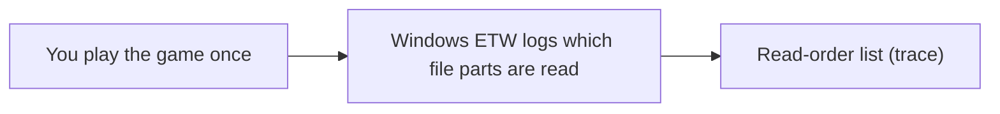
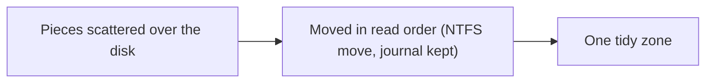
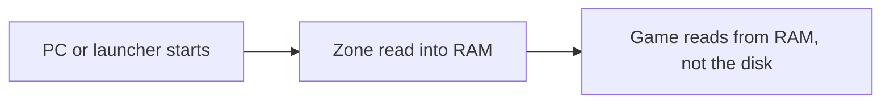

**English** | [한국어](README.ko.md)

<p align="center"></p>

<h1 align="center">AsterCache</h1>

<p align="center">A Windows desktop utility that brings load times of games installed on an HDD closer to SSD speeds</p>

<p align="center">
  <a href="LICENSE"></a>
  
  
  <a href="https://github.com/DO0OG/AsterCache/actions/workflows/csharp-ci.yml"></a>
  <a href="https://github.com/DO0OG/AsterCache/actions/workflows/kernel-build.yml"></a>
</p>

> **Beta.** AsterCache is distributed as a beta pre-release. It physically moves file data, so back up drives that hold important data before using it. Validation covers one SMR drive (WD20EZAZ) and one real game (Frostpunk); CMR drives and anti-cheat games have not been tested (see [Known limitations](#known-limitations)).

## Recent changes

These changes are on `main` since beta.8, including follow-ups from an external review. They are not a release yet.

- **Parallel relocation.** Eight parallel reads cut relocation work on the test HDD from 186 s to 41 s (4.5×). See [docs/RESULTS_SUMMARY.md](docs/RESULTS_SUMMARY.md).
- **Drive recovery check.** After a game update, or after a relocation on an SMR drive, the service judges whether the drive has recovered before it starts the next job (`auto.post_relocate_recovery`).
- **Hands-off after install.** `aster status` and the manager window summary show one line: "found → bootstrap planned → relocated → prewarmed → average hit rate". While you are likely to play (a launcher is running or it is your usual play hour), the service reads 4 KiB every 10 minutes so the HDD does not spin down (`auto.keep_awake`, on by default; power settings are never changed).
- **Prewarm yields to a running game.** On the same physical disk, a prewarm stops at the next 64 MiB batch boundary when a game starts. Disks are compared by physical disk number, not drive letter, so one HDD split into several volumes also counts as the same disk. `auto.keep_stream_on_game_start` (default `false`, experimental) restores the old behavior.
- **System drive on an HDD.** Games on an HDD that is the Windows system drive are discovered and prewarmed only, not relocated or tiered (status "prewarm only (system drive)").
- **Metric name.** `tier0_probe_ready_ms` (formerly `load_boundary_ms`, still read) is the time a tier0 prewarm sample was found in RAM. It is not the time a game finishes loading.

## Table of contents

- [Recent changes](#recent-changes)
- [What it does](#what-it-does)
- [How it works](#how-it-works)
- [Features](#features)
- [Measured results](#measured-results)
- [Screenshots](#screenshots)
- [System requirements](#system-requirements)
- [Getting started](#getting-started)
- [Automatic mode](#automatic-mode)
- [Configuration](#configuration)
- [Safety measures](#safety-measures)
- [Anti-cheat compatibility](#anti-cheat-compatibility)
- [Known limitations](#known-limitations)
- [Troubleshooting](#troubleshooting)
- [Project layout](#project-layout)
- [Development](#development)
- [License](#license)
- [Disclaimer](#disclaimer)

## What it does

AsterCache helps games installed on a hard disk (HDD) load faster. It watches what a game reads while it loads, puts those pieces side by side in one place on the disk, and loads them into RAM before you start the game. It does not change your game files and does not copy them to another drive, except for the optional SSD assist storage (off by default, see [SSD assist storage](#ssd-assist-storage-optional)). Once it is installed you do not have to do anything: it works in the background (see [Getting started](#getting-started)).

The figures in this document are replay times of recorded read patterns of one real game on one drive, not total load times of a running game. See [Measured results](#measured-results) and [VALIDATION_REPORT.md](VALIDATION_REPORT.md) for details.

## How it works

### The problem

A hard disk reads data with a moving head, like the arm of a record player. Every time the head has to jump to another spot, it waits. A game that loads a level reads thousands of pieces that are spread all over the disk, so the head spends most of its time jumping instead of reading.

Think of a library. Fetching a few hundred books from shelves all over the building takes a long time. Taking the same books from one cart, already stacked in the order you need them, is fast. AsterCache builds that cart.

On the test drive, scattered reads ran at about 39 MiB/s, while one continuous read ran at 90~110 MB/s ([docs/RESULTS_SUMMARY.md](docs/RESULTS_SUMMARY.md)). Other drives will differ.

### Part 1: Trace

AsterCache watches the game once while it loads and writes down which parts of which files it reads, and in what order. It uses Windows' own event tracing (ETW) for this. It never touches the game process.



### Part 2: Relocate

Using that list, AsterCache moves the pieces to one area of the disk, side by side, in the order the game reads them. File contents stay exactly the same. The move uses the official NTFS move function (the one disk defragmenters use), keeps a journal of every step, and can be reverted.



### Part 3: Prewarm

Before you start the game, for example when the PC boots or when your game launcher opens, AsterCache reads that whole zone into RAM (the file cache). When the game starts, it reads from RAM instead of the disk. If the zone was not prewarmed in time, AsterCache starts reading it in order the moment the game starts (read-ahead), which is still much faster than the scattered original.



### With or without an SSD

- **With an SSD (optional, off by default):** AsterCache copies the hot files of an HDD game to an SSD within a budget (8 GiB per game by default), keeps each original as `<name>.aster-orig`, and puts a symbolic link in its place, so the game reads the same paths as before.
- **Without an SSD:** only the HDD path above (relocation and prewarm) is used. The prewarm hit rate is measured at each game start and shown in the per-game status line.

### The result

In the measurement (Frostpunk, a 2 GB set of data read while loading the first map, on an SMR HDD), replaying the recorded reads took 24 s with nothing done, about 12 s after relocation plus read-ahead, and about 0.5 s after prewarm; the same reads on an NVMe SSD, cold, took 3.8 s. Prewarm itself needs about as long as the read-ahead, so it helps most when it finishes before you start the game. These are single-game, single-drive replay times, not full game load times.

### What AsterCache does not do

- It does not change the content of your game files. A SHA-256 check before and after each move confirms this.
- It does not touch the game process: no injection, no hooking, no driver.
- It does not copy your game to an SSD by default. The optional SSD assist storage (off by default) copies selected hot files; see [SSD assist storage](#ssd-assist-storage-optional).
- RAM is used only for prewarm and first-run read-ahead, within a budget: by default at most a quarter of physical RAM (read-ahead is also capped at 4 GiB), and only while the free RAM stays above `prewarm.min_free_ram_mib` (4 GB by default). Prewarmed data is ordinary file cache, which Windows can drop when programs need the memory.

## Features

- **Drive list.** Shows HDD/SSD type, capacity, model, and the number of registered games.
- **Game registration.** Set the game name, exe name, install folder, allowed folders, and volume label, and specify a prewarm trigger program.
- **Trace capture.** Run the game once and load up to the first map; the read blocks are recorded with a live ETW session (administrator rights required).
- **Plan, relocate, revert.** Builds a layout plan from the trace and applies it. The apply journal can be replayed in reverse to return to the previous layout.
- **Prewarm.** Runs automatically (on service start, or when a trigger program launches) or on demand with "Prewarm now".
- **Automatic mode (on by default).** Finds HDD games from supported launcher libraries and by game-start detection, traces them on their first run, and relocates them while the PC is idle. See [Automatic mode](#automatic-mode).
- **Service.** Detects game launches to run concurrent prefetch, and manages prewarm and re-apply. Runs as a Windows service (LocalSystem, automatic start).
- **Status and logs.** Tabs show service and watcher state, the last prewarm result, per-game layout state, and logs.
- **Measurement.** Measures cold replay time per game before and after relocation.
- **Profile export and import.** Moves a recorded trace to another PC with `aster profile export` and `aster profile import`. An import is accepted only when the file size and a sampled hash match.
- **Management window.** Without administrator rights a banner appears at the top, and you can relaunch as administrator.
- **Command line `aster`.** Runs the same operations as the management window as commands, for automation.
- **English and Korean UI.** The management window and the CLI support both languages (see [Language](#language)).

## Measured results

The figures are replay times of traced read patterns, not total load times of a running game.

| Target | Measurement | Result |
|---|---|---|
| Synthetic dataset 2.1 GiB | HDD cold read → prefetch after relocation | 17.1 s → 1.14 s (holds 10 hours after relocation) |
| Synthetic dataset 2.1 GiB | SSD cold read under the same conditions | 0.76~1.22 s |
| Frostpunk, 2.02 GB read while loading the first map | HDD cold replay → concurrent prefetch after relocation | 24.3 s → 11.93 s (median of 3, see note) |
| Frostpunk | Replay after prewarm | 0.48 s |
| Frostpunk, 1.9 GB loading read | HDD cold → SSD assist storage cold (warm) | 12.90 s → 2.81 s (warm 0.48 s) |
| Frostpunk, same read pattern | NVMe SSD cold replay | 3.8 s |
| Frostpunk-trace replica, scattered vs contiguous layout (2.02 GB) | Direct replay of the same read pattern, read-ahead off, median | Scattered 41.0~55.3 s → contiguous 19.3~20.5 s ([result folder](results/csharp_e7c_gen/README.md)) |
| Service | Game start detection latency (polling, p95) | 58 ms |

- The HDD is a WD20EZAZ (SATA, D:) and the SSD is NVMe (C:). The test machine runs Windows 11 Pro 10.0.26200 with 32 GiB of memory.
- The Frostpunk results come from tracing one game once and replaying it. There are no p50/p95 figures for repeated loads yet.
- The SSD value for the synthetic dataset and the NVMe value for Frostpunk use different data and methods, so do not compare them directly.
- For prewarm to beat an SSD cold read, prewarm must finish at least 15 s before the game starts. Memory pressure reduces the effect.
- The 11.93 s value is from the E6 experiment: the relocation now moves all hot data into one zone by default (preservation off), instead of keeping segments of 8 MiB or more in place. The earlier value was 15.1 s. See [docs/research_cold_limit.md](docs/research_cold_limit.md).
- More tables and interpretation are in [docs/RESULTS_SUMMARY.md](docs/RESULTS_SUMMARY.md) and [VALIDATION_REPORT.md](VALIDATION_REPORT.md).
- Research note on general HDD I/O (outside the game): [docs/research_hdd_general.md](docs/research_hdd_general.md).

## Screenshots

The management window (Games tab) and the Status tab. They were produced with `AsterCache.Tray.exe --smoke --screenshot <png>`, so the drive and game information is sample data.

<p align="center"></p>
<p align="center"></p>

## System requirements

- Windows 11 x64. The validated environment is Windows 11 Pro 10.0.26200.
- Building from source requires the .NET 10 SDK. The repository's `csharp/global.json` uses SDK 10.0.400 (latestPatch).
- Trace capture (ETW), relocation (`apply`, `revert`), and service installation require administrator rights.
- The relocation target must be an NTFS volume. Comparing origin against cache requires two different physical devices.

## Getting started

### 1. Install

1. Open [GitHub Releases](https://github.com/DO0OG/AsterCache/releases) and download `AsterCache-v<version>-win-x64-setup.exe` (pre-release, for example v0.9.0-beta.6).
2. Run it and choose a language (English or 한국어).
3. Keep the default choices (desktop and Start menu shortcuts, start with Windows, install the service) and click Next until it finishes.

Prefer no installer? The same release has a zip, `AsterCache-0.9.0-beta.6-win-x64.zip`. Extract it, run `AsterCache.Tray.exe` as administrator, and install and start the service from the Settings tab.

Running a newer installer upgrades the existing installation. Uninstalling reverts any SSD assist links first (`aster tier revert --all`; the copies stay in the tier folder), then removes the program and the service, but keeps the data folder `%ProgramData%\AsterCache`. The installer is not code-signed, so Windows SmartScreen may show a warning.

### 2. That is all: automatic mode

After installing, you have nothing else to do. [Automatic mode](#automatic-mode) is on by default. In short: install → automatic discovery → prewarm (a small game's whole folder, or a large game's engine profile, even without a trace) → record reads on the first launch → about 30 seconds after you quit the game, relocation → prewarm the moved zone right away → the full effect from the second launch. First-run read-ahead is off by default. No button needs pressing. This is what happens over time:

| When | What AsterCache does |
|---|---|
| Right after install | The background service starts. |
| About 10 seconds later (then every hour) | It looks through your Steam, Epic, GOG, Ubisoft, and Riot libraries and the Windows uninstall list, and registers games installed on an HDD. |
| Registered game, before its first launch (at service start, launcher start, or after a game quits) | A small game (folder within the RAM budget) gets its whole folder prewarmed; a larger game gets only its engine profile (Unity, Unreal, Source). This happens without a trace. For a game with no record, placement info is looked up in this order: shared profile (skipped silently while the repository is not yet available) → Windows prefetch record → engine profile → whole folder. The effect of this prewarm is not yet measured. |
| The first time you play a registered game | It records what the game reads (the trace). First-run read-ahead is an experimental feature, off by default (no gain in E7 to E7f measurements; `auto.learn.enabled`), so this run only records. The full effect comes from the second launch. |
| You quit the game, the game's drive stays under 4 MiB/s for 30 seconds, and the PC is on AC power (or a battery at 50 % or more) | It moves the game's pieces into one zone, one game at a time, then prewarms that zone right away. This takes a few minutes (about 5 minutes per 2 GB). If you start a game meanwhile, it pauses and continues later. |
| Every time the PC starts or the launcher opens | It prewarms the zone into RAM, within a RAM budget. |
| From the second launch | The full effect applies (figures in [Measured results](#measured-results); total load time is not yet measured). |

"Idle" means no registered game installed on the same drive as the games waiting to move is running (games on other drives are ignored), the game's drive stays under 4 MiB/s for 30 seconds in a row, and the PC is on AC power (or a battery at 50 % or more). CPU use is not part of the test: relocation uses low I/O priority and only affects the target drive, so a PC with background work is still relocated. If the PC has not been idle for 6 hours, `service.log` records one line with the reason (`game running`, `on battery`, or `disk busy`). To see which stage each game is in, open the management window (tray icon, or the desktop shortcut) and look at the **Status** tab and the stage column of the **Games** tab.

### 3. Doing it by hand (optional)

Use this if you want to control each step, or to try a game that automatic mode skipped. Start the management window as administrator, open the **Games** tab, and work through the buttons in this order.

| Step | Button | What it does |
|---|---|---|
| 1 | Register | Add the game by choosing its exe file. |
| 2 | Collect trace | Run the game, load up to the first map, and quit. This records the read order. |
| 3 | Create plan | Decide where the pieces should go. |
| 4 | Apply relocation | Move the pieces. A journal is kept. |
| 5 | Prewarm now | Load the zone into RAM right away. |
| 6 | Measure | Time one read of the zone. |

The same steps are available on the command line (`aster`), for example:

```bat
aster discover
aster tier status
aster trace --live --exe Frostpunk.exe --origin-root D:\Games\Frostpunk --out trace.json --seconds 180
aster plan --trace trace.json --origin-root D:\Games\Frostpunk --zone-mib 1536 --out plan.json
aster apply --plan plan.json --allowed-root D:\Games --require-volume-label GAMES --dry-run
aster apply --plan plan.json --allowed-root D:\Games --require-volume-label GAMES --execute
aster prewarm --plan plan.json --origin-root D:\Games\Frostpunk
```

- `discover` lists the games found in your launcher libraries, read only.
- `tier status` shows the SSD assist state. `tier apply --game <name>`, `tier revert --game <name>` or `--all`, and `tier clean` need administrator rights.
- Run `trace --live` and `apply --execute` from an administrator PowerShell.
- `--dry-run` moves nothing and only shows the plan. If `--require-volume-label` does not match the actual volume label, nothing is moved.
- `--zone-mib` is an example value; set it to fit the game's hot data size. The global option `--lang ko|en` sets the output language (see [Language](#language)).
- Every command and option is described in [csharp/README.md](csharp/README.md).

### 4. Turning it off and reverting

- **Turn off automatic mode.** In the **Settings** tab, clear **Use automatic mode** and click **Apply automatic mode**. Or set `"auto": {"enabled": false}` in `%ProgramData%\AsterCache\config.json`. To exclude one game, add its exe to `auto.ignore_exes`. See [Automatic mode](#automatic-mode).
- **Put a game back.** On the **Games** tab, select the game and click **Revert**. It follows the journal and restores the previous disk layout; the file contents never changed.
- **Uninstall.** Use Windows' Installed apps. Your data folder `%ProgramData%\AsterCache` stays; it is deleted only if you run `cs_service.ps1 -Action uninstall -PurgeData`.

### FAQ

**Does it work for games installed on an SSD?**
No. It only targets games on an HDD. Games on an SSD are skipped, because an SSD does not need it. A game on an HDD that is also the Windows system drive is only discovered and prewarmed (status "prewarm only (system drive)"); it is not relocated or tiered.

**Is it safe with anti-cheat games?**
AsterCache never touches the game process; it only reads files from its own process, watches file reads with Windows event tracing, and moves files after the game has exited. But it has not been tested with any anti-cheat game yet. For such a game, turn automatic mode off or add the game to `auto.ignore_exes` first. Details are in [Anti-cheat compatibility](#anti-cheat-compatibility).

**How much RAM does it use?**
About the size of the zone, which is the game's recorded read set (up to 2 GiB by default). Prewarm runs only when at least 4 GB of RAM would still be free afterwards, and Windows can reclaim the cache when your programs need the memory.

**What happens after a game update?**
A patch can change files, so a saved plan may no longer match them. AsterCache checks the plan before moving anything and skips files that changed, and every 5 minutes (while the game is off) it re-applies the plan if the layout has fallen apart. After a big patch, run Collect trace, Create plan, and Apply relocation again. This has not been tried with a real game update yet.

**Does it matter whether my drive is SMR or CMR?**
Only one SMR drive (WD20EZAZ) has been measured; CMR drives have not. Removing head movement should help both kinds, but that is not verified. SMR drives can write slowly during the one-time move.

**Is the first run required?**
Relocation needs a trace (the record of what the game reads). Without one from a first run, the service tries a matching shared profile (`auto.shared_profiles`) and then the game's Windows prefetch record. Each of these gives a boot trace, so relocation can start before the first run. The shared profile repository (https://github.com/DO0OG/AsterCache-profiles) is still being prepared and does not exist yet; until it does, that step is skipped silently. Prewarm still runs without a trace. A game whose whole install folder fits the RAM budget (the smaller of a quarter of physical RAM and free RAM minus `prewarm.min_free_ram_mib`) is prewarmed in full (`auto.full_prewarm`, on by default; the budget can be changed with `auto.full_prewarm_max_mib`). A larger game gets only the files its engine (Unity, Unreal, or Source) reads almost every time at the start of loading (`auto.engine_profiles`, on by default). Their effect has not been measured yet. A trace recorded on another PC can be brought in with `aster profile import` (see `aster profile export`). It is saved as `plans\<name>.boot.trace.json`, so relocation and prewarm can start from it without a first run; the first run is still recorded, and the plan is then made again from that recording (same zone first), and the old plan is kept as `.stale`.

**Will the very first launch be faster?**
First-run read-ahead is an experimental feature, off by default (no gain in E7 to E7f measurements; `auto.learn.enabled`). The first launch only records what the game reads; the full effect comes from the second launch, after the move and prewarm. A game found only by activity detection (not from a launcher library) starts recording on its next launch. The measurements are in [docs/RESULTS_SUMMARY.md](docs/RESULTS_SUMMARY.md#e7-first-run-read-ahead). Prewarm (the whole folder or an engine profile) also runs without a trace, but its effect has not been measured yet.

**Can my files get damaged?**
Every move is verified with a SHA-256 check and written to a journal that can be reverted. Still, this is a beta that moves real data: back up important drives first. See [Safety measures](#safety-measures).

## Automatic mode

Automatic mode is on by default. In the usual case you do not need to register games or set anything. Each part can be turned off in the **Automatic mode** group of the Settings tab, or in `config.json`.

### Sources before the first run

A game with no trace takes its first layout data from the first source below that applies. When the first real run records a trace, the plan made from it replaces the earlier one (the old plan is kept as `.stale`).

1. **Shared profile** (`auto.shared_profiles`, on by default). Once a week the service downloads one zip of shared profiles over HTTPS and looks each game up in its index by Steam app ID and depot manifest IDs, Epic app name and version, or exe size and sample SHA-256. A profile is used only when the file size and sample hash on this PC match. Offline or 404 responses are skipped silently. The download is capped at 64 MiB. The shared repository is still being prepared.
2. **Windows prefetch record** (`C:\Windows\Prefetch\*.pf`). Used when the SysMain service runs and the application bit of `EnablePrefetcher` is on. The service only reads the game's `.pf` files and builds a boot trace from the files in the install folder, skipping files flagged "do not prefetch". Only files of 64 MiB or less are moved into the zone, in physical order; larger files are left in place. The management window shows this as "relocated (prefetch)".
3. **Engine profile** (Unity, Unreal, or Source), prewarmed without a trace.
4. **Whole folder**, prewarmed without a trace when the folder fits the RAM budget.

### Stages

1. **Discovery.** Ten seconds after the service starts, and every hour after that, the service reads the libraries of the supported launchers (below). A game installed on an HDD (rotational volume) is registered with `"source": "auto"`. A game is skipped if its volume label is empty or longer than 32 characters (a log line is written), or if its exe name or an overlapping folder is already registered. The list holds up to 32 games. When it is full, launcher discovery stops, and a game that is actually run and detected replaces the least recently used automatic entry.
2. **Trace.** When a registered game without a trace starts, the service records its reads with a live ETW session named `AsterCacheAutoTrace`. Recording stops at the first of: the game exiting, 600 seconds (`trace_cap_seconds`), or 6144 MiB (`trace_cap_mib`). The result is saved as `plans\<name>.trace.json`, the same file that the manual **Capture trace** button writes. The next plays are recorded the same way until `trace_runs` (default 3) are collected: each is saved as `plans\<name>.trace.runN.json`, and `trace.json` becomes the union of their blocks (the first run's access order, then blocks first seen in later runs), replaced atomically. If the merged hot set is at least `trace_merge_min_mib` (default 64) larger than the plan's, and the game is not running, the zone is extended in place: blocks already in the zone stay where they are and only new blocks are appended after them, within `max_zone_mib` (the earliest run's blocks win), through the same idle, daily-limit and write-budget checks as any relocation. If the region after the zone is not free, the extension is skipped, the previous plan stays, and it is retried only when a newer play changes the trace (`zone extension blocked: ...` in the log). The status column shows `trace 2/3` while more plays are being collected. A game detected at its start has already begun loading, so its trace is recorded from the next run. While this trace is recorded, the service can also read ahead (first-run learning). This is an experimental feature, off by default (`auto.learn.enabled` is `false`; no gain in E7 to E7f measurements). When it is on, it reads ahead only in files the game reads sequentially: a file is judged sequential after 6 forward reads in a row, each at most 4 MiB past the end of the previous read, and the game has read at least 8 MiB of that file. Such a file is read ahead in 16 MiB steps from the current position, up to `auto.learn.window_mib` (default 512 MiB) further, without waiting for gaps in the game's reads, and it keeps going while the game reads (`auto.learn.mode` `"stream"`, the default). With `"gap"`, it reads ahead only after 100 ms of quiet, in 1 MiB requests. Reads come from the service's own process, with one reader thread, low I/O priority, and the most recently read file first. Files the game has opened exclusively are skipped. The total is at most the game's reads × 1.5 + 64 MiB, and stays within `auto.learn.max_total_mib` (default: the smaller of a quarter of physical RAM and 4096 MiB) and keeps the free-RAM reserve (`min_free_ram_mib`). Only games on an HDD that is not the system drive are learned. The game process is never opened; reads are only observed through ETW.
3. **Plan and relocation.** After a trace exists, the game is not running, and the PC has been idle for `idle_seconds` (default 30) in a row, the service handles one game at a time. It plans the zone (hot data × 1.1, capped by `max_zone_mib`), moves the data with the same Applier as manual relocation (journal and SHA-256 sample check), and confirms the layout. Idle means: throughput on the game's drive below 4 MiB/s and either AC power or a battery at 50 % or more. At most `max_relocations_per_day` (default 4) relocations run in 24 hours, and each game gets one automatic first relocation; later upkeep uses the existing periodic check. If a game starts during a move, the move stops after the current fragment and resumes later from the journal. If the data check fails or an error occurs while the game is off, the journal is used to revert, and the failure is recorded. Right after a move finishes (or fails, if a trace exists), the zone is prewarmed. Moves carry a low I/O priority hint (`FileIoPriorityHintInfo` Low). The documentation does not guarantee that the kernel applies it to the copy I/O of a move, and this has not been measured yet. If a game's files change size or modification time after relocation (a game update), the trace and plan are set aside as `.stale` (checked every 10 minutes), the stage goes back to discovery, and the game is traced and relocated again on its next run, trying its previous zone position first.
4. **Prewarm.** At service start, when a supported launcher starts, and after a game exits, the most recently played games are prewarmed. Games you played recently, and often at this time of day, are warmed first. With `prewarm_recent` at its default 0, the service prewarms as many recent games as fit in the budget (the smaller of a quarter of physical RAM and free RAM minus `min_free_ram_mib`); a value from 1 to 32 caps the number of games instead. To keep the prewarm, every `rewarm_minutes` (default 10; 0 turns it off) the service reads 1 MiB from each of 8 places in the zone (the first 4 in read order and 4 evenly spaced). If at least 2 of them take more than 2 ms, the data has probably been evicted from the file cache, so it prewarms again while keeping `min_free_ram_mib` free. It does not run while a game on the same drive as a prewarmed game is running. The prewarm reads in 64 MiB batches: if another game starts, it stops at the next batch boundary; if the game being prewarmed starts, it also stops at the next batch boundary and yields to the game (`auto.keep_stream_on_game_start`, default `false`; `true` restores the old behavior of reading to the end, for experiments). The management window shows `prewarming x/y MiB`, and a tray notification is sent when a game's prewarm finishes (once per game per day). A full-folder prewarm reads in the disk's physical order. When a batch holds more than one game, the loading head (tier0) of each game is read first, in recent order, and then each game's whole zone. After a game update is detected, re-planning, relocation and prewarm for that game wait `post_update_delay_min` minutes (default 15; 0 turns it off), because the drive may still be reorganizing scattered writes (E9). On SMR drives, after a relocation the service waits for the drive to recover before it starts the next job (`auto.post_relocate_recovery`, default `"probe"`: every 2 minutes it reads a short sample, and the drive counts as recovered after 2 consecutive samples at 90% or more of the baseline, waiting at most `post_update_delay_min` × 4 minutes; `"fixed"` waits a fixed number of minutes, `"off"` turns it off).
5. **Pinning (optional).** With `prewarm.pin` set to `true` (when the key is not written, it turns on automatically with 24 GiB of RAM or more; `false` turns it off; an explicit `true` works with 16 GiB of RAM or more), the prewarmed pages stay open as read-only mappings in the service, so they are less likely to be evicted. The mappings are released at once when free RAM falls below the reserve or when a game or launcher starts, so launcher updates can change the files. A prewarm started by a trigger program is not pinned. Effect unverified (needs an experiment).

### Supported launchers

| Launcher | How the game list is read | Prewarm trigger for auto-registered games |
|---|---|---|
| Steam | `libraryfolders.vdf` and `appmanifest` files. The executable is the largest `.exe` in the game folder, excluding installers, redistributables, and crash tools | `steam.exe` |
| Epic Games Store | `LaunchExecutable` in `%ProgramData%\Epic\EpicGamesLauncher\Data\Manifests\*.item` | `EpicGamesLauncher.exe` |
| GOG Galaxy | Registry `HKLM\SOFTWARE\WOW6432Node\GOG.com\Games` | `GalaxyClient.exe` |
| Ubisoft Connect | Registry `Launcher\Installs`, value `InstallDir` | `upc.exe`, `UbisoftConnect.exe` |
| Riot Client | `product_install_full_path` in `%ProgramData%\Riot Games\Metadata\<product>.live\*.product_settings.yaml`. League of Legends (`LeagueClient.exe`, `League of Legends.exe`) and Teamfight Tactics use the same exe names, and their entries are merged when they share a folder. VALORANT uses `VALORANT.exe` and `VALORANT-Win64-Shipping.exe`. Other products use the largest `.exe` in the folder. Entries that are not `.live` (for example PBE) are skipped. Marked as Vanguard anti-cheat | `RiotClientServices.exe` |
| Windows uninstall list | `Uninstall` keys of HKLM and HKCU (32-bit too). Kept when the install folder is on an HDD (not the system drive), is at least 1 GiB, is not from a common publisher (Microsoft, Intel, NVIDIA, and others), and is not a launcher's own folder. The exe is the largest `.exe` in the folder. Catches standalone games such as Battle.net, EA, Nexon, and HoYoverse titles. An entry that was skipped because its name matched a launcher exclusion word has its exe chosen again at service start under the current rules (one log line). Limits: a launcher-style folder can give the wrong exe; after the game runs, the heuristic adds the real exe. | None |
| Xbox (Microsoft Store) | `XboxGames\<game>\Content` folder on each HDD. The exe is the largest `.exe`. Folders that cannot be read are skipped. | None |

The GOG and Ubisoft readers have not been checked on a real PC yet. The Riot reader was checked on this PC with League of Legends on D: (an HDD). The Xbox reader has not been checked, because this PC has no such folder.

Not read for discovery: Battle.net and EA app. Games from these, and games installed without a launcher, are found by the Windows uninstall list above when it matches, and otherwise by the heuristic below. A game in the same folder as a game you registered by hand is not registered automatically, and a log line is written. `Battle.net.exe` and `EADesktop.exe` are listed only as prewarm trigger programs; the service does not read their libraries.

### Heuristic detection

A process that is not registered, starts from an exe on an HDD volume, and reads 256 MiB or more within 20 seconds is treated as a game and registered. Excluded: the Windows folder, AsterCache itself, launchers and tool programs, and the exes in `auto.ignore_exes`. Also excluded are exes whose path contains `\bin\Debug\`, `\bin\Release\`, `\obj\`, `\.git\`, `\node_modules\`, or `\AppData\Local\Temp\`, and the built-in tool exes `testhost*`, `dotnet`, `msbuild`, `vstest*`, `python*`, `node`, `java*`, `powershell`, `pwsh`, `cmd`, `conhost`, `explorer`, `7z*`, and `winrar` (this fixed list is separate from `auto.ignore_exes`). The folder must also look like a game: it holds a file of 256 MiB or more, or a launcher mark (`steam_appid.txt`, `.egstore`, `goggame-*.info`, or a Steam manifest). Games installed under `AppData\Local\Temp` are therefore not found by this heuristic. Because the start was already missed, the first trace is recorded from the next run.

### Settings

```json
{
  "max_zone_mib": 2048,
  "auto": {
    "enabled": true,
    "discover": true,
    "trace": true,
    "relocate": true,
    "full_prewarm": true,
    "full_prewarm_max_mib": 0,
    "engine_profiles": true,
    "shared_profiles": {"enabled": true, "url": "https://github.com/DO0OG/AsterCache-profiles/releases/latest/download/profiles.zip"},
    "learn": {"enabled": false, "mode": "stream", "window_mib": 512, "max_total_mib": 0},
    "prewarm_recent": 0,
    "idle_seconds": 30,
    "trace_cap_seconds": 600,
    "trace_cap_mib": 6144,
    "trace_runs": 3,
    "trace_merge_min_mib": 64,
    "max_relocations_per_day": 2,
    "rewarm_minutes": 10,
    "post_update_delay_min": 15,
    "ignore_exes": [],
    "ssd_tier": {"enabled": false, "budget_gib": 8, "root": "auto"}
  }
}
```

- `"auto": {"enabled": false}` turns off the whole automatic mode. `discover`, `trace`, and `relocate` turn off one stage each. `max_zone_mib` can also be `"auto"`. `"auto": {"learn": {"enabled": true}}` turns the first-run read-ahead on (an experimental feature, off by default). `mode` (experimental) is `"stream"` (default), `"gap"`, `"bounded"`, or `"adaptive"`. `"bounded"` reads ahead as `"stream"` does, but caps the total at the game's reads + 32 MiB and sends no new request for 50 ms after each game read. `"adaptive"` adds to `"bounded"` a pause while the game's reads over the last 500 ms run at `saturation_mbps` (1..10000, default 80 MiB/s) or more, and a 200 ms pause when our own request latency doubles. Read-ahead stays off by default (no gain in E7 to E7f measurements). `shared_profiles.enabled` turns the weekly download off, and `url` must be https. `idle_seconds` replaces the older `idle_minutes`; if only `idle_minutes` is written, that value is used.
- `"auto": {"ssd_tier": {"enabled": true, "budget_gib": 8, "root": "auto"}}` turns on the optional SSD assist storage (off by default). `budget_gib` (1..4096) is the most SSD space one game may use. `root` is `"auto"` (the system drive if it is an SSD, otherwise the SSD with the most free space, under `AsterCache\tier`) or an absolute path on an SSD. See [SSD assist storage](#ssd-assist-storage-optional).
- The manual buttons (register, capture trace, create plan, run relocation, prewarm now) work as before.
- The service writes its state to `%ProgramData%\AsterCache\auto_status.json`. Only the service writes that file.
- The Status tab shows one line per game, such as "Auto: Frostpunk discovered → collecting trace → waiting to relocate → relocating → [done]". The Games tab shows the source, stage, and anti-cheat columns. The learning stage shows "First run: learning (read-ahead n MiB)", and "Prewarmed" appears after prewarm. The per-game status line also shows `prewarm hit N%` (the hit rate measured at the last game start) and `SSD assist N GB` (the size of the game's SSD copies). Tray notifications are sent for discovery, for a finished relocation, and when a first run ends ("Faster from the next launch: <game>").
- `aster status` has an `"auto"` key. `aster discover [--json]` lists the launcher games read-only, with the anti-cheat marker.
- A game you registered by hand is also relocated automatically when `auto.relocate` is on, once its trace exists and the PC is idle. To prevent this, turn off `auto.relocate` (in the Settings tab of the management window, clear the Relocate box) or add the game's exe to `auto.ignore_exes`.
- Games on an SSD are not automatically registered, traced, or relocated. On an HDD that is the Windows system drive, games are only discovered and prewarmed (status "prewarm only (system drive)"); they are not relocated or tiered.
- A game you removed in the management window has its exe added to `auto.ignore_exes`, so it is not registered automatically again. The list holds up to 64 exes; when it is full, the oldest entries are dropped.
- The daily limit `max_relocations_per_day` counts 24 hours from the start of each relocation.
- If an automatic relocation fails, its journal reverts only that automatic change.

### Effect

The speed effect of automatic mode has not been measured yet. When results exist, they will be added to [docs/RESULTS_SUMMARY.md](docs/RESULTS_SUMMARY.md).

### SSD assist storage (optional)

Off by default (`auto.ssd_tier.enabled`). While it is off, AsterCache does not touch any file, except that it reverts links left by an earlier run.

- **Choosing files.** Each file is scored by its hot bytes (the parts the trace read) divided by its size. Files are taken from the highest score down while they fit the budget (`budget_gib`, default 8 GiB per game). Game `.exe` and `.dll` files and files outside `allowed_roots` are never chosen.
- **Applying.** The file is copied to the SSD, and the size and a sampled SHA-256 are checked. The copy is recorded in the journal, the original is renamed to `<name>.aster-orig` in the same folder, a symbolic link takes its place, and the link is checked by size. If one file fails, only that file is reverted.
- **When it runs.** One game at a time, only for an HDD game that is not running, is not on the system drive, has no anti-cheat folder, and has finished relocation (or has relocation turned off). It waits for idle like relocation does, and retries a game it could not finish after 6 hours.
- **Keeping.** At each service tick the journal is checked. A missing or wrong-size copy is reverted at once. A file that became a normal file, or whose copy changed through the link, is marked stale and left alone. If the SSD has less than 1 GiB free, no new copies are added and the oldest game is reverted first. A change to the budget or the folder makes the game revert and apply again with the new setting.
- **Reverting.** `aster tier revert --game <name>` or `--all` removes the links and restores the originals. The copies stay in the tier folder until `aster tier clean` deletes the unused ones. Uninstalling reverts all games first.
- **Where it is stored.** The journal is `%ProgramData%\AsterCache\tier\<game>.json`. If a journal cannot be read, that game is skipped, nothing is touched, and a log line is written.
- **Management window.** The checkbox and the budget are in the Settings tab, under Automatic mode. The per-game status line shows `SSD assist N GB`.
- **Commands.** `aster tier status`, `aster tier apply --game <name>`, `aster tier revert --game <name>` or `--all`, and `aster tier clean` (apply, revert, and clean need administrator rights).

## Configuration

The configuration file is `%ProgramData%\AsterCache\config.json`. Editing it in the management window is recommended. When editing by hand, write JSON backslashes as `\\`.

```json
{
  "language": "auto",
  "watcher": "poll",
  "games": [
    {
      "name": "frostpunk",
      "exe_names": ["Frostpunk.exe"],
      "trace": "C:\\ProgramData\\AsterCache\\plans\\frostpunk.prefetch.json",
      "plan": "C:\\ProgramData\\AsterCache\\plans\\frostpunk.plan.json",
      "origin_root": "D:\\Games\\Frostpunk",
      "allowed_roots": ["D:\\Games"],
      "volume_label": "GAMES",
      "max_stream_mib": 4096,
      "prewarm": {
        "on_service_start": true,
        "trigger_exes": ["Steam.exe"],
        "min_free_ram_mib": 4096,
        "cooldown_min": 30
      }
    }
  ]
}
```

| Key | Meaning |
|---|---|
| `language` | UI language. `auto` (default), `ko`, or `en`. `auto` follows the Windows display language and falls back to English unless it is Korean. |
| `watcher` | How game starts are detected. `poll` (default) or `etw`. `etw` requires administrator rights and falls back to polling if it fails. |
| `games[].name`, `exe_names` | Game name and list of executable names |
| `trace`, `plan` | Paths to the trace file and plan file |
| `origin_root` | Game install folder |
| `allowed_roots` | Folders where relocation is allowed |
| `volume_label` | Label of the target volume. If it differs, nothing is relocated. |
| `max_stream_mib` | Upper limit of what one stream or prewarm reads (default 4096) |
| `prewarm.on_service_start` | Run prewarm when the service starts (default `true`) |
| `prewarm.trigger_exes` | Run prewarm when one of these programs starts (for example a launcher). Empty by default |
| `prewarm.min_free_ram_mib` | Available RAM to leave free even after prewarm (default 4096) |
| `prewarm.cooldown_min` | Minimum interval between prewarms (default 30 minutes) |
| `auto` | Automatic mode settings. Omitted keys take their defaults. See [Automatic mode](#automatic-mode). |
| `max_zone_mib` | Upper limit of the zone size for automatic planning, in MiB (default 2048), or `"auto"` (physical RAM ÷ 4, between 2048 and 8192 MiB; capped at 2048 when the disk type is unknown or the disk is on USB) |
| `games[].source` | `auto` for a game found automatically, `manual` for a game you registered |
| `games[].anticheat` | Anti-cheat folders found in the install folder, for example `EasyAntiCheat`. Shown in the Games tab; it does not change behavior |
| `auto.ssd_tier` | Optional SSD assist storage: `enabled` (default `false`), `budget_gib` (default 8), `root` (default `"auto"`). See [SSD assist storage](#ssd-assist-storage-optional) |
| `auto.trace_runs` | Default 3. If the number of plays is below this value, the service traces again to accumulate the hot set and widen the zone. |
| `auto.restream_cooldown_min` | Default 10. The start-up stream of the same game is not run again within this many minutes. It is also skipped while the game process is already running or the disk is busy. |
| `auto.rewarm_after_exit_min` | Default 2. When a game exit is detected, the rewarm check is pulled forward to this many minutes later. |
| `auto.load_boundary` | Default `false`. When `true`, the service measures when the loading head (tier0) is in RAM at each game start. It reads the disk, so it stops when the game exits. |
| `prewarm.pin` | Keep prewarmed data open as read-only mappings in the service. When not written, it is on automatically with 24 GiB of RAM or more; `false` turns it off; an explicit `true` works with 16 GiB of RAM or more. Effect unverified (needs an experiment). See [Anti-cheat compatibility](#anti-cheat-compatibility) |

The service re-reads the whole `config.json` every 5 seconds (when its size or modified time changes), so adding, removing, or changing games and the watcher takes effect without a restart. If the new configuration fails validation or the folder permission check, the previous settings stay in force and the reason is written to the log.

| Watcher | How it works | Permission | Detection latency (S4 measurement) | Load | Recommended |
|---|---|---|---|---|---|
| `poll` | Reads the PID list every 50 ms and looks up the names of new PIDs only | No administrator rights | median 27 ms, p95 58 ms | About 1% of one core when idle | Default and recommended |
| `etw` | Subscribes to kernel process events in a real-time session and flushes the buffer every 50 ms with `FlushTrace` | Administrator rights (the service runs as LocalSystem) | p95 119 ms (1.65 s before the 50 ms flush) | Session buffer memory | Falls back to polling if it fails |

In the **Settings** tab the saved value is `poll` or `etw`, and the label shows `poll (recommended)` or `etw`.

### Language

The management window and the `aster` CLI are available in Korean and English.

- The language is chosen by `"language"` in `config.json`: `"auto"` (default, follows the Windows display language and uses English unless it is Korean), `"ko"`, or `"en"`. You can also change it in the **Language** item on the management window's Settings tab.
- The CLI accepts the global option `--lang ko|en` and the environment variable `ASTER_LANG`. Priority: `--lang` > `ASTER_LANG` > `config.json` > OS language.
- JSON output does not depend on the language.

## Safety measures

- **Content verification.** SHA-256 is compared before and after relocation. If the content differs, it is recorded as a failure.
- **Journal and revert.** A journal (JSON Lines) is written for every moved fragment, and `revert` returns to the previous physical layout. The data content does not change.
- **Allowed folders and volume pinning.** Files outside `allowed_roots` and volumes whose label differs from `volume_label` are not touched.
- **Interruption handling.** If a game starts during relocation, only the fragment currently being moved is finished and then it stops. A resume point is left in the journal, and the same plan continues after the game exits.
- **Data folder permissions.** Only SYSTEM and Administrators can write to `%ProgramData%\AsterCache`; ordinary users can only read. Uninstalling the service leaves the data folder; it is deleted only when you explicitly pass `cs_service.ps1 -Action uninstall -PurgeData`.
- **Permission check.** Without administrator rights, relocation and revert change nothing and end with `not_admin`.

## Anti-cheat compatibility

Many current games run kernel-level anti-cheat. This section says what AsterCache does and does not do, so you can decide whether to use it with a game. Anti-cheat policies differ per game and can change. AsterCache has not been tested with any anti-cheat game yet.

### What it does

- The service reads game files from inside its own process, read-only, with shared access (read, write, and delete sharing), or only maps them.
- First-run read-ahead also reads files from the service's own process. The game process is not touched; reads are only observed through ETW.
- It watches file-read events with a live ETW kernel session. It needs no handle to the game process.
- It reads Windows prefetch records (`C:\Windows\Prefetch\*.pf`) with read-only access, from the service only, and downloads one shared-profile zip a week over HTTPS. Neither touches the game process.
- It moves file clusters with the NTFS defragmentation API (`FSCTL_MOVE_FILE`), and only after the game has fully exited. File content, size, and modified time do not change. Before a move, the plan's fingerprint (size and modified time) is checked.

### What it does not do

- No code injection, no thread creation in the game process, no reading or writing of its memory, no debug privilege, no hooking, no overlay, and no handle duplication.
- Game processes are opened only with `PROCESS_QUERY_LIMITED_INFORMATION`, to read the name, path, and bytes read. If a protected process refuses even that, the service decides from ETW events alone and does not try to open that process again. In that case it judges from the reads in the 20 seconds after the refusal is confirmed; reads before those 20 seconds are not counted.
- No kernel driver.

### Skipped and marked files

- Files that the game has opened exclusively are skipped.
- During automatic discovery, the service looks at file and folder names up to 4 levels deep in the install folder. It recognizes EasyAntiCheat, BattlEye, Vanguard (`vgc`, `vgk`), and Ricochet; other names containing anticheat, xigncode, nprotect, or gameguard are marked `unknown`. A game with such a name is marked in the Games tab and in the `anticheat` setting, and one log line is written. The behavior does not change. On the test PC, `aster discover` marked The Outlast Trials (Steam) with `eac`.

### Why each speed feature is considered safe

These are the reasons each feature is considered safe. They are reasoning, not verified results.

- **Prewarm:** reads ordinary files from the service's own process.
- **Prewarm upkeep:** samples ordinary 1 MiB file reads.
- **Pinning:** read-only mappings in the service's own process, released when a game or launcher starts.
- **Relocation:** runs only after the game has exited, and file content does not change.
- **Prefetch records and shared profiles:** the `.pf` files are read only by the service, and the download is one file a week.
- **Detection:** a query-only process handle, or ETW events.

### Signing

The executables are not code-signed, so Windows SmartScreen may show a warning. That warning is the only effect confirmed so far. Whether signing status relates to anti-cheat decisions has not been checked.

### Limits and advice

- Automatic mode is on by default. For a game with anti-cheat, turn automatic mode off in the Settings tab, or add the game's exe to `auto.ignore_exes`, before you play.
- Automatic tracing uses the same kind of ETW collection as the manual route, so the Ricochet and Vanguard cautions in [GAME_GUIDE](docs/GAME_GUIDE.md) still apply.
- SSD assist storage skips games with anti-cheat folders, and never copies game exe or dll files.
- Not yet tested on any real anti-cheat game. This is outside the current validation.

## Known limitations

- This is not a driver or file system filter. It does not intercept the game's I/O path. The kernel minifilter (`kernel/`) has been through source, build, static analysis, and INF verification, but it has not been signed, loaded, or tested on real hardware, and it is not included in the release. Automatic warm-up right after boot is handled by the user-mode service. See [kernel/README.md](kernel/README.md).
- Tracing records only reads that went to disk. Reads that were already in the cache may be missed.
- SSD assist storage has only the Frostpunk loading read measured. Power loss during a copy, a full SSD, and anti-cheat games are not tested.
- Only one real game, Frostpunk, has been measured. Anti-cheat games (MW4, LoL, and so on) have not been validated.
- Persistence was confirmed up to 10 hours after relocation. Beyond 24 hours has not been measured.
- Measured on a single SMR drive (WD20EZAZ). CMR drives have not been measured.
- The cold condition was produced by clearing the standby list with administrator rights. The drive's internal cache was not cleared.
- Relocation actually moves files, so the first run takes a long time. The gain shows up in repeated loads after relocation.
- Power loss, SSD damage, BitLocker, and DirectStorage environments have not been tested.
- Release binaries are not code-signed, so Windows may show an unsigned-publisher warning.
- If only the tray is updated, the service stays on the old version. The tray shows the version mismatch, and you must reinstall the service with the installer.
- Apps other than games in the Steam library, such as Wallpaper Engine or YoloMouse, can be registered automatically when they are on an HDD. To avoid this, add their exe to `auto.ignore_exes` or remove the game on the Games tab.
- Automatic tracing may miss some of a game's first reads before its session starts. Automatic tracing and automatic relocation have not yet been run with a real game; only tests in a simulated environment have been done.
- Games installed under `AppData\Local\Temp` are not found by the heuristic.
- The shared profile repository is still being prepared. The effect of shared profiles, of Windows prefetch boot traces, and of engine and whole-folder prewarm has not been measured.

## Troubleshooting

**It says you do not have permission to save settings.**
The data folder is writable only by administrators. Relaunch the management window as administrator.

**I added or removed a game but it was not applied.**
The service re-reads `config.json` every 5 seconds, so this normally applies without a restart. If the new configuration fails validation or the folder permission check, the previous settings stay in force and the reason is written to the log.

**The tray shows "Service reinstall required".**
A tray update does not replace the service executable. Reinstall the service with the installer.

**A relocation command ends with `not_admin`.**
Run relocation, revert, and volume commands from an administrator PowerShell.

**Prewarm did not run.**
The reason it was skipped is recorded in `service.log`. Typical causes are insufficient available RAM, the game already running, an active cooldown, or a missing plan file. You can also check the `prewarm` entry of `aster status`.

## Project layout

- `csharp/` — the final C# implementation: command-line tool `aster`, service, management window, installer script, and tests
- `kernel/` — source of the AsterFlt kernel minifilter. Experimental; it is not loaded.
- `prefetch/`, `relayout/`, `bench/` — Python reference implementation (prefetch, relocation, and measurement tools). It is the cross-validation baseline for the C# code. For commands and layout see [docs/PYTHON_TOOLS.md](docs/PYTHON_TOOLS.md).
- `scripts/` — experimental administrator PowerShell scripts for the reference implementation
- `docs/` — design documents, game guide, and results summary
- `tests/` — unit and regression tests of the Python reference implementation
- `results/` — measurement result JSON and logs
- `.github/workflows/` — C# build and test workflows and the kernel build workflow
- `*.py` in the root — older versions, the SQLite cache reference implementation, and test and measurement scripts
- `VALIDATION_REPORT.md` — validation report

## Development

### Build from source

Publish the three executables with the .NET 10 SDK. The output goes under `csharp\publish\` and is ignored by Git.

```bat
dotnet publish csharp\src\AsterCache.Cli\AsterCache.Cli.csproj -c Release -r win-x64 --self-contained -o csharp\publish\cli
dotnet publish csharp\src\AsterCache.Service\AsterCache.Service.csproj -c Release -r win-x64 --self-contained -o csharp\publish\service
dotnet publish csharp\src\AsterCache.Tray\AsterCache.Tray.csproj -c Release -r win-x64 --self-contained -o csharp\publish\gui
```

- `csharp\publish\cli\aster.exe` is the command-line tool.
- `csharp\publish\gui\AsterCache.Tray.exe` is the management window.
- Install the service from an administrator PowerShell.

```powershell
csharp\scripts\cs_service.ps1 -Action install
```

### Build the installer

The release workflow attaches the installer `.exe` to the GitHub release. The installer's defines are listed in [csharp/README.md](csharp/README.md). To build it yourself:

```bat
ISCC.exe /DAppDir=<gui publish path> /DAppVersion=<version> csharp\packaging\windows\aster.iss
```

### Build and test

```bat
dotnet build csharp/AsterCache.sln -c Release
dotnet test csharp/AsterCache.sln -c Release --filter "Category!=Live"
dotnet format csharp/AsterCache.sln --verify-no-changes
py -3.12 -m unittest discover -s tests
```

- `Category=Live` tests need `D:\AsterBench` and the Python reference implementation, so they are excluded above.
- The Python reference implementation requires Python 3.11 or later and has no external packages. It was validated on Python 3.11.4 and 3.12.10. For commands and layout see [docs/PYTHON_TOOLS.md](docs/PYTHON_TOOLS.md).

## License

MIT License. See the [LICENSE](LICENSE) file for details. Copyright (c) 2026 DO0OG.

## Disclaimer

- It has not been validated on games with anti-cheat or games tied to online accounts.
- Relocation actually moves file data. Back up before using it on a drive that holds important data, and try it on a test folder first.
- Provided without warranty under the MIT license. The measurements are results from a single PC.
