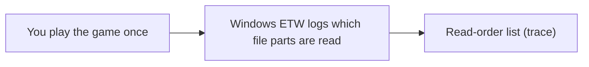
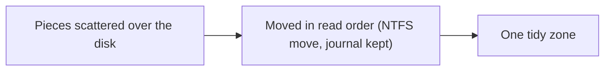
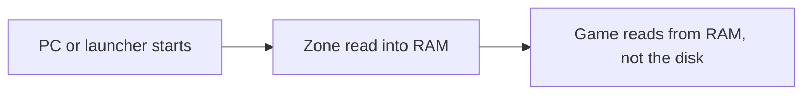

**English** | [한국어](README.ko.md)

<p align="center"></p>

<h1 align="center">AsterCache</h1>

<p align="center">A Windows desktop utility that brings load times of games installed on an HDD closer to SSD speeds</p>

<p align="center">
  <a href="LICENSE"></a>
  
  
  <a href="https://github.com/DO0OG/AsterCache/actions/workflows/csharp-ci.yml"></a>
  <a href="https://github.com/DO0OG/AsterCache/actions/workflows/kernel-build.yml"></a>
</p>

> **Beta.** AsterCache is distributed as a beta pre-release. It physically moves file data, so back up drives that hold important data before using it. Validation covers one SMR drive (WD20EZAZ) and one real game (Frostpunk); CMR drives and anti-cheat games have not been tested (see [Known limitations](#known-limitations)).

## Table of contents

- [What it does](#what-it-does)
- [How it works](#how-it-works)
- [Features](#features)
- [Measured results](#measured-results)
- [Screenshots](#screenshots)
- [System requirements](#system-requirements)
- [Getting started](#getting-started)
- [Automatic mode](#automatic-mode)
- [Configuration](#configuration)
- [Safety measures](#safety-measures)
- [Anti-cheat compatibility](#anti-cheat-compatibility)
- [Known limitations](#known-limitations)
- [Troubleshooting](#troubleshooting)
- [Project layout](#project-layout)
- [Development](#development)
- [License](#license)
- [Disclaimer](#disclaimer)

## What it does

AsterCache helps games installed on a hard disk (HDD) load faster. It watches what a game reads while it loads, puts those pieces side by side in one place on the disk, and loads them into RAM before you start the game. It does not change your game files and does not copy them to another drive. Once it is installed you do not have to do anything: it works in the background (see [Getting started](#getting-started)).

The figures in this document are replay times of recorded read patterns of one real game on one drive, not total load times of a running game. See [Measured results](#measured-results) and [VALIDATION_REPORT.md](VALIDATION_REPORT.md) for details.

## How it works

### The problem

A hard disk reads data with a moving head, like the arm of a record player. Every time the head has to jump to another spot, it waits. A game that loads a level reads thousands of pieces that are spread all over the disk, so the head spends most of its time jumping instead of reading.

Think of a library. Fetching a few hundred books from shelves all over the building takes a long time. Taking the same books from one cart, already stacked in the order you need them, is fast. AsterCache builds that cart.

On the test drive, scattered reads ran at about 39 MiB/s, while one continuous read ran at 90~110 MB/s ([docs/RESULTS_SUMMARY.md](docs/RESULTS_SUMMARY.md)). Other drives will differ.

### Part 1: Trace

AsterCache watches the game once while it loads and writes down which parts of which files it reads, and in what order. It uses Windows' own event tracing (ETW) for this. It never touches the game process.



### Part 2: Relocate

Using that list, AsterCache moves the pieces to one area of the disk, side by side, in the order the game reads them. File contents stay exactly the same. The move uses the official NTFS move function (the one disk defragmenters use), keeps a journal of every step, and can be reverted.



### Part 3: Prewarm

Before you start the game, for example when the PC boots or when your game launcher opens, AsterCache reads that whole zone into RAM (the file cache). When the game starts, it reads from RAM instead of the disk. If the zone was not prewarmed in time, AsterCache starts reading it in order the moment the game starts (read-ahead), which is still much faster than the scattered original.



### The result

In the measurement (Frostpunk, a 2 GB set of data read while loading the first map, on an SMR HDD), replaying the recorded reads took 24 s with nothing done, about 12 s after relocation plus read-ahead, and about 0.5 s after prewarm; the same reads on an NVMe SSD, cold, took 3.8 s. Prewarm itself needs about as long as the read-ahead, so it helps most when it finishes before you start the game. These are single-game, single-drive replay times, not full game load times.

### What AsterCache does not do

- It does not change the content of your game files. A SHA-256 check before and after each move confirms this.
- It does not touch the game process: no injection, no hooking, no driver.
- It does not copy your game to an SSD.
- RAM is used only for prewarm, and only when enough memory is free (at least the zone size plus 4 GB by default). Prewarmed data is ordinary file cache, which Windows can drop when programs need the memory.

## Features

- **Drive list.** Shows HDD/SSD type, capacity, model, and the number of registered games.
- **Game registration.** Set the game name, exe name, install folder, allowed folders, and volume label, and specify a prewarm trigger program.
- **Trace capture.** Run the game once and load up to the first map; the read blocks are recorded with a live ETW session (administrator rights required).
- **Plan, relocate, revert.** Builds a layout plan from the trace and applies it. The apply journal can be replayed in reverse to return to the previous layout.
- **Prewarm.** Runs automatically (on service start, or when a trigger program launches) or on demand with "Prewarm now".
- **Automatic mode (on by default).** Finds HDD games from supported launcher libraries and by game-start detection, traces them on their first run, and relocates them while the PC is idle. See [Automatic mode](#automatic-mode).
- **Service.** Detects game launches to run concurrent prefetch, and manages prewarm and re-apply. Runs as a Windows service (LocalSystem, automatic start).
- **Status and logs.** Tabs show service and watcher state, the last prewarm result, per-game layout state, and logs.
- **Measurement.** Measures cold replay time per game before and after relocation.
- **Management window.** Without administrator rights a banner appears at the top, and you can relaunch as administrator.
- **Command line `aster`.** Runs the same operations as the management window as commands, for automation.
- **English and Korean UI.** The management window and the CLI support both languages (see [Language](#language)).

## Measured results

The figures are replay times of traced read patterns, not total load times of a running game.

| Target | Measurement | Result |
|---|---|---|
| Synthetic dataset 2.1 GiB | HDD cold read → prefetch after relocation | 17.1 s → 1.14 s (holds 10 hours after relocation) |
| Synthetic dataset 2.1 GiB | SSD cold read under the same conditions | 0.76~1.22 s |
| Frostpunk, 2.02 GB read while loading the first map | HDD cold replay → concurrent prefetch after relocation | 24.3 s → 11.93 s (median of 3, see note) |
| Frostpunk | Replay after prewarm | 0.48 s |
| Frostpunk, same read pattern | NVMe SSD cold replay | 3.8 s |
| Service | Game start detection latency (polling, p95) | 58 ms |

- The HDD is a WD20EZAZ (SATA, D:) and the SSD is NVMe (C:). The test machine runs Windows 11 Pro 10.0.26200 with 32 GiB of memory.
- The Frostpunk results come from tracing one game once and replaying it. There are no p50/p95 figures for repeated loads yet.
- The SSD value for the synthetic dataset and the NVMe value for Frostpunk use different data and methods, so do not compare them directly.
- For prewarm to beat an SSD cold read, prewarm must finish at least 15 s before the game starts. Memory pressure reduces the effect.
- The 11.93 s value is from the E6 experiment: the relocation now moves all hot data into one zone by default (preservation off), instead of keeping segments of 8 MiB or more in place. The earlier value was 15.1 s. See [docs/research_cold_limit.md](docs/research_cold_limit.md).
- More tables and interpretation are in [docs/RESULTS_SUMMARY.md](docs/RESULTS_SUMMARY.md) and [VALIDATION_REPORT.md](VALIDATION_REPORT.md).

## Screenshots

The management window (Games tab) and the Status tab. They were produced with `AsterCache.Tray.exe --smoke --screenshot <png>`, so the drive and game information is sample data.

<p align="center"></p>
<p align="center"></p>

## System requirements

- Windows 11 x64. The validated environment is Windows 11 Pro 10.0.26200.
- Building from source requires the .NET 10 SDK. The repository's `csharp/global.json` uses SDK 10.0.400 (latestPatch).
- Trace capture (ETW), relocation (`apply`, `revert`), and service installation require administrator rights.
- The relocation target must be an NTFS volume. Comparing origin against cache requires two different physical devices.

## Getting started

### 1. Install

1. Open [GitHub Releases](https://github.com/DO0OG/AsterCache/releases) and download `AsterCache-v<version>-win-x64-setup.exe` (pre-release, for example v0.9.0-beta.2).
2. Run it and choose a language (English or 한국어).
3. Keep the default choices (desktop and Start menu shortcuts, start with Windows, install the service) and click Next until it finishes.

Prefer no installer? The same release has a zip, `AsterCache-0.9.0-beta.2-win-x64.zip`. Extract it, run `AsterCache.Tray.exe` as administrator, and install and start the service from the Settings tab.

Running a newer installer upgrades the existing installation. Uninstalling removes the program and the service but keeps the data folder `%ProgramData%\AsterCache`. The installer is not code-signed, so Windows SmartScreen may show a warning.

### 2. That is all: automatic mode

After installing, you have nothing else to do. [Automatic mode](#automatic-mode) is on by default. This is what happens over time:

| When | What AsterCache does |
|---|---|
| Right after install | The background service starts. |
| About 1 minute later (then every 6 hours) | It looks through your Steam, Epic, GOG, and Ubisoft libraries and registers games installed on an HDD. |
| The first time you play a registered game | It records what the game reads (the trace). The game loads at its normal speed this time. |
| After you quit the game and the PC has been idle for 3 minutes | It moves the game's pieces into one zone, one game at a time. This takes a few minutes (about 5 minutes per 2 GB). If you start a game meanwhile, it pauses and continues later. |
| From then on, every time the PC starts or the launcher opens | It prewarms the zone into RAM. |
| From the second launch | The game loads faster. |

"Idle" means little disk activity, low CPU use, and AC power (or a battery at 50 % or more). To see which stage each game is in, open the management window (tray icon, or the desktop shortcut) and look at the **Status** tab and the stage column of the **Games** tab.

### 3. Doing it by hand (optional)

Use this if you want to control each step, or to try a game that automatic mode skipped. Start the management window as administrator, open the **Games** tab, and work through the buttons in this order.

| Step | Button | What it does |
|---|---|---|
| 1 | Register | Add the game by choosing its exe file. |
| 2 | Collect trace | Run the game, load up to the first map, and quit. This records the read order. |
| 3 | Create plan | Decide where the pieces should go. |
| 4 | Apply relocation | Move the pieces. A journal is kept. |
| 5 | Prewarm now | Load the zone into RAM right away. |
| 6 | Measure | Time one read of the zone. |

The same steps are available on the command line (`aster`), for example:

```bat
aster discover
aster trace --live --exe Frostpunk.exe --origin-root D:\Games\Frostpunk --out trace.json --seconds 180
aster plan --trace trace.json --origin-root D:\Games\Frostpunk --zone-mib 1536 --out plan.json
aster apply --plan plan.json --allowed-root D:\Games --require-volume-label GAMES --dry-run
aster apply --plan plan.json --allowed-root D:\Games --require-volume-label GAMES --execute
aster prewarm --plan plan.json --origin-root D:\Games\Frostpunk
```

- `discover` lists the games found in your launcher libraries, read only.
- Run `trace --live` and `apply --execute` from an administrator PowerShell.
- `--dry-run` moves nothing and only shows the plan. If `--require-volume-label` does not match the actual volume label, nothing is moved.
- `--zone-mib` is an example value; set it to fit the game's hot data size. The global option `--lang ko|en` sets the output language (see [Language](#language)).
- Every command and option is described in [csharp/README.md](csharp/README.md).

### 4. Turning it off and reverting

- **Turn off automatic mode.** In the **Settings** tab, clear **Use automatic mode** and click **Apply automatic mode**. Or set `"auto": {"enabled": false}` in `%ProgramData%\AsterCache\config.json`. To exclude one game, add its exe to `auto.ignore_exes`. See [Automatic mode](#automatic-mode).
- **Put a game back.** On the **Games** tab, select the game and click **Revert**. It follows the journal and restores the previous disk layout; the file contents never changed.
- **Uninstall.** Use Windows' Installed apps. Your data folder `%ProgramData%\AsterCache` stays; it is deleted only if you run `cs_service.ps1 -Action uninstall -PurgeData`.

### FAQ

**Does it work for games installed on an SSD?**
No. It only targets games on an HDD. Games on an SSD or on the Windows system drive are skipped, because an SSD does not need it.

**Is it safe with anti-cheat games?**
AsterCache never touches the game process; it only reads files from its own process, watches file reads with Windows event tracing, and moves files after the game has exited. But it has not been tested with any anti-cheat game yet. For such a game, turn automatic mode off or add the game to `auto.ignore_exes` first. Details are in [Anti-cheat compatibility](#anti-cheat-compatibility).

**How much RAM does it use?**
About the size of the zone, which is the game's recorded read set (up to 2 GiB by default). Prewarm runs only when at least 4 GB of RAM would still be free afterwards, and Windows can reclaim the cache when your programs need the memory.

**What happens after a game update?**
A patch can change files, so a saved plan may no longer match them. AsterCache checks the plan before moving anything and skips files that changed, and every 5 minutes (while the game is off) it re-applies the plan if the layout has fallen apart. After a big patch, run Collect trace, Create plan, and Apply relocation again. This has not been tried with a real game update yet.

**Does it matter whether my drive is SMR or CMR?**
Only one SMR drive (WD20EZAZ) has been measured; CMR drives have not. Removing head movement should help both kinds, but that is not verified. SMR drives can write slowly during the one-time move.

**Will the very first launch be faster?**
No. The first launch is used to record what the game reads, and the move happens afterwards. The speed-up starts with the second launch. A game found only by activity detection (not from a launcher library) starts recording on its next launch.

**Can my files get damaged?**
Every move is verified with a SHA-256 check and written to a journal that can be reverted. Still, this is a beta that moves real data: back up important drives first. See [Safety measures](#safety-measures).

## Automatic mode

Automatic mode is on by default. In the usual case you do not need to register games or set anything. Each part can be turned off in the **Automatic mode** group of the Settings tab, or in `config.json`.

### Stages

1. **Discovery.** One minute after the service starts, and every 6 hours after that, the service reads the libraries of the supported launchers (below). A game installed on an HDD (rotational volume) is registered with `"source": "auto"`. A game is skipped if its volume label is empty or longer than 32 characters (a log line is written), or if its exe name or an overlapping folder is already registered. The list holds up to 32 games. When it is full, launcher discovery stops, and a game that is actually run and detected replaces the least recently used automatic entry.
2. **Trace.** When a registered game without a trace starts, the service records its reads with a live ETW session named `AsterCacheAutoTrace`. Recording stops at the first of: the game exiting, 600 seconds (`trace_cap_seconds`), or 6144 MiB (`trace_cap_mib`). The result is saved as `plans\<name>.trace.json`, the same file that the manual **Capture trace** button writes. A game detected at its start has already begun loading, so its trace is recorded from the next run.
3. **Plan and relocation.** After a trace exists, the game is not running, and the PC has been idle for `idle_minutes` (default 3) in a row, the service handles one game at a time. It plans the zone (hot data × 1.1, capped by `max_zone_mib`), moves the data with the same Applier as manual relocation (journal and SHA-256 sample check), and confirms the layout. Idle means: throughput on the game's drive below 4 MiB/s, CPU below 20 %, and either AC power or a battery at 50 % or more. At most `max_relocations_per_day` (default 2) relocations run in 24 hours, and each game gets one automatic first relocation; later upkeep uses the existing periodic check. If a game starts during a move, the move stops after the current fragment and resumes later from the journal. If the data check fails or an error occurs while the game is off, the journal is used to revert, and the failure is recorded.
4. **Prewarm.** At service start, the most recently played game is prewarmed (`prewarm_recent`, default 1). When a supported launcher starts, its most recently played `prewarm_recent` games are prewarmed. To keep the prewarm, every `rewarm_minutes` (default 10; 0 turns it off) the service reads 1 MiB from each of 8 places in the zone. If the average takes more than 2 ms, the data has probably been evicted from the file cache, so it prewarms again while keeping `min_free_ram_mib` free. It does not run while a game is running.
5. **Pinning (optional).** With `prewarm.pin` set to `true` (off by default; works only with 16 GiB of RAM or more), the prewarmed pages stay open as read-only mappings in the service, so they are less likely to be evicted. The mappings are released at once when free RAM falls below the reserve or when a game or launcher starts, so launcher updates can change the files. A prewarm started by a trigger program is not pinned. The effect of pinning has not been measured yet.

### Supported launchers

| Launcher | How the game list is read | Prewarm trigger for auto-registered games |
|---|---|---|
| Steam | `libraryfolders.vdf` and `appmanifest` files. The executable is the largest `.exe` in the game folder, excluding installers, redistributables, and crash tools | `steam.exe` |
| Epic Games Store | `LaunchExecutable` in `%ProgramData%\Epic\EpicGamesLauncher\Data\Manifests\*.item` | `EpicGamesLauncher.exe` |
| GOG Galaxy | Registry `HKLM\SOFTWARE\WOW6432Node\GOG.com\Games` | `GalaxyClient.exe` |
| Ubisoft Connect | Registry `Launcher\Installs`, value `InstallDir` | `upc.exe`, `UbisoftConnect.exe` |

The GOG and Ubisoft readers have not been checked on a real PC yet.

Not supported for discovery: Battle.net, EA app, Riot Client, and Xbox (PC Game Pass). Games from these, and games installed without a launcher, are found only by the heuristic below. `Battle.net.exe`, `RiotClientServices.exe`, and `EADesktop.exe` are listed only as prewarm trigger programs; the service does not read their libraries.

### Heuristic detection

A process that is not registered, starts from an exe on an HDD volume, and reads 256 MiB or more within 20 seconds is treated as a game and registered. Excluded: the Windows folder, AsterCache itself, launchers and tool programs, and the exes in `auto.ignore_exes`. Because the start was already missed, the first trace is recorded from the next run.

### Settings

```json
{
  "max_zone_mib": 2048,
  "auto": {
    "enabled": true,
    "discover": true,
    "trace": true,
    "relocate": true,
    "prewarm_recent": 1,
    "idle_minutes": 3,
    "trace_cap_seconds": 600,
    "trace_cap_mib": 6144,
    "max_relocations_per_day": 2,
    "rewarm_minutes": 10,
    "ignore_exes": []
  }
}
```

- `"auto": {"enabled": false}` turns off the whole automatic mode. `discover`, `trace`, and `relocate` turn off one stage each. `max_zone_mib` can also be `"auto"`.
- The manual buttons (register, capture trace, create plan, run relocation, prewarm now) work as before.
- The service writes its state to `%ProgramData%\AsterCache\auto_status.json`. Only the service writes that file.
- The Status tab shows one line per game, such as "Auto: Frostpunk discovered → collecting trace → waiting to relocate → relocating → [done]". The Games tab shows the source, stage, and anti-cheat columns. Tray notifications are sent only for discovery and for a finished relocation.
- `aster status` has an `"auto"` key. `aster discover [--json]` lists the launcher games read-only, with the anti-cheat marker.
- A game you registered by hand is also relocated automatically when `auto.relocate` is on, once its trace exists and the PC is idle. To prevent this, turn off `auto.relocate` (in the Settings tab of the management window, clear the Relocate box) or add the game's exe to `auto.ignore_exes`.
- Games on the Windows system drive and on SSDs are not automatically registered, traced, or relocated.
- A game you removed in the management window has its exe added to `auto.ignore_exes`, so it is not registered automatically again. The list holds up to 64 exes; when it is full, the oldest entries are dropped.
- The daily limit `max_relocations_per_day` counts 24 hours from the start of each relocation.
- If an automatic relocation fails, its journal reverts only that automatic change.

### Effect

The speed effect of automatic mode has not been measured yet. When results exist, they will be added to [docs/RESULTS_SUMMARY.md](docs/RESULTS_SUMMARY.md).

## Configuration

The configuration file is `%ProgramData%\AsterCache\config.json`. Editing it in the management window is recommended. When editing by hand, write JSON backslashes as `\\`.

```json
{
  "language": "auto",
  "watcher": "poll",
  "games": [
    {
      "name": "frostpunk",
      "exe_names": ["Frostpunk.exe"],
      "trace": "C:\\ProgramData\\AsterCache\\plans\\frostpunk.prefetch.json",
      "plan": "C:\\ProgramData\\AsterCache\\plans\\frostpunk.plan.json",
      "origin_root": "D:\\Games\\Frostpunk",
      "allowed_roots": ["D:\\Games"],
      "volume_label": "GAMES",
      "max_stream_mib": 4096,
      "prewarm": {
        "on_service_start": true,
        "trigger_exes": ["Steam.exe"],
        "min_free_ram_mib": 4096,
        "cooldown_min": 30
      }
    }
  ]
}
```

| Key | Meaning |
|---|---|
| `language` | UI language. `auto` (default), `ko`, or `en`. `auto` follows the Windows display language and falls back to English unless it is Korean. |
| `watcher` | How game starts are detected. `poll` (default) or `etw`. `etw` requires administrator rights and falls back to polling if it fails. |
| `games[].name`, `exe_names` | Game name and list of executable names |
| `trace`, `plan` | Paths to the trace file and plan file |
| `origin_root` | Game install folder |
| `allowed_roots` | Folders where relocation is allowed |
| `volume_label` | Label of the target volume. If it differs, nothing is relocated. |
| `max_stream_mib` | Upper limit of what one stream or prewarm reads (default 4096) |
| `prewarm.on_service_start` | Run prewarm when the service starts (default `true`) |
| `prewarm.trigger_exes` | Run prewarm when one of these programs starts (for example a launcher). Empty by default |
| `prewarm.min_free_ram_mib` | Available RAM to leave free even after prewarm (default 4096) |
| `prewarm.cooldown_min` | Minimum interval between prewarms (default 30 minutes) |
| `auto` | Automatic mode settings. Omitted keys take their defaults. See [Automatic mode](#automatic-mode). |
| `max_zone_mib` | Upper limit of the zone size for automatic planning, in MiB (default 2048), or `"auto"` (physical RAM ÷ 4, between 2048 and 8192 MiB) |
| `games[].source` | `auto` for a game found automatically, `manual` for a game you registered |
| `games[].anticheat` | Anti-cheat folders found in the install folder, for example `EasyAntiCheat`. Shown in the Games tab; it does not change behavior |
| `prewarm.pin` | Keep prewarmed data open as read-only mappings in the service. Default `false`; works only with 16 GiB of RAM or more. See [Anti-cheat compatibility](#anti-cheat-compatibility) |

The service re-reads the whole `config.json` every 5 seconds (when its size or modified time changes), so adding, removing, or changing games and the watcher takes effect without a restart. If the new configuration fails validation or the folder permission check, the previous settings stay in force and the reason is written to the log.

### Language

The management window and the `aster` CLI are available in Korean and English.

- The language is chosen by `"language"` in `config.json`: `"auto"` (default, follows the Windows display language and uses English unless it is Korean), `"ko"`, or `"en"`. You can also change it in the **Language** item on the management window's Settings tab.
- The CLI accepts the global option `--lang ko|en` and the environment variable `ASTER_LANG`. Priority: `--lang` > `ASTER_LANG` > `config.json` > OS language.
- JSON output does not depend on the language.

## Safety measures

- **Content verification.** SHA-256 is compared before and after relocation. If the content differs, it is recorded as a failure.
- **Journal and revert.** A journal (JSON Lines) is written for every moved fragment, and `revert` returns to the previous physical layout. The data content does not change.
- **Allowed folders and volume pinning.** Files outside `allowed_roots` and volumes whose label differs from `volume_label` are not touched.
- **Interruption handling.** If a game starts during relocation, only the fragment currently being moved is finished and then it stops. A resume point is left in the journal, and the same plan continues after the game exits.
- **Data folder permissions.** Only SYSTEM and Administrators can write to `%ProgramData%\AsterCache`; ordinary users can only read. Uninstalling the service leaves the data folder; it is deleted only when you explicitly pass `cs_service.ps1 -Action uninstall -PurgeData`.
- **Permission check.** Without administrator rights, relocation and revert change nothing and end with `not_admin`.

## Anti-cheat compatibility

Many current games run kernel-level anti-cheat. This section says what AsterCache does and does not do, so you can decide whether to use it with a game. Anti-cheat policies differ per game and can change. AsterCache has not been tested with any anti-cheat game yet.

### What it does

- The service reads game files from inside its own process, read-only, with shared access (read, write, and delete sharing), or only maps them.
- It watches file-read events with a live ETW kernel session. It needs no handle to the game process.
- It moves file clusters with the NTFS defragmentation API (`FSCTL_MOVE_FILE`), and only after the game has fully exited. File content, size, and modified time do not change. Before a move, the plan's fingerprint (size and modified time) is checked.

### What it does not do

- No code injection, no thread creation in the game process, no reading or writing of its memory, no debug privilege, no hooking, no overlay, and no handle duplication.
- Game processes are opened only with `PROCESS_QUERY_LIMITED_INFORMATION`, to read the name, path, and bytes read. If a protected process refuses even that, the service decides from ETW events alone and does not try to open that process again. In that case it judges from the reads in the 20 seconds after the refusal is confirmed; reads before those 20 seconds are not counted.
- No kernel driver.

### Skipped and marked files

- Files that the game has opened exclusively are skipped.
- During automatic discovery, the service looks at file and folder names up to 4 levels deep in the install folder. It recognizes EasyAntiCheat, BattlEye, Vanguard (`vgc`, `vgk`), and Ricochet; other names containing anticheat, xigncode, nprotect, or gameguard are marked `unknown`. A game with such a name is marked in the Games tab and in the `anticheat` setting, and one log line is written. The behavior does not change. On the test PC, `aster discover` marked The Outlast Trials (Steam) with `eac`.

### Why each speed feature is considered safe

These are the reasons each feature is considered safe. They are reasoning, not verified results.

- **Prewarm:** reads ordinary files from the service's own process.
- **Prewarm upkeep:** samples ordinary 1 MiB file reads.
- **Pinning:** read-only mappings in the service's own process, released when a game or launcher starts.
- **Relocation:** runs only after the game has exited, and file content does not change.
- **Detection:** a query-only process handle, or ETW events.

### Signing

The executables are not code-signed, so Windows SmartScreen may show a warning. That warning is the only effect confirmed so far. Whether signing status relates to anti-cheat decisions has not been checked.

### Limits and advice

- Automatic mode is on by default. For a game with anti-cheat, turn automatic mode off in the Settings tab, or add the game's exe to `auto.ignore_exes`, before you play.
- Automatic tracing uses the same kind of ETW collection as the manual route, so the Ricochet and Vanguard cautions in [GAME_GUIDE](docs/GAME_GUIDE.md) still apply.
- Not yet tested on any real anti-cheat game. This is outside the current validation.

## Known limitations

- This is not a driver or file system filter. It does not intercept the game's I/O path. The kernel minifilter (`kernel/`) has been through source, build, static analysis, and INF verification, but it has not been signed, loaded, or tested on real hardware, and it is not included in the release. Automatic warm-up right after boot is handled by the user-mode service. See [kernel/README.md](kernel/README.md).
- Tracing records only reads that went to disk. Reads that were already in the cache may be missed.
- Only one real game, Frostpunk, has been measured. Anti-cheat games (MW4, LoL, and so on) have not been validated.
- Persistence was confirmed up to 10 hours after relocation. Beyond 24 hours has not been measured.
- Measured on a single SMR drive (WD20EZAZ). CMR drives have not been measured.
- The cold condition was produced by clearing the standby list with administrator rights. The drive's internal cache was not cleared.
- Relocation actually moves files, so the first run takes a long time. The gain shows up in repeated loads after relocation.
- Power loss, SSD damage, BitLocker, and DirectStorage environments have not been tested.
- Release binaries are not code-signed, so Windows may show an unsigned-publisher warning.
- If only the tray is updated, the service stays on the old version. The tray shows the version mismatch, and you must reinstall the service with the installer.
- Apps other than games in the Steam library, such as Wallpaper Engine or YoloMouse, can be registered automatically when they are on an HDD. To avoid this, add their exe to `auto.ignore_exes` or remove the game on the Games tab.
- Automatic tracing may miss some of a game's first reads before its session starts. Automatic tracing and automatic relocation have not yet been run with a real game; only tests in a simulated environment have been done.

## Troubleshooting

**It says you do not have permission to save settings.**
The data folder is writable only by administrators. Relaunch the management window as administrator.

**I added or removed a game but it was not applied.**
The service re-reads `config.json` every 5 seconds, so this normally applies without a restart. If the new configuration fails validation or the folder permission check, the previous settings stay in force and the reason is written to the log.

**The tray shows "Service reinstall required".**
A tray update does not replace the service executable. Reinstall the service with the installer.

**A relocation command ends with `not_admin`.**
Run relocation, revert, and volume commands from an administrator PowerShell.

**Prewarm did not run.**
The reason it was skipped is recorded in `service.log`. Typical causes are insufficient available RAM, the game already running, an active cooldown, or a missing plan file. You can also check the `prewarm` entry of `aster status`.

## Project layout

- `csharp/` — the final C# implementation: command-line tool `aster`, service, management window, installer script, and tests
- `kernel/` — source of the AsterFlt kernel minifilter. Experimental; it is not loaded.
- `prefetch/`, `relayout/`, `bench/` — Python reference implementation (prefetch, relocation, and measurement tools). It is the cross-validation baseline for the C# code. For commands and layout see [docs/PYTHON_TOOLS.md](docs/PYTHON_TOOLS.md).
- `scripts/` — experimental administrator PowerShell scripts for the reference implementation
- `docs/` — design documents, game guide, and results summary
- `tests/` — unit and regression tests of the Python reference implementation
- `results/` — measurement result JSON and logs
- `.github/workflows/` — C# build and test workflows and the kernel build workflow
- `*.py` in the root — older versions, the SQLite cache reference implementation, and test and measurement scripts
- `VALIDATION_REPORT.md` — validation report

## Development

### Build from source

Publish the three executables with the .NET 10 SDK. The output goes under `csharp\publish\` and is ignored by Git.

```bat
dotnet publish csharp\src\AsterCache.Cli\AsterCache.Cli.csproj -c Release -r win-x64 --self-contained -o csharp\publish\cli
dotnet publish csharp\src\AsterCache.Service\AsterCache.Service.csproj -c Release -r win-x64 --self-contained -o csharp\publish\service
dotnet publish csharp\src\AsterCache.Tray\AsterCache.Tray.csproj -c Release -r win-x64 --self-contained -o csharp\publish\gui
```

- `csharp\publish\cli\aster.exe` is the command-line tool.
- `csharp\publish\gui\AsterCache.Tray.exe` is the management window.
- Install the service from an administrator PowerShell.

```powershell
csharp\scripts\cs_service.ps1 -Action install
```

### Build the installer

The release workflow attaches the installer `.exe` to the GitHub release. The installer's defines are listed in [csharp/README.md](csharp/README.md). To build it yourself:

```bat
ISCC.exe /DAppDir=<gui publish path> /DAppVersion=<version> csharp\packaging\windows\aster.iss
```

### Build and test

```bat
dotnet build csharp/AsterCache.sln -c Release
dotnet test csharp/AsterCache.sln -c Release --filter "Category!=Live"
dotnet format csharp/AsterCache.sln --verify-no-changes
py -3.12 -m unittest discover -s tests
```

- `Category=Live` tests need `D:\AsterBench` and the Python reference implementation, so they are excluded above.
- The Python reference implementation requires Python 3.11 or later and has no external packages. It was validated on Python 3.11.4 and 3.12.10. For commands and layout see [docs/PYTHON_TOOLS.md](docs/PYTHON_TOOLS.md).

## License

MIT License. See the [LICENSE](LICENSE) file for details. Copyright (c) 2026 DO0OG.

## Disclaimer

- It has not been validated on games with anti-cheat or games tied to online accounts.
- Relocation actually moves file data. Back up before using it on a drive that holds important data, and try it on a test folder first.
- Provided without warranty under the MIT license. The measurements are results from a single PC.
