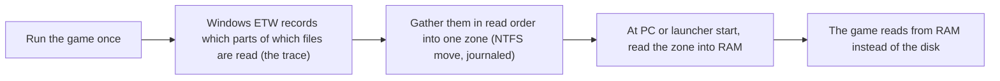
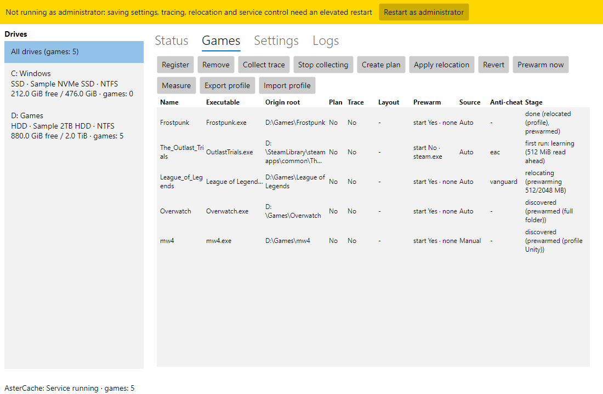
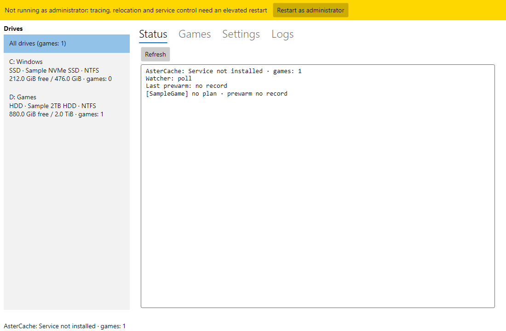
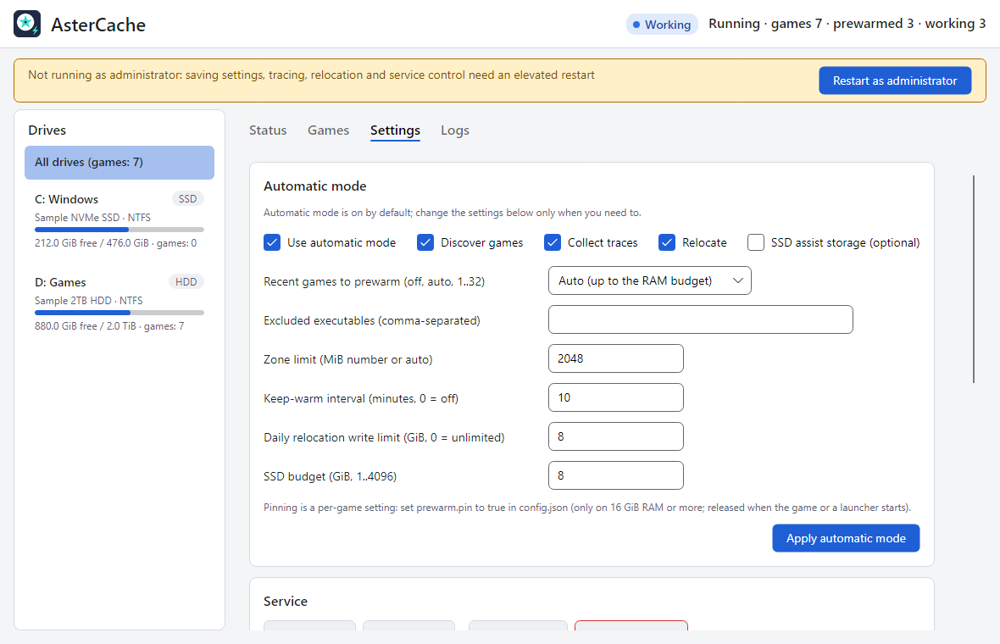
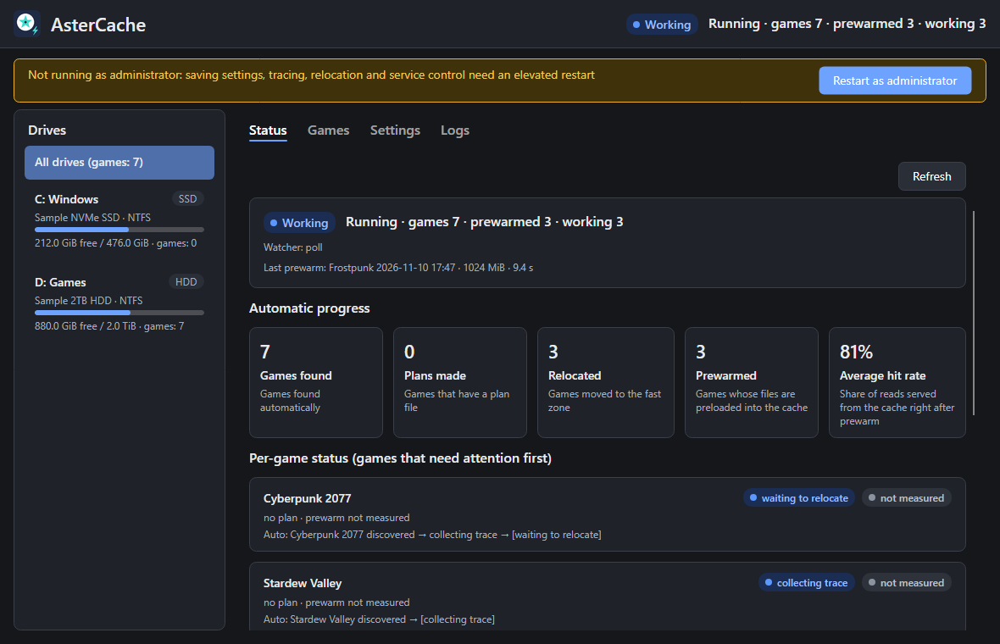

**English** | [한국어](README.ko.md)

<h1 align="center">AsterCache</h1>

A Windows desktop utility that aims to shorten load times of games installed on an HDD

  
  
  
  
  

> **Read before use.** AsterCache physically moves file data, so back up drives that hold important data before using it. Validation covers one SMR drive (WD20EZAZ) and one real game (Frostpunk); CMR drives have not been tested. Anti-cheat games have only usage records from one PC and no controlled validation ([Anti-cheat compatibility](docs/ANTICHEAT.md)).

## What it does

AsterCache is meant to shorten the loading of games installed on a hard disk (HDD). It watches what a game reads while it loads, puts those pieces side by side in one place on the disk, and loads them into RAM before you start the game.

- It does not change your game files, and does not copy them to another drive (the optional SSD assist storage, off by default, is the one exception).
- After installing, there is nothing you have to do. It works in the background.
- The tray window shows a summary of each game's last play. It is disk read statistics, not a load-time or frame measurement. A diagnostics ZIP can be exported for support; it stays on your PC.
- While a game runs, the play record also keeps the frame interval (stutter). It opens no game process: an ordinary ETW session receives only the `Microsoft-Windows-DXGI` Present start event and the service totals it per second; `play.series` also writes one line per second (frame values, CPU, memory, graphics memory, disk) to a file per play. The session is not opened for a game whose anti-cheat blocks automatic tracing, and `play.frame_times` turns it off. Only DirectX games can be measured, and its behavior in a real game and next to anti-cheat has not been checked. See the [anti-cheat page](docs/ANTICHEAT.md).
- The measured figures in this document are replay times of recorded read patterns, not total load times of a running game.

## Who it is for

**A good fit**
- Games installed on an HDD (NTFS) that you launch again and again, on Windows 11 x64.
- A PC with spare RAM. Validation used 32 GiB; prewarm leaves 4 GiB (4,096 MiB) free by default.

**Not a good fit, or no gain**
- Games on an SSD are skipped. A game on an HDD that is also the Windows system drive is only prewarmed, not relocated.
- The first real play of a game is mostly recorded. The full effect is expected from the second launch; before that, a prewarm without a record, or the game's Windows prefetch record used in place of a trace, may help, but no effect on real loading time has been measured.
- Reads that were not recorded (another level or mode, texture streaming during play) are not helped.
- Games with anti-cheat: no guarantee is made about account sanctions. Read [Anti-cheat compatibility](docs/ANTICHEAT.md) first.

## Getting started

### 1. Install

Requirements: Windows 11 x64 and an NTFS game drive. Installing the service, tracing, and relocation need administrator rights.

1. Open [GitHub Releases](https://github.com/DO0OG/AsterCache/releases) and download `AsterCache-v<version>-win-x64-setup.exe` (the latest release).
2. Run it and choose a language (English or 한국어).
3. Keep the default choices (desktop and Start menu shortcuts, start with Windows, install the service) and click Next until it finishes.

Prefer no installer? The same release has a zip, `AsterCache-<version>-win-x64.zip`. Extract it, run `AsterCache.Tray.exe` as administrator, and install and start the service from the Settings tab.

Running a newer installer upgrades the existing installation. Uninstalling reverts any SSD assist links first, then removes the program and the service, but keeps the data folder `%ProgramData%\AsterCache`. The installer is not code-signed, so Windows SmartScreen may show a warning. Building from source: [docs/DEVELOPMENT.md](docs/DEVELOPMENT.md).

### 2. Use it: there is nothing to press

[Automatic mode](docs/AUTO_MODE.md) is on by default. Play as usual:

| When | What AsterCache does |
|---|---|
| Right after install, then every hour | Finds HDD games in your Steam, Epic, GOG, Ubisoft, and Riot libraries and the Windows uninstall list, and registers them. |
| First play of a registered game | Records what the game reads. This run is mainly for recording. |
| After you quit the game and the drive is idle | Moves the recorded pieces into one zone, a contiguous area of the disk (about 5 minutes per 2 GB), one game at a time, then prewarms that zone. Starting a game pauses the move. |
| Every PC start and launcher open | Prewarms the zone into RAM, within a RAM budget. |
| From the second launch | The full effect is expected (the effect on real loading time has not been measured). |

Before a first run, a small game's whole folder (or a large game's engine profile) is prewarmed without a record; the effect of that prewarm has not been measured.

To watch progress, double-click the tray icon and open the **Status** tab. To turn automatic mode off, put a game back, or run each step by hand, see [docs/USAGE.md](docs/USAGE.md). Questions and troubleshooting: [docs/FAQ.md](docs/FAQ.md).

### 3. Updates

The tray checks the official releases 5 minutes after it starts and then every 24 hours. By default (`update.mode` = `auto`) it downloads a newer installer, verifies its SHA-256, and installs it silently, but only when the tray runs with administrator rights from an installed copy, no registered game is running, and no relocation is in progress. Otherwise it only notifies you, or opens the release page. You can choose **Install automatically**, **Notify only**, or **Off** in the Settings tab's Updates section; prereleases are not included unless you turn that on. Program updates are handled by the tray; the service itself uses the network only to download the shared profile over HTTPS (about once a week, while automatic mode and `auto.shared_profiles` are on). The silent installation has not yet been confirmed on a real machine. See [docs/FAQ.md](docs/FAQ.md).

## How it works

A hard disk reads by moving a head to each location. A game that loads a level reads thousands of pieces spread all over the disk, so the head spends most of its time moving instead of reading. Reading the same data from one contiguous area, in the order it is needed, needs far less head movement and is faster. AsterCache builds that area. On the test drive, scattered reads ran at about 39 MiB/s and one continuous read at 90~110 MB/s ([docs/RESULTS_SUMMARY.md](docs/RESULTS_SUMMARY.md)); other drives will differ.

1. **Discover.** The background service finds HDD games from launcher libraries and by detecting game starts.
2. **Record.** On the first play, Windows event tracing (ETW) writes down which parts of which files the game reads, in what order. The game process is never touched.
3. **Relocate.** When the game is off and the drive is idle, the pieces are moved side by side into one zone of the disk, in read order, with the official NTFS move function (the one disk defragmenters use). File contents stay the same, and every step is journaled so it can be reverted.
4. **Prewarm.** At PC start or when the launcher opens, the zone is read into RAM (the file cache). The game then reads from RAM. If the prewarm was not done in time, the zone is read in order the moment the game starts, which is expected to be faster than the scattered original (that was measured on replays of recorded reads, not on real loading).
5. **Keep up.** The service re-prewarms if the cache went cold and restores the layout if it drifted (for example after a game update). It also touches the prewarmed cache again in memory, and while a game runs it holds the front of that cache as read-only mapped views in its own process, so those pages stay in the service's working set instead of on the standby list ([SOLAR](docs/SOLAR.md)).

**ORBIT: prewarm order adjustment.** For a game that has a recording, ORBIT calculates whether reading the prewarm in a different order, in segments of about 64 MiB, would help. Only the order changes, not the amount or the set of data read. The default mode is `active`; change it with `aster orbit mode off|shadow|active`. In the 2026-11-09 Call of Duty bench (one game, one drive, one session), the median value-weighted ready time fell 18.8%, but the worst-episode p95 (an episode is one load scenario, such as one map's loading) rose by 13.1 s, so it is too early to generalize. See [docs/ORBIT.md](docs/ORBIT.md).

**SOLAR: keeping the cache and its eviction order.** Prewarmed data is ordinary file cache. Windows reuses pages of the same priority in the order they entered its standby list, so the data a load needs first, which the prewarm reads first, would be the first to go. After a prewarm, SOLAR touches the cache the game has again, in the reverse of the read order and without reading the disk, so that the most important data is the last to be pushed out. It touches it again when Windows' standby-list statistics show that the pages that would be reused before it are being used up. If its time cap would hold that back while no game is running and a game's cache is close to being pushed out, it touches that game under a second, higher cap. If it finds a part missing, it leaves that to the next re-prewarm check. With several games, it touches the others first when one game is refreshed or when another game's prewarm is about to read, so that one game's reads do not push out another's cache, and it skips files with the sparse attribute. It is on by default (`memory.standby_ladder`) and does not run on a disk where a game is running, except for touching that game's own prewarmed cache at its start and while it runs. While the game runs, `memory.keep_hold` (on by default) also holds the front of that cache, up to 5 GiB, as read-only mapped views in the service process, so that Windows does not reuse those pages; the pages are not locked and are released when the available memory falls under 2 GiB. Nothing is held for a game whose anti-cheat forbids tracing. The experiments on the test PC show that the order can be set; what it does for load time or stutter in a real game has not been measured. See [docs/SOLAR.md](docs/SOLAR.md).

**What AsterCache does not do.**
- It does not change the content of your game files (a SHA-256 check before and after each move).
- It does not touch the game process: no injection, no hooking, no driver.
- It does not copy the game to an SSD by default. The optional SSD assist storage (off by default) copies selected hot files only; see [docs/AUTO_MODE.md](docs/AUTO_MODE.md).
- RAM is used only for prewarm and first-run read-ahead, within a budget (prewarm at most half of physical RAM, and only while free RAM stays above 4 GiB by default). Prewarmed data is ordinary file cache, which Windows can drop when programs need the memory.

## Effects on your hard disk, and cautions

This is a summary. The full guide is [docs/GAME_GUIDE.md](docs/GAME_GUIDE.md).

- **It writes to the game drive.** Relocation physically moves data. One automatic round writes at most 1 GiB on an SMR drive and 2 GiB on other drives. Per day the limit is 2 GiB on SMR and 8 GiB otherwise (`auto.max_relocate_gib_per_day`), and at most 4 relocations (`auto.max_relocations_per_day`). The first run of a relocation takes time; the gain shows in repeated loads.
- **It works only when the PC is idle.** The game must be off, the game drive under 4 MiB/s for 30 seconds, and the PC on AC power (or a battery at 50% or more). If a game starts during a move, only the fragment being moved is finished, then it stops and resumes later.
- **It also reads.** Prewarm reads the zone into RAM within the budget. A cache check reads 1 MiB from each of 8 places every 10 minutes. The reads that no game start, game exit, launcher, or service start asks for (the cache check, the supplement prewarm, the prewarm after a relocation, the automatic prewarm of a played game that has no play record) have a daily limit on each drive (`auto.idle_read_gib_per_day`; the default is meant to cap an unusually heavy day, not ordinary reading). A small 4 KiB read every 10 minutes keeps the HDD from spinning down while a launcher is open or at the hours you usually play (`auto.keep_awake`, on by default; Windows power settings are not changed). Background reads yield to a game running on the same disk, and prewarm reads lower their own I/O priority while other programs read the same disk. One exception: when a game starts a second registered program of its own (for example the main program after a launcher program), the blocks that program reads first are read right after it starts, at low I/O priority (the stage stream; `auto.stage_stream_enabled` turns it off). Its effect in real play has not been measured.
- **It asks other programs to give up memory.** While a registered game is running, programs that have nothing to do with the game have their memory priority lowered: to "very low" when they have not used the CPU or done I/O in the last minute, and to "below normal" when they have (the working set of a program in use is never emptied). Only when the available memory minus what the game is expected to take falls below a floor are the working sets of the idle ones emptied, largest first and only by the amount missing, so that Windows takes their memory before the prewarm cache. The priority is restored when the session ends. This is on by default (`memory.background_yield`) and also lowers their disk priority, including that of programs in use, so that their disk reads do not delay the game's (`memory.background_io_priority`) and can lower the CPU priority class of those that are at normal to below normal (`memory.background_cpu_priority`, off by default), and never touches game, launcher, or anti-cheat processes. Such a program can be slow for a moment when you use it again, and a program in use can be slower while memory is short, because Windows then takes its pages before the game's cache (`memory.background_in_use_memory_priority`). Programs that start during the game get the same priority change within about 3 seconds (their working set is not emptied then; `memory.background_yield_fast`). The effect in real play has not been measured. See [docs/AUTO_MODE.md](docs/AUTO_MODE.md#background-memory-yield).
- **It touches and holds the prewarmed cache.** SOLAR reads pages that are already in the file cache, in memory from the least important page to the most important one, so that the data a load needs first is the last to be reused from the standby list (it does not guarantee that the data stays). The re-touching does not read the disk on purpose (when it finds a part missing it stops and leaves that to the next re-prewarm check). Holding can read from the disk within caps: the first pass at most 32 MiB (it can pass it by up to one 16 MiB batch); holding again together with continuing the ranges the first pass did not take at most 1 GiB per play (a round of holding again asks for 16 MiB batches without looking at what is left of it, so each round can still read up to one such batch after it is used up; see [issue #355](https://github.com/DO0OG/AsterCache/issues/355)), only while the game is not loading and the drive queue is 0; the two-minute check at most 32 MiB per check, without a drive queue condition (while the loading judgment from the reads and graphics signals says the game is loading, 2 MiB; the check can pass these by the interval of its statistics reads, see [issue #355](https://github.com/DO0OG/AsterCache/issues/355)). If the number of disk reads of the process cannot be read for a batch, holding adds no further read from the disk in that play (what is held stays). The part that is not held is touched again in rounds while the game runs (keep rounds); these rounds read from the disk at most 8 MiB per round while they confirm and touch the most important ranges first, 32 MiB per round while they put the ranges back in order, and 8 MiB per round (64 MiB per play) while they look for ranges not yet confirmed to be in memory, and the blocks of sparse files, which cannot be held, are read again at most 512 MiB per play (`memory.keep_sparse`). The figures are in [docs/SOLAR.md](docs/SOLAR.md). It does not run on a disk where a game is running, except for the touch of that game's own cache at its start and while it runs. It is on by default (`memory.standby_ladder`). While a game runs, the service also holds the front of that cache as mapped views (`memory.keep_hold`, on by default; `memory.keep_hold_written_files` adds files the game writes when their history allows it), so Task Manager shows the service's memory larger by the held amount and the available memory smaller by it, and a write that shrinks a held file fails until the view is closed. The touch at game start, holding, and the keep rounds run only for a game whose start stream is allowed (`auto.start_stream_enabled` on and a policy that allows prewarm), and not on the run the service backs off after quick exits. The effect in real play is not established (see above). See [docs/SOLAR.md](docs/SOLAR.md).
- **If a game closes right after launch.** AsterCache does not stop it. It counts quick exits (a session shorter than 90 seconds by default), skips its extra work for one run when you start the game again within 10 minutes, and does so only once until a normal session resets the streak. From the second quick exit in a row, it lists the kernel drivers that have loaded since the last normal run, in the log, a tray pop-up, and the Status tab. A driver of another program can be the cause; the list is a clue, not a finding. See [docs/FAQ.md](docs/FAQ.md).
- **SMR drives write slowly.** After a relocation the service waits until the drive has recovered before the next job. Only one SMR drive has been validated; CMR drives have not.
- **Windows drive optimization may stay on.** Windows defragments HDDs on a weekly schedule, which can move pieces AsterCache placed. The service defers moving files while an optimization runs, and the default layout (`whole_file`; a `config.json` that the 1.0.6 tray saved has `ranges` written in it and keeps that layout until the `auto.relocate_layout` key is deleted) places each chosen file as one piece, which stayed in place on test files and one game after the optimization's defragmentation step (the state after its free-space consolidation step was not seen). If the layout drifts, the service restores it, which is another write. See [docs/GAME_GUIDE.md](docs/GAME_GUIDE.md).
- **Do not power off or sleep during a move.** Resume after interruptions was checked on a test volume; power loss during a move on real game data was not tested.
- **Not measured:** effects on drive lifespan, temperature, and noise.
- **Relocation can be reverted.** Select the game on the **Games** tab and click **Revert**; the journal restores the previous layout.

Safety checks, in short: SHA-256 comparison before and after each move; a journal for every moved fragment; files outside `allowed_roots` and volumes whose label differs from `volume_label` are never touched; `not_admin` and no change without administrator rights. Details: [docs/DEVELOPMENT.md](docs/DEVELOPMENT.md#safety-measures).

## Measured results

The synthetic dataset and Frostpunk figures are replay times of traced read patterns. The League of Legends and Call of Duty figures are a tally of the service log on one PC during real play (2026-11-02 to 2026-11-10), plus a read benchmark of the prewarm list. None of them is the total load time of a running game, and the usage-log rows are not a controlled benchmark.

| Target | Measurement | Result |
|---|---|---|
| Synthetic dataset 2.1 GiB | HDD cold read → prefetch after relocation | 17.1 s → 1.14 s (holds 10 hours after relocation) |
| Synthetic dataset 2.1 GiB | SSD cold read under the same conditions | 0.76~1.22 s |
| Frostpunk, 2.02 GB read while loading the first map | HDD cold replay → concurrent prefetch after relocation | 24.3 s → 11.93 s (median of 3, all hot data moved into one zone) |
| Frostpunk | Replay after prewarm | 0.48 s |
| Frostpunk, 1.9 GB loading read | HDD cold → SSD assist storage cold (warm) | 12.90 s → 2.81 s (warm 0.48 s) |
| Frostpunk, same read pattern | NVMe SSD cold replay | 3.8 s |
| Frostpunk-trace replica, scattered vs contiguous layout (2.02 GB) | Direct replay of the same read pattern, read-ahead off, median | Scattered 41.0\~55.3 s → contiguous 19.3\~20.5 s ([result folder](results/csharp_e7c_gen/README.md)) |
| League of Legends, prewarm target 8,182 MiB | RAM prewarm at launcher start (usage log, 1 run) | 8,173 MiB in 48.4 s (169 MB/s), hit rate right after prewarm 100% |
| Call of Duty, prewarm target 10,218 MiB | Hot set RAM prewarm (usage log, 7 runs) | 9,081\~10,217 MiB in 128\~416 s (median 249.8 s) |
| Call of Duty | Prewarm of the first 1,023 MiB at service start (usage log, 3 runs) | 34.7~40.7 s, hit rate right after prewarm 75% |
| Call of Duty, prewarm list about 9.5 GB | HDD cold read, before and after prewarm reordering (ABBA benchmark, median) | Total read about 326 s. Reordering cut value-weighted ready time by 18.8% and delayed the worst episode (load scenario) by 13.1 s ([ORBIT](docs/ORBIT.md)) |
| Service | Game start detection latency (polling, p95) | 58 ms |

- Test machine: HDD WD20EZAZ (SATA, D:), NVMe SSD (C:), Windows 11 Pro 10.0.26200, 32 GiB of memory.
- The Frostpunk results come from tracing one game once and replaying it. There are no p50/p95 figures for repeated loads yet. The synthetic dataset's SSD value and Frostpunk's NVMe value use different data and methods, so do not compare them directly.
- For prewarm to beat an SSD cold read, it must finish at least 15 s before the game starts. Memory pressure reduces the effect.
- "Hit rate" is the share of 8 sampled places (1 MiB each) that were in the RAM file cache right after a prewarm ended. It is not a value at game start.
- Methods, conditions, how to read the numbers, and the usage records: [docs/RESULTS_SUMMARY.md](docs/RESULTS_SUMMARY.md) and [VALIDATION_REPORT.md](VALIDATION_REPORT.md).

## Known limits

- It is not a driver or file system filter and does not intercept the game's I/O. The kernel minifilter in `kernel/` is experimental and not part of the release ([kernel/README.md](kernel/README.md)).
- Tracing records only reads that went to disk; reads already in the cache may be missed.
- Replay was measured for one real game (Frostpunk) on one SMR drive. Persistence was confirmed up to 10 hours after relocation. Call of Duty and League of Legends have only usage-log tallies.
- Power loss, SSD damage, BitLocker, and DirectStorage environments have not been tested.
- If only the tray is updated, the service stays on the old version; reinstall the service with the installer. Automatic updates install the whole installer, so they update the service too.
- Resident utilities such as Wallpaper Engine are excluded from automatic registration. Other non-game apps on an HDD may still be registered; add their exe to `auto.ignore_exes` or remove them on the Games tab.
- Games installed under `AppData\Local\Temp` are not found by the heuristic. The shared profile repository is still being prepared.
- The full list of what was and was not validated is in [VALIDATION_REPORT.md](VALIDATION_REPORT.md).

## Screenshots

The management window. The top row shows the Games tab and the Status tab; the bottom row shows the Settings tab and the Status tab in the dark theme. The images were taken from example data in a temporary data folder, so the drive and game information is sample data. They were taken without administrator rights, which is why the notice bar appears at the top.

 

 

## Recent changes

- **After 1.0.6 (not released yet): the whole-file layout as the default, a pause for relocation that keeps placing the same pieces again, a daily limit on automatic disk reads, holding that starts first and continues where it stopped, a larger refresh time share for a cache about to be pushed out, and two switches for the background yield.** New plans use `whole_file` (`auto.relocate_layout`). When a game's source files did not change but pieces the service had placed had to be moved again three times in seven days, relocation for that game pauses. Reads that no game start, game exit, launcher, or service start asks for stop at `auto.idle_read_gib_per_day` per drive. A game whose cache is close to being pushed out may be refreshed with 5% of wall time instead of 2% while no game runs. `memory.background_yield_fast` and `memory.background_in_use_memory_priority` are new. None of this was measured in real play; it was checked with unit tests and code review. See [docs/CHANGES.md](docs/CHANGES.md).
- **1.0.6, relocation deferred during Windows drive optimization, a loading judgment, holding again, the whole-file layout, and sparse files in the ranking.** While Windows' scheduled drive optimization runs, relocation is deferred and the run is logged. While a game runs, the service judges whether the game is loading and reads less from the disk meanwhile. What was released because memory ran short is held again. The whole-file layout (`auto.relocate_layout`; its default was `ranges` in 1.0.6) places each chosen file as one piece, and such pieces stayed in place on test files after the defragmentation step of a drive optimization (the state after the free-space consolidation step was not seen). The blocks of sparse files are ranked with the other blocks and kept in memory while a game runs (`memory.keep_sparse`). The effect on load time and stutter was not measured, and holding again, the in-game loading judgment, and keeping sparse blocks were checked only with unit tests and code review.
- **1.0.5, holding the prewarmed cache while a game runs, lower disk priority for background programs, and a per-second play record.** While a game runs, the front of the prewarmed cache is held as read-only mapped views in the service process (`memory.keep_hold`), including files the game writes when their history allows it (`memory.keep_hold_written_files`); nothing is held for a game whose anti-cheat forbids tracing, and files the game reads without the file cache are not held because that read was about 2 times slower in a replay. Background programs also get a lower disk priority during a game session (`memory.background_io_priority`); programs in use keep their memory priority and working set, and lowering the CPU priority class is off by default (`memory.background_cpu_priority`). The play record gained the frame interval and a per-second series (`play.frame_times`, `play.series`). Also changed: prewarm selection by a block ranking list, a load-section refill, relocation of sparse files, and lower CPU use of the tray and the service. In four plays of Call of Duty on one PC, the share of seconds in a match with a frame interval over 100 ms was 8.0% and 9.7% in the two plays before holding and 4.0% and 1.4% in the two after it. In the play with 1.4%, most of the held data was released right after the match began, so that play's low share cannot be credited to holding. Several other changes went in between these plays besides holding, the plays differed in free memory, running programs, and match length, and the sample is small, so the effect of holding has not been established.
- **1.0.4, keeping the prewarmed cache without reading the disk and setting the order it is pushed out in (SOLAR), prewarm right after boot, a stage-aware start stream (reading the game's recorded start-up data in order right after it starts), and quick-exit detection.** After a prewarm, the ranges in the cache are touched again in the reverse of the read order without reading the disk, so the most important data is pushed out last. The order now holds for several games and for large games, sparse-attribute files are read without a mapping so the cache carries over, and the prewarm right after a reboot is no longer skipped by the cooldown and yields to other reads on the same disk. When a game starts its executables one after another, the blocks each stage reads first are streamed as each executable starts, and when a game exits right after launch the service skips its extra work on the next launch and reports newly loaded kernel drivers. The tray's idle CPU went from 0.41 to 0.49 cores down to 0.017 to 0.037 cores with the window open, before and after measured side by side on the test PC. The effect on load time and stutter in real games, and the effect of the stage-aware start stream in real games, have not been measured yet.
- **1.0.3, background programs yield memory to the game during a game session.** When a game takes memory, Windows takes it from the standby list, where the prewarmed game files sit, and other programs reading files keep replacing pages in the same list. During a game session AsterCache now empties the working sets of background programs and lowers their memory priority, so their memory is reused before the prewarmed files and their file reads no longer push those files out. The priority is restored when the session ends. Game, launcher, and anti-cheat processes and services are not touched, the memory reserve and the cache budget are unchanged, and `memory.background_yield` turns it off. The effect on load time and stutter in real games has not been measured yet.
- **1.0.2, a full prewarm that runs short of memory shrinks instead of stopping.** A prewarm that started reading the whole list and then failed the memory check was cancelled without keeping anything, and this repeated for a game whose list sits near the edge of available memory, which 1.0.1 made more likely by adding blocks to the list. It now reads the front part that fits, once, in the same run. The supplement prewarm (the prewarm that continues with the part of the list that did not fit earlier) also follows the current list size after the list grows. The memory reserve and the cache budget are unchanged.
- **1.0.1, prewarm keeps more of what a game reads, and works right after switching games.** When memory is short and only part of the prewarm list is read, the ranges a game reads right after launch are now kept and read first, and blocks seen after the zone is full are added to the prewarm list without moving anything. Reads after the first 10 minutes of play are now actually recorded. A prewarm that runs short of memory keeps what it already read and continues later instead of being discarded, and a prewarm started by a launcher runs right after another game was closed. The effect on load time in real games has not been measured yet.
- Changes since beta.25, and the earlier list since beta.8 (parallel relocation, drive recovery judgment, progress after install, yielding at game start, and more), are in [docs/CHANGES.md](docs/CHANGES.md).

## Documentation

| Document | Contents |
|---|---|
| [docs/USAGE.md](docs/USAGE.md) | Using the tray window and the `aster` command, with examples |
| [docs/AUTO_MODE.md](docs/AUTO_MODE.md) | What the service does by itself, step by step |
| [docs/ORBIT.md](docs/ORBIT.md) | Prewarm order adjustment (ORBIT) |
| [docs/SOLAR.md](docs/SOLAR.md) | Keeping the cache and its eviction order (SOLAR) |
| [docs/GAME_GUIDE.md](docs/GAME_GUIDE.md) | Effects on the disk, cautions, and guidance by kind of game |
| [docs/ANTICHEAT.md](docs/ANTICHEAT.md) | Anti-cheat compatibility: what it does, what it does not do |
| [docs/CONFIGURATION.md](docs/CONFIGURATION.md) | Settings table with defaults, the watcher, and language |
| [docs/FAQ.md](docs/FAQ.md) | FAQ and troubleshooting |
| [docs/RESULTS_SUMMARY.md](docs/RESULTS_SUMMARY.md), [VALIDATION_REPORT.md](VALIDATION_REPORT.md) | Measurements and the validation report |
| [docs/CHANGES.md](docs/CHANGES.md) | Changes by version |
| [docs/DEVELOPMENT.md](docs/DEVELOPMENT.md), [docs/PYTHON_TOOLS.md](docs/PYTHON_TOOLS.md) | Building, tests, project structure; the Python reference tools |
| [csharp/README.md](csharp/README.md), [kernel/README.md](kernel/README.md) | C# commands and service behavior; the kernel minifilter |
| [docs/research_cold_limit.md](docs/research_cold_limit.md), [docs/research_hdd_general.md](docs/research_hdd_general.md) | Research notes (cold limit, general HDD I/O) |

## License and disclaimer

MIT License. See the [LICENSE](LICENSE) file. Copyright (c) 2026 DO0OG. Third-party notices: [THIRD_PARTY_NOTICES.md](THIRD_PARTY_NOTICES.md).

Provided without warranty. The measurements are results from a single PC. No controlled validation has been done on games with anti-cheat or games tied to online accounts, and no guarantee is made about account sanctions. Relocation moves file data: back up before using it on a drive that holds important data.
