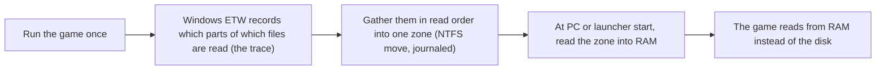
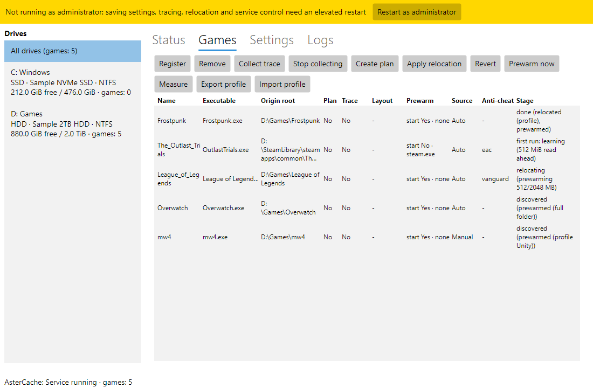
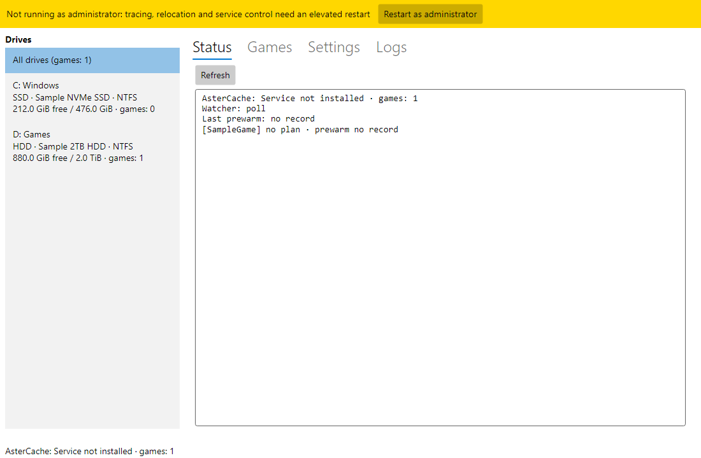
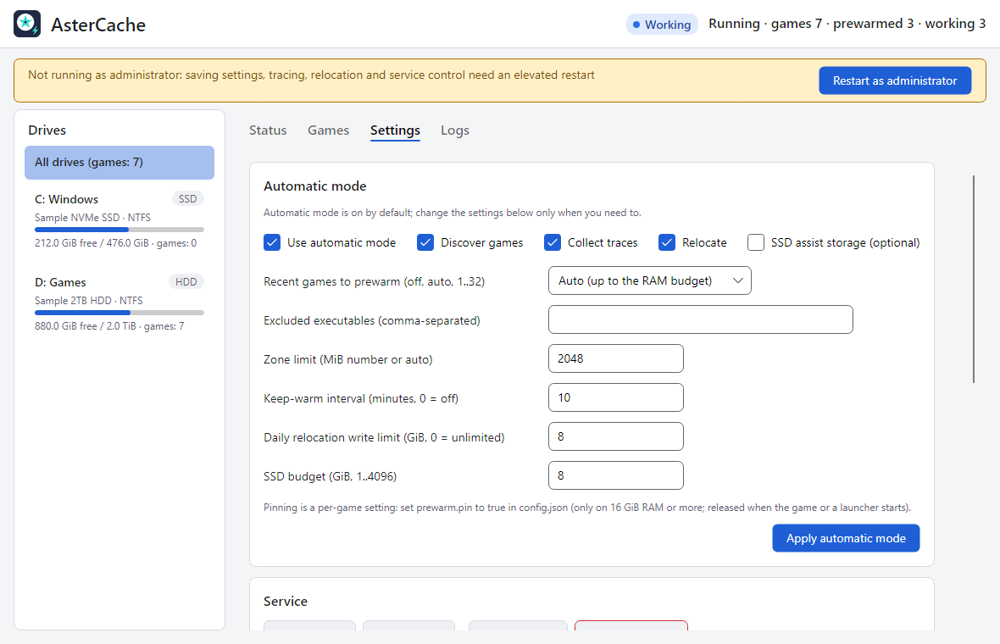
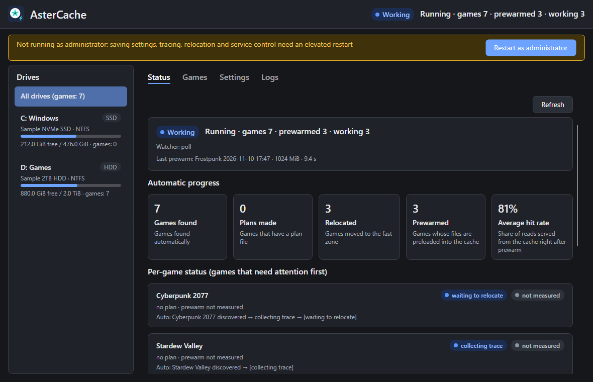

**English** | [한국어](README.ko.md)

<h1 align="center">AsterCache</h1>

A Windows desktop utility that brings load times of games installed on an HDD closer to SSD speeds

  
  
  
  
  

> **Read before use.** AsterCache physically moves file data, so back up drives that hold important data before using it. Validation covers one SMR drive (WD20EZAZ) and one real game (Frostpunk); CMR drives have not been tested. Anti-cheat games have only usage records from one PC and no controlled validation ([Anti-cheat compatibility](docs/ANTICHEAT.md)).

## What it does

AsterCache helps games installed on a hard disk (HDD) load faster. It watches what a game reads while it loads, puts those pieces side by side in one place on the disk, and loads them into RAM before you start the game.

- It does not change your game files, and does not copy them to another drive (the optional SSD assist storage, off by default, is the one exception).
- After installing, you do not have to do anything. It works in the background.
- The tray window shows a summary of each game's last play. It is disk read statistics, not a load-time or frame measurement. A diagnostics ZIP can be exported for support; it stays on your PC.
- The measured figures in this document are replay times of recorded read patterns, not total load times of a running game.

## Who it is for

**A good fit**
- Games installed on an HDD (NTFS) that you launch again and again, on Windows 11 x64.
- A PC with spare RAM. Validation used 32 GiB; prewarm leaves 4 GB free by default.

**Not a good fit, or no gain**
- Games on an SSD are skipped. A game on an HDD that is also the Windows system drive is only prewarmed, not relocated.
- The first launch of a game is not faster. The effect starts from the second launch.
- Reads that were not recorded (another level or mode, texture streaming during play) are not helped.
- Games with anti-cheat: no guarantee is made about account sanctions. Read [Anti-cheat compatibility](docs/ANTICHEAT.md) first.

## Getting started

### 1. Install

Requirements: Windows 11 x64 and an NTFS game drive. Installing the service, tracing, and relocation need administrator rights.

1. Open [GitHub Releases](https://github.com/DO0OG/AsterCache/releases) and download `AsterCache-v<version>-win-x64-setup.exe` (the latest release).
2. Run it and choose a language (English or 한국어).
3. Keep the default choices (desktop and Start menu shortcuts, start with Windows, install the service) and click Next until it finishes.

Prefer no installer? The same release has a zip, `AsterCache-<version>-win-x64.zip`. Extract it, run `AsterCache.Tray.exe` as administrator, and install and start the service from the Settings tab.

Running a newer installer upgrades the existing installation. Uninstalling reverts any SSD assist links first, then removes the program and the service, but keeps the data folder `%ProgramData%\AsterCache`. The installer is not code-signed, so Windows SmartScreen may show a warning. Building from source: [docs/DEVELOPMENT.md](docs/DEVELOPMENT.md).

### 3. Updates

The tray checks the official releases 5 minutes after it starts and then every 24 hours. By default (`update.mode` = `auto`) it downloads a newer installer, verifies its SHA-256, and installs it silently, but only when the tray runs with administrator rights from an installed copy, no registered game is running, and no relocation is in progress. Otherwise it only notifies you, or opens the release page. You can choose **Install automatically**, **Notify only**, or **Off** in the Settings tab's Updates section; prereleases are not included unless you turn that on. The service itself does not use the network. The silent installation has not yet been confirmed on a real machine. See [docs/FAQ.md](docs/FAQ.md).

### 2. Use it: there is nothing to press

[Automatic mode](docs/AUTO_MODE.md) is on by default. Play as usual:

| When | What AsterCache does |
|---|---|
| Right after install, then every hour | Finds HDD games in your Steam, Epic, GOG, Ubisoft, and Riot libraries and the Windows uninstall list, and registers them. |
| First play of a registered game | Records what the game reads. This run is only recorded. |
| After you quit the game and the drive is idle | Moves the recorded pieces into one zone (about 5 minutes per 2 GB), one game at a time, then prewarms that zone. Starting a game pauses the move. |
| Every PC start and launcher open | Prewarms the zone into RAM, within a RAM budget. |
| From the second launch | The full effect applies. |

Before a first run, a small game's whole folder (or a large game's engine profile) is prewarmed without a record; the effect of that prewarm has not been measured.

To watch progress, double-click the tray icon and open the **Status** tab. To turn automatic mode off, put a game back, or run each step by hand, see [docs/USAGE.md](docs/USAGE.md). Questions and troubleshooting: [docs/FAQ.md](docs/FAQ.md).

## How it works

A hard disk reads with a moving head, like the arm of a record player. A game that loads a level reads thousands of pieces spread all over the disk, so the head spends most of its time jumping instead of reading. Fetching a few hundred books from shelves all over a library is slow; taking the same books from one cart, stacked in the order you need them, is fast. AsterCache builds that cart. On the test drive, scattered reads ran at about 39 MiB/s and one continuous read at 90~110 MB/s ([docs/RESULTS_SUMMARY.md](docs/RESULTS_SUMMARY.md)); other drives will differ.

1. **Discover.** The background service finds HDD games from launcher libraries and by detecting game starts.
2. **Record.** On the first play, Windows event tracing (ETW) writes down which parts of which files the game reads, in what order. The game process is never touched.
3. **Relocate.** When the game is off and the drive is idle, the pieces are moved side by side into one zone of the disk, in read order, with the official NTFS move function (the one disk defragmenters use). File contents stay the same, and every step is journaled so it can be reverted.
4. **Prewarm.** At PC start or when the launcher opens, the zone is read into RAM (the file cache). The game then reads from RAM. If the prewarm was not done in time, the zone is read in order the moment the game starts, which is still much faster than the scattered original.
5. **Keep up.** The service re-prewarms if the cache went cold, and restores the layout if it drifted (for example after a game update).

**ORBIT: prewarm order adjustment.** For a game that has a recording, ORBIT calculates whether reading the prewarm in a different order, in segments of about 64 MiB, would help. Only the order changes, not the amount or the set of data read. The default mode is `active`; change it with `aster orbit mode off|shadow|active`. In the 2026-11-09 Call of Duty bench (one game, one drive, one session), the median value-weighted ready time fell 18.8%, but the worst-episode p95 rose by 13.1 s, so it is too early to generalize. See [docs/ORBIT.md](docs/ORBIT.md).

**What AsterCache does not do.**
- It does not change the content of your game files (a SHA-256 check before and after each move).
- It does not touch the game process: no injection, no hooking, no driver.
- It does not copy the game to an SSD by default. The optional SSD assist storage (off by default) copies selected hot files only; see [docs/AUTO_MODE.md](docs/AUTO_MODE.md).
- RAM is used only for prewarm and first-run read-ahead, within a budget (prewarm at most half of physical RAM, and only while free RAM stays above 4 GB by default). Prewarmed data is ordinary file cache, which Windows can drop when programs need the memory.

## Effects on your hard disk, and cautions

This is a summary. The full guide is [docs/GAME_GUIDE.md](docs/GAME_GUIDE.md).

- **It writes to the game drive.** Relocation physically moves data. One automatic round writes at most 1 GiB on an SMR drive and 2 GiB on other drives. Per day the limit is 2 GiB on SMR and 8 GiB otherwise (`auto.max_relocate_gib_per_day`), and at most 4 relocations (`auto.max_relocations_per_day`). The first run of a relocation takes time; the gain shows in repeated loads.
- **It works only when the PC is idle.** The game must be off, the game drive under 4 MiB/s for 30 seconds, and the PC on AC power (or a battery at 50% or more). If a game starts during a move, only the fragment being moved is finished, then it stops and resumes later.
- **It also reads.** Prewarm reads the zone into RAM within the budget. A cache check reads 1 MiB from each of 8 places every 10 minutes. A small 4 KiB read every 10 minutes keeps the HDD from spinning down while a launcher is open or at the hours you usually play (`auto.keep_awake`, on by default; Windows power settings are not changed). Background reads yield to a game running on the same disk.
- **SMR drives write slowly.** After a relocation the service waits until the drive has recovered before the next job. Only one SMR drive has been validated; CMR drives have not.
- **Exclude the game drive from Windows drive optimization.** Windows defragments HDDs on a weekly schedule, which can undo the relocated layout. Do not run `defrag` on that drive either.
- **Do not power off or sleep during a move.** Resume after interruptions was checked on a test volume; power loss during a move on real game data was not tested.
- **Not measured:** effects on drive lifespan, temperature, and noise.
- **Everything can be undone.** Select the game on the **Games** tab and click **Revert**; the journal restores the previous layout.

Safety checks, in short: SHA-256 comparison before and after each move; a journal for every moved fragment; files outside `allowed_roots` and volumes whose label differs from `volume_label` are never touched; `not_admin` and no change without administrator rights. Details: [docs/DEVELOPMENT.md](docs/DEVELOPMENT.md#safety-measures).

## Measured results

The synthetic dataset and Frostpunk figures are replay times of traced read patterns. The League of Legends and Call of Duty figures are a tally of the service log on one PC during real play (2026-11-02 to 2026-11-10), plus a read benchmark of the prewarm list. None of them is the total load time of a running game, and the usage-log rows are not a controlled benchmark.

| Target | Measurement | Result |
|---|---|---|
| Synthetic dataset 2.1 GiB | HDD cold read → prefetch after relocation | 17.1 s → 1.14 s (holds 10 hours after relocation) |
| Synthetic dataset 2.1 GiB | SSD cold read under the same conditions | 0.76~1.22 s |
| Frostpunk, 2.02 GB read while loading the first map | HDD cold replay → concurrent prefetch after relocation | 24.3 s → 11.93 s (median of 3, all hot data moved into one zone) |
| Frostpunk | Replay after prewarm | 0.48 s |
| Frostpunk, 1.9 GB loading read | HDD cold → SSD assist storage cold (warm) | 12.90 s → 2.81 s (warm 0.48 s) |
| Frostpunk, same read pattern | NVMe SSD cold replay | 3.8 s |
| Frostpunk-trace replica, scattered vs contiguous layout (2.02 GB) | Direct replay of the same read pattern, read-ahead off, median | Scattered 41.0\~55.3 s → contiguous 19.3\~20.5 s ([result folder](results/csharp_e7c_gen/README.md)) |
| League of Legends, prewarm target 8,182 MiB | RAM prewarm at launcher start (usage log, 1 run) | 8,173 MiB in 48.4 s (169 MB/s), hit rate right after prewarm 100% |
| Call of Duty, prewarm target 10,218 MiB | Hot set RAM prewarm (usage log, 7 runs) | 9,081\~10,217 MiB in 128\~416 s (median 249.8 s) |
| Call of Duty | Prewarm of the first 1,023 MiB at service start (usage log, 3 runs) | 34.7~40.7 s, hit rate right after prewarm 75% |
| Call of Duty, prewarm list about 9.5 GB | HDD cold read, before and after prewarm reordering (ABBA benchmark, median) | Total read about 326 s. Reordering cut value-weighted ready time by 18.8% and delayed the worst episode by 13.1 s ([ORBIT](docs/ORBIT.md)) |
| Service | Game start detection latency (polling, p95) | 58 ms |

- Test machine: HDD WD20EZAZ (SATA, D:), NVMe SSD (C:), Windows 11 Pro 10.0.26200, 32 GiB of memory.
- The Frostpunk results come from tracing one game once and replaying it. There are no p50/p95 figures for repeated loads yet. The synthetic dataset's SSD value and Frostpunk's NVMe value use different data and methods, so do not compare them directly.
- For prewarm to beat an SSD cold read, it must finish at least 15 s before the game starts. Memory pressure reduces the effect.
- "Hit rate" is the share of 8 sampled places (1 MiB each) that were in the RAM file cache right after a prewarm ended. It is not a value at game start.
- Methods, conditions, how to read the numbers, and the usage records: [docs/RESULTS_SUMMARY.md](docs/RESULTS_SUMMARY.md) and [VALIDATION_REPORT.md](VALIDATION_REPORT.md).

## Known limits

- It is not a driver or file system filter and does not intercept the game's I/O. The kernel minifilter in `kernel/` is experimental and not part of the release ([kernel/README.md](kernel/README.md)).
- Tracing records only reads that went to disk; reads already in the cache may be missed.
- Replay was measured for one real game (Frostpunk) on one SMR drive. Persistence was confirmed up to 10 hours after relocation. Call of Duty and League of Legends have only usage-log tallies.
- Power loss, SSD damage, BitLocker, and DirectStorage environments have not been tested.
- If only the tray is updated, the service stays on the old version; reinstall the service with the installer. Automatic updates install the whole installer, so they update the service too.
- Resident utilities such as Wallpaper Engine are excluded from automatic registration. Other non-game apps on an HDD may still be registered; add their exe to `auto.ignore_exes` or remove them on the Games tab.
- Games installed under `AppData\Local\Temp` are not found by the heuristic. The shared profile repository is still being prepared.
- The full list of what was and was not validated is in [VALIDATION_REPORT.md](VALIDATION_REPORT.md).

## Screenshots

The management window. The top row shows the Games tab and the Status tab; the bottom row shows the Settings tab and the Status tab in the dark theme. The images were taken from example data in a temporary data folder, so the drive and game information is sample data. They were taken without administrator rights, which is why the notice bar appears at the top.

 

 

## Recent changes

- **1.0.2, a full prewarm that runs short of memory shrinks instead of stopping.** A prewarm that started reading the whole list and then failed the memory check was cancelled without keeping anything, and this repeated for a game whose list sits near the edge of available memory, which 1.0.1 made more likely by adding blocks to the list. It now reads the front part that fits, once, in the same run. The supplement prewarm also follows the current list size after the list grows. The memory reserve and the cache budget are unchanged.
- **1.0.1, prewarm keeps more of what a game reads, and works right after switching games.** When memory is short and only part of the prewarm list is read, the ranges a game reads right after launch are now kept and read first, and blocks seen after the zone is full are added to the prewarm list without moving anything. Reads after the first 10 minutes of play are now actually recorded. A prewarm that runs short of memory keeps what it already read and continues later instead of being discarded, and a prewarm started by a launcher runs right after another game was closed. The effect on load time in real games has not been measured yet.
- **1.0.0, first stable release.** The tray now updates AsterCache by itself: it checks the official releases, verifies the installer with SHA-256, and installs quietly only when no registered game is running and no relocation is in progress (notify-only and off are available). Each game can be paused or limited to prewarm only, relocation only, or off, and relocation can be limited to chosen hours. These, the display name, the start stream switch, and the numeric limits can be changed in the tray. The status tab shows a last-play summary, the log tab exports a diagnostics ZIP, notifications can be turned off, the service and the tray hold less memory, and the icon is new.
- **0.9.0-beta.38, supplement prewarm no longer rereads without progress.** When memory was tight, the supplement prewarm reread the same front part about every 90 seconds without reading more. It now waits for the retry interval when nothing new was read, and tries again sooner only when memory grows.
- Changes since beta.25, and the earlier list since beta.8 (parallel relocation, drive recovery judgment, progress after install, yielding at game start, and more), are in [docs/CHANGES.md](docs/CHANGES.md).

## Documentation

| Document | Contents |
|---|---|
| [docs/USAGE.md](docs/USAGE.md) | Using the tray window and the `aster` command, with examples |
| [docs/AUTO_MODE.md](docs/AUTO_MODE.md) | What the service does by itself, step by step |
| [docs/ORBIT.md](docs/ORBIT.md) | Prewarm order adjustment (ORBIT) |
| [docs/GAME_GUIDE.md](docs/GAME_GUIDE.md) | Effects on the disk, cautions, and guidance by kind of game |
| [docs/ANTICHEAT.md](docs/ANTICHEAT.md) | Anti-cheat compatibility: what it does, what it does not do |
| [docs/CONFIGURATION.md](docs/CONFIGURATION.md) | Settings table with defaults, the watcher, and language |
| [docs/FAQ.md](docs/FAQ.md) | FAQ and troubleshooting |
| [docs/RESULTS_SUMMARY.md](docs/RESULTS_SUMMARY.md), [VALIDATION_REPORT.md](VALIDATION_REPORT.md) | Measurements and the validation report |
| [docs/CHANGES.md](docs/CHANGES.md) | Changes by version |
| [docs/DEVELOPMENT.md](docs/DEVELOPMENT.md), [docs/PYTHON_TOOLS.md](docs/PYTHON_TOOLS.md) | Building, tests, project structure; the Python reference tools |
| [csharp/README.md](csharp/README.md), [kernel/README.md](kernel/README.md) | C# commands and service behavior; the kernel minifilter |
| [docs/research_cold_limit.md](docs/research_cold_limit.md), [docs/research_hdd_general.md](docs/research_hdd_general.md) | Research notes (cold limit, general HDD I/O) |

## License and disclaimer

MIT License. See the [LICENSE](LICENSE) file. Copyright (c) 2026 DO0OG. Third-party notices: THIRD_PARTY_NOTICES.md.

Provided without warranty. The measurements are results from a single PC. No controlled validation has been done on games with anti-cheat or games tied to online accounts, and no guarantee is made about account sanctions. Relocation moves file data: back up before using it on a drive that holds important data.
