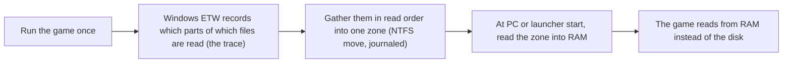
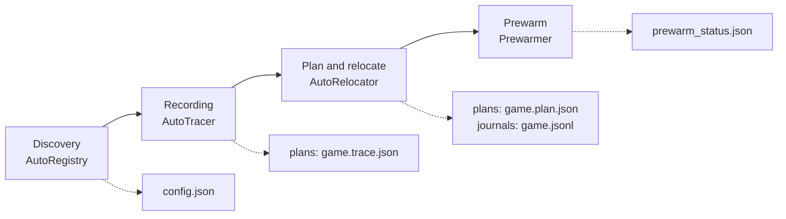

**English** | [한국어](README.ko.md)

<p align="center"></p>

<h1 align="center">AsterCache</h1>

<p align="center">A Windows desktop utility that brings load times of games installed on an HDD closer to SSD speeds</p>

<p align="center">
  <a href="LICENSE"></a>
  
  
  <a href="https://github.com/DO0OG/AsterCache/actions/workflows/csharp-ci.yml"></a>
  <a href="https://github.com/DO0OG/AsterCache/actions/workflows/kernel-build.yml"></a>
</p>

> **Beta.** AsterCache is distributed as a beta pre-release. It physically moves file data, so back up drives that hold important data before using it. Validation covers one SMR drive (WD20EZAZ) and one real game (Frostpunk); CMR drives have not been tested. Anti-cheat games have only usage records from this PC and no controlled validation (see [Real-world usage records](#real-world-usage-records) and [Known limitations](#known-limitations)).

## Recent changes

- **0.9.0-beta.31, tray redesign.** The windows, tabs, dialogs, and notifications share one design system, with light and dark themes ([Screenshots](#screenshots)).
- **0.9.0-beta.30, no duplicate work in one prewarm round.** The same prewarm list is computed once, and per-phase elapsed times are logged.
- **0.9.0-beta.29, game start stream fixes.** The start stream stops at the loading boundary (`auto.start_stream_cap_seconds`), and the trace also collects short late-play windows.
- **0.9.0-beta.28, ORBIT refinements.** Added a per-episode delay allowance ([ORBIT](docs/ORBIT.md)).
- Changes since beta.25, and the earlier list since beta.8 (parallel relocation, drive recovery judgment, progress after install, yielding at game start, and more), are in [docs/CHANGES.md](docs/CHANGES.md).

## What it does

AsterCache helps games installed on a hard disk (HDD) load faster. It watches what a game reads while it loads, puts those pieces side by side in one place on the disk, and loads them into RAM before you start the game. It does not change your game files and does not copy them to another drive, except for the optional SSD assist storage (off by default, see [SSD assist storage](docs/AUTO_MODE.md#ssd-assist-storage-optional)). Once it is installed you do not have to do anything: it works in the background (see [Getting started](#getting-started)).

The measured figures in this document are replay times of recorded read patterns of one real game on one drive, not total load times of a running game. The [Real-world usage records](#real-world-usage-records) are a tally of usage logs, which is a different kind of figure. See [Measured results](#measured-results) and [VALIDATION_REPORT.md](VALIDATION_REPORT.md) for details.

The main features are listed below. The full list is in [docs/USAGE.md](docs/USAGE.md).

- **Automatic mode (on by default).** It finds HDD games through launcher libraries and game start detection, records the first run, relocates while the PC is idle, and then prewarms.
- **Management window and tray icon.** Drives, games, status, settings, and logs in one window. Korean and English are supported.
- **Manual steps and the command line.** Register, collect a trace, make a plan, relocate, revert, prewarm now, and measure, from buttons or `aster` commands.
- **Optional features.** SSD assist storage (off by default) and profile export and import (`aster profile`).

## Screenshots

The management window. The top row shows the Games tab and the Status tab; the bottom row shows the Settings tab and the Status tab in the dark theme. The images were taken from an example `config.json` and status files in a temporary data folder with example drives, so the drive and game information is sample data. They were taken without administrator rights, which is why the notice bar appears at the top.

<p align="center"> </p>
<p align="center"> </p>

To recreate them, run `AsterCache.Tray.exe --smoke --screenshot <png> [--tab 0..3] [--theme light|dark] [--lang ko|en] [--data-dir <folder>]`. Details are in [csharp/README.md](csharp/README.md).

## Measured results

The figures are replay times of traced read patterns, not total load times of a running game.

| Target | Measurement | Result |
|---|---|---|
| Synthetic dataset 2.1 GiB | HDD cold read → prefetch after relocation | 17.1 s → 1.14 s (holds 10 hours after relocation) |
| Synthetic dataset 2.1 GiB | SSD cold read under the same conditions | 0.76~1.22 s |
| Frostpunk, 2.02 GB read while loading the first map | HDD cold replay → concurrent prefetch after relocation | 24.3 s → 11.93 s (median of 3, see note) |
| Frostpunk | Replay after prewarm | 0.48 s |
| Frostpunk, 1.9 GB loading read | HDD cold → SSD assist storage cold (warm) | 12.90 s → 2.81 s (warm 0.48 s) |
| Frostpunk, same read pattern | NVMe SSD cold replay | 3.8 s |
| Frostpunk-trace replica, scattered vs contiguous layout (2.02 GB) | Direct replay of the same read pattern, read-ahead off, median | Scattered 41.0~55.3 s → contiguous 19.3~20.5 s ([result folder](results/csharp_e7c_gen/README.md)) |
| Service | Game start detection latency (polling, p95) | 58 ms |

- The HDD is a WD20EZAZ (SATA, D:) and the SSD is NVMe (C:). The test machine runs Windows 11 Pro 10.0.26200 with 32 GiB of memory.
- The Frostpunk results come from tracing one game once and replaying it. There are no p50/p95 figures for repeated loads yet.
- The SSD value for the synthetic dataset and the NVMe value for Frostpunk use different data and methods, so do not compare them directly.
- For prewarm to beat an SSD cold read, prewarm must finish at least 15 s before the game starts. Memory pressure reduces the effect.
- The 11.93 s value is from the E6 experiment: the relocation now moves all hot data into one zone by default (preservation off), instead of keeping segments of 8 MiB or more in place. The earlier value was 15.1 s. See [docs/research_cold_limit.md](docs/research_cold_limit.md).
- More tables and interpretation are in [docs/RESULTS_SUMMARY.md](docs/RESULTS_SUMMARY.md) and [VALIDATION_REPORT.md](VALIDATION_REPORT.md).
- Research note on general HDD I/O (outside the game): [docs/research_hdd_general.md](docs/research_hdd_general.md).

### Real-world usage records

This is a tally of the service log on one PC (2026-11-02 to 2026-11-10). It is not a controlled benchmark. Total game load time and in-game frame stutter were not measured. The method and sample counts are in [docs/RESULTS_SUMMARY.md](docs/RESULTS_SUMMARY.md#real-world-usage-records).

| Item | League of Legends | Call of Duty |
|---|---|---|
| Game start detections (process starts) | 10, over 6 days | 62, over 8 days |
| Anti-cheat (as judged by the service) | Vanguard | Ricochet |
| Trace | 2 collected, then skipped (8 times) | 14 collections started |
| Pin | Skipped (4 times) | Skipped (7 times) |
| Relocation | 4 completed, 4 stopped | 5 completed, 3 stopped |
| Prewarm target / RAM budget | 8,182 MiB / 8,173 MiB | 10,218 MiB / 8,173 MiB |
| Prewarm duration (2026-11-08 to 11-10) | One partial prewarm of 8,173 MiB: 48.4 s | 7 whole-hot-set runs of 9,081 to 10,217 MiB: 128 to 416 s (median 249.8 s) |
| Head-part prewarm at service start | 5 runs of 970 to 1,023 MiB: 11.5 to 22.3 s | 3 runs of 1,023 MiB: 34.7 to 40.7 s |
| Hit rate right after prewarm (latest value only) | 100% | 75% |

- **Hit rate.** Right after a prewarm ends, up to 8 places chosen from the hot set (1 MiB each) are read, and the hit rate is the share that finished in 0.8 ms or less, that is, the share that was in the RAM file cache. It is not a value at game start, and only the latest value per game is kept. The 75% for Call of Duty was measured right after 1,023 MiB of its 10,218 MiB hot set was prewarmed at service start.
- **Limits.** The log has no program version, so the data is split by date only, and the table holds only late-period figures (2026-11-08 to 11-10). There is no record of a start stream actually running. There is no comparison with prewarm off.

## System requirements

- Windows 11 x64. The validated environment is Windows 11 Pro 10.0.26200.
- Building from source requires the .NET 10 SDK. The repository's `csharp/global.json` uses SDK 10.0.400 (latestPatch).
- Trace capture (ETW), relocation (`apply`, `revert`), and service installation require administrator rights.
- The relocation target must be an NTFS volume. Comparing origin against cache requires two different physical devices.

## Getting started

### 1. Install

1. Open [GitHub Releases](https://github.com/DO0OG/AsterCache/releases) and download `AsterCache-v<version>-win-x64-setup.exe` (pre-release, for example v0.9.0-beta.31).
2. Run it and choose a language (English or 한국어).
3. Keep the default choices (desktop and Start menu shortcuts, start with Windows, install the service) and click Next until it finishes.

Prefer no installer? The same release has a zip, `AsterCache-0.9.0-beta.31-win-x64.zip`. Extract it, run `AsterCache.Tray.exe` as administrator, and install and start the service from the Settings tab.

Running a newer installer upgrades the existing installation. Uninstalling reverts any SSD assist links first (`aster tier revert --all`; the copies stay in the tier folder), then removes the program and the service, but keeps the data folder `%ProgramData%\AsterCache`. The installer is not code-signed, so Windows SmartScreen may show a warning.

### 2. That is all: automatic mode

After installing, you have nothing else to do. [Automatic mode](docs/AUTO_MODE.md) is on by default. In short: install → automatic discovery → prewarm (a small game's whole folder, or a large game's engine profile, even without a trace) → record reads on the first launch → about 30 seconds after you quit the game, relocation → prewarm the moved zone right away → the full effect from the second launch. First-run read-ahead is off by default. No button needs pressing. This is what happens over time:

| When | What AsterCache does |
|---|---|
| Right after install | The background service starts. |
| About 10 seconds later (then every hour) | It looks through your Steam, Epic, GOG, Ubisoft, and Riot libraries and the Windows uninstall list, and registers games installed on an HDD. |
| Registered game, before its first launch (at service start, launcher start, or after a game quits) | A small game (folder within the RAM budget) gets its whole folder prewarmed; a larger game gets only its engine profile (Unity, Unreal, Source). This happens without a trace. For a game with no record, placement info is looked up in this order: shared profile (skipped silently while the repository is not yet available) → Windows prefetch record → engine profile → whole folder. The effect of this prewarm is not yet measured. |
| The first time you play a registered game | It records what the game reads (the trace). First-run read-ahead is an experimental feature, off by default (no gain in E7 to E7f measurements; `auto.learn.enabled`), so this run only records. The full effect comes from the second launch. |
| You quit the game, the game's drive stays under 4 MiB/s for 30 seconds, and the PC is on AC power (or a battery at 50 % or more) | It moves the game's pieces into one zone, one game at a time, then prewarms that zone right away. This takes a few minutes (about 5 minutes per 2 GB). If you start a game meanwhile, it pauses and continues later. |
| Every time the PC starts or the launcher opens | It prewarms the zone into RAM, within a RAM budget. |
| From the second launch | The full effect applies (figures in [Measured results](#measured-results); total load time is not yet measured). |

### 3. Turning it off and reverting

To drive the steps yourself or use the command line, see [docs/USAGE.md](docs/USAGE.md#doing-it-by-hand-optional). The FAQ and troubleshooting are in [docs/FAQ.md](docs/FAQ.md).

- **Turn off automatic mode.** In the **Settings** tab, clear **Use automatic mode** and click **Apply automatic mode**. Or set `"auto": {"enabled": false}` in `%ProgramData%\AsterCache\config.json`. To exclude one game, add its exe to `auto.ignore_exes`. See [Automatic mode](docs/AUTO_MODE.md).
- **Put a game back.** On the **Games** tab, select the game and click **Revert**. It follows the journal and restores the previous disk layout; the file contents never changed.
- **Uninstall.** Use Windows' Installed apps. Your data folder `%ProgramData%\AsterCache` stays; it is deleted only if you run `cs_service.ps1 -Action uninstall -PurgeData`.

## How it works

### The problem

A hard disk reads data with a moving head, like the arm of a record player. Every time the head has to jump to another spot, it waits. A game that loads a level reads thousands of pieces that are spread all over the disk, so the head spends most of its time jumping instead of reading.

Think of a library. Fetching a few hundred books from shelves all over the building takes a long time. Taking the same books from one cart, already stacked in the order you need them, is fast. AsterCache builds that cart.

On the test drive, scattered reads ran at about 39 MiB/s, while one continuous read ran at 90~110 MB/s ([docs/RESULTS_SUMMARY.md](docs/RESULTS_SUMMARY.md)). Other drives will differ.

### Trace, relocate, prewarm

1. **Trace.** AsterCache watches the game once while it loads and writes down which parts of which files it reads, and in what order. It uses Windows' own event tracing (ETW) for this. It never touches the game process.
2. **Relocate.** Using that list, AsterCache moves the pieces to one area of the disk, side by side, in the order the game reads them. File contents stay exactly the same. The move uses the official NTFS move function (the one disk defragmenters use), keeps a journal of every step, and can be reverted.
3. **Prewarm.** Before you start the game, for example when the PC boots or when your game launcher opens, AsterCache reads that whole zone into RAM (the file cache). When the game starts, it reads from RAM instead of the disk. If the zone was not prewarmed in time, AsterCache starts reading it in order the moment the game starts (read-ahead), which is still much faster than the scattered original.



### ORBIT: prewarm order adjustment

For the hot-set prewarm of a game that has a recording, ORBIT computes whether reordering in segments of about 64 MiB, with the current prewarm order as the baseline, would help. The leading tier0 part stays fixed, and the amount and set of data read do not change, only the order. The default mode is `active`; change it with `aster orbit mode off|shadow|active`. In the 2026-11-09 Call of Duty ABBA bench on the user's PC (WD20EZAZ 2 TB SMR HDD), the median value-weighted ready time fell 18.8%, but the worst-episode p95 rose by 13.1 s and flag 4 failed. This is one game, one drive, and one session, so it is too early to generalize. When it turns on, the modes, safety, and how it is measured are in [docs/ORBIT.md](docs/ORBIT.md).

### With or without an SSD

- **With an SSD (optional, off by default):** AsterCache copies the hot files of an HDD game to an SSD within a budget (8 GiB per game by default), keeps each original as `<name>.aster-orig`, and puts a symbolic link in its place, so the game reads the same paths as before.
- **Without an SSD:** only the HDD path above (relocation and prewarm) is used. The prewarm hit rate is measured right after a prewarm ends and shown in the per-game status line as "hit right after prewarm N%" (see [Real-world usage records](#real-world-usage-records)).

### The result

In the measurement (Frostpunk, a 2 GB set of data read while loading the first map, on an SMR HDD), replaying the recorded reads took 24 s with nothing done, about 12 s after relocation plus read-ahead, and about 0.5 s after prewarm; the same reads on an NVMe SSD, cold, took 3.8 s. Prewarm itself needs about as long as the read-ahead, so it helps most when it finishes before you start the game. These are single-game, single-drive replay times, not full game load times.

### What AsterCache does not do

- It does not change the content of your game files. A SHA-256 check before and after each move confirms this.
- It does not touch the game process: no injection, no hooking, no driver.
- It does not copy your game to an SSD by default. The optional SSD assist storage (off by default) copies selected hot files; see [SSD assist storage](docs/AUTO_MODE.md#ssd-assist-storage-optional).
- RAM is used only for prewarm and first-run read-ahead, within a budget: by default at most a quarter of physical RAM (read-ahead is also capped at 4 GiB), and only while the free RAM stays above `prewarm.min_free_ram_mib` (4 GB by default). Prewarmed data is ordinary file cache, which Windows can drop when programs need the memory.

## Implementation

The C# projects in `csharp/AsterCache.sln` are the final implementation. The repository also holds a Python reference implementation and an experimental kernel filter ([Repository layout](#repository-layout)).

### What each project does

They live under `csharp/src/` and reference each other in this order: Core ← Windows ← Tracer·Prefetch ← Service ← Cli·Tray.

| Project | Output | Role and main files |
|---|---|---|
| `AsterCache.Core` | library | Platform-independent rules. Planning (`Plan/HotSet.cs`, `ZoneAllocator.cs`, `PlanFile.cs`), the ORBIT planner (`Plan/Orbit/OrbitPlanner.cs`), relocation, journal, and revert (`Apply/Applier.cs`, `Journal.cs`, `Reverter.cs`, `LayoutVerifier.cs`), settings (`Settings/SettingsStore.cs`, `ConfigEditor.cs`), anti-cheat detection and the per-feature policy table (`Discovery/AntiCheat.cs`, `Capabilities.cs`), engine profiles (`Profiles/engines.json`), SSD assist storage (`Tier/`), and UI strings (`I18n/`) |
| `AsterCache.Windows` | library | Win32 calls. NTFS cluster moves (`NtfsVolume.cs`, `FSCTL_MOVE_FILE`), physical file layout lookup (`FileLayout.cs`), read-only mappings and `PrefetchVirtualMemory` (`FileMapping.cs`, `FilePin.cs`), reads that bypass the cache (`UnbufferedReader.cs`), cache hit sampling (`CacheProbe.cs`), disk kind and a volume's physical disk (`DiskInfo.cs`, `VolumeDisks.cs`), Windows prefetch `.pf` files (`PrefetchFiles.cs`), and launcher libraries (`LauncherScan.cs`) |
| `AsterCache.Tracer` | library | ETW recording. Real-time kernel session (`LiveSession.cs`, `KernelCollector.cs`), `.etl` conversion (`EtlReader.cs`), and trace building and saving (`TraceBuilder.cs`, `TraceWriter.cs`) |
| `AsterCache.Prefetch` | library | Read engines. The zone stream (`ZoneStreamer.cs`), whole-folder prewarm (`FolderWarm.cs`), and first-run read-ahead (`ReadAhead.cs`, experimental, off by default) |
| `AsterCache.Service` | `AsterCache.Service.exe` | The Windows service. Everything that runs automatically lives here. |
| `AsterCache.Cli` | `aster.exe` | The command line. `Commands/` holds plan, trace, apply, revert, prefetch, prewarm, status, discover, tier, orbit, profile, and more. |
| `AsterCache.Tray` | `AsterCache.Tray.exe` | The Avalonia management window, tray icon, notifications, and Velopack updates. |

The tests are in `csharp/tests/AsterCache.Tests`.

### Inside the service

Files in `csharp/src/AsterCache.Service/`.

| Part | Main files | What it does |
|---|---|---|
| Service core | `Program.cs`, `Worker.cs` | Stays resident as the Windows service `AsterCache`. Runs game start detection, the periodic layout check and reapply, and config reloading (every 5 seconds), and attaches the parts below. It has no channel (IPC) for outside commands and reads only the config file and the plans folder. |
| Start detection | `ProcessWatching.cs`, `EtwProcessWatcher.cs` | Notices the start of registered games and launchers by polling (default) or ETW. If an anti-cheat game is registered, polling is used even when the setting is `etw`. |
| Automatic mode | `AutoMode.cs` | Bundles discovery, the tracer, relocation, and SSD assist storage. |
| Discovery | `AutoRegistry.cs`, `ProfileFeed.cs`, `ProfileSupplement.cs` | Finds games through launcher libraries (hourly) and a read-volume heuristic (every 2 seconds) and registers them in `config.json`. Layout information for a game without a recording is looked up in this order: shared profile, Windows prefetch record, engine profile, whole folder. |
| Tracer | `AutoTracer.cs`, `TracePhases.cs`, `LoadTiers.cs` | Records reads with an ETW session from a registered game's first run and merges several plays. Computes the ranges read repeatedly in every play (common) and decides the loading head (tier0). |
| Relocation | `AutoRelocator.cs`, `DriveRecovery.cs` | Makes the plan from the recording, then moves and verifies while the PC is idle and the game is off. After relocation it checks drive recovery and prewarms right away. |
| Prewarm and streamer | `Prewarm.cs`, `Streaming.cs`, `Rewarm.cs`, `Pinning.cs`, `KeepAwake.cs` | `Prewarmer` decides the prewarm order and RAM budget at service start, launcher start, and after a game exits, and `PrefetchStreamer` reads through `ZoneStreamer`. `GameDispatcher` handles the start stream when a game starts. `Rewarmer` samples cache hits periodically and prewarms again if they went cold, `PinKeeper` holds the prewarmed pages with read-only mappings (optional), and `KeepAwake` does small reads so the HDD does not spin down. |
| ORBIT | `OrbitModel.cs`, `OrbitCalibration.cs`, `OrbitRuntime.cs`, `OrbitShadow.cs` | Builds the episode model (`<game>.orbit.json`) and the disk calibration (`disk_model.json`), and applies the decision of `Core/Plan/Orbit/OrbitPlanner.cs` to the prewarm order according to the mode (`orbit_mode.json`). `shadow` mode only records. |
| Disk lease and cancellation | `DiskReadCoordinator.cs`, `GameExits.cs`, `BootQuiet.cs` | Background reads must take a lease on the physical disk. While a registered game runs on the same disk, or is in its post-exit grace period, no lease is given, and leases already held are stopped through a cancellation token. Disk work is held back briefly right after boot. |
| Anti-cheat gate | `Core/Discovery/AntiCheat.cs`, `Capabilities.cs` | See [Anti-cheat gate](#anti-cheat-gate) below. |
| SSD assist storage | `AutoTier.cs`, `Core/Tier/` | Optional. Keeps a copy of the hot files on the SSD and puts a symbolic link at the original path. The journal is `tier\<game>.json`. |

### Data flow

The flow from recording to prewarm. Each step leaves its output as a file in the data folder, and the next step reads that file.



1. **Discovery.** `AutoRegistry` registers the game in `games[]` of `config.json` with `source: auto`.
2. **Recording.** When a registered game first runs, `AutoTracer` records its reads through the real-time ETW session of `Tracer` and writes `plans\<game>.trace.json`. Later plays are collected as `.trace.runN.json` and merged.
3. **Plan.** `AutoRelocator` extracts the hot set (`HotSet`) from the trace and builds the plan with `PlanFile` (which lays out the zone through `ZoneAllocator`), writing `plans\<game>.plan.json` and the read-order file `.plan.json.prefetch.json`. It is the same code as the manual `aster plan`.
4. **Relocation.** When the game is off and the PC is idle, the same `Applier` as for manual relocation moves the pieces with `FSCTL_MOVE_FILE` through `NtfsVolume`. Each move is recorded in `journals\<game>.jsonl`, and if verification fails `Reverter` rolls back along the journal.
5. **Prewarm.** `Prewarmer` maps the zone's files read-only through `ZoneStreamer`, requests them with `PrefetchVirtualMemory`, and writes the result to `prewarm_status.json`. If ORBIT is on, the prewarm order is changed before the reads.

### The data folder

Files in `%ProgramData%\AsterCache`. The service runs as SYSTEM, and only administrators can write settings or revert.

| File | Written by | Contents |
|---|---|---|
| `config.json` | management window, service | Settings and the game list. Writes lock `config.json.lock`, and the service re-reads it every 5 seconds. |
| `plans\<game>.trace.json`, `.trace.runN.json`, `.trace.common.json` | service, `aster trace` | The read recording, the per-play recordings, and the ranges repeated in every play. A recording built from prefetch or a shared profile is `.boot.trace.json`. |
| `plans\<game>.plan.json`, `.plan.json.prefetch.json`, `.warmonly.json` | service, `aster plan` | The layout plan, the prewarm input, and the prewarm-only list. |
| `plans\<game>.orbit.json` | service, `aster orbit` | The ORBIT episode model. |
| `journals\<game>.jsonl` | `Applier` | The relocation journal. Earlier journals are kept as `.jsonl.<UTC time>`. |
| `tier\<game>.json` | service | The SSD assist storage journal. |
| `auto_status.json` | service | Per-game automatic stage (`discovered`, `tracing`, `learning`, `waiting_idle`, `relocating`, `done`, `failed`, `skipped`), relocation history, play history, and prewarm hit rate. |
| `prewarm_status.json` | service | The last prewarm result per game. |
| `orbit_mode.json`, `disk_model.json`, `benchmark_samples.json` | service | The ORBIT mode, per-disk calibration samples, and loading time samples. |
| `logs\service.log`, `logs\tray.log` | service, tray | Logs. If the tray cannot write to the data folder, it writes to `%LocalAppData%\AsterCache\logs`. |
| `tray.json` | user | Tray settings (the update feed address). |

### How the tray app talks to the service

There is no channel for sending commands to the service. The tray uses only files and the Windows Service Control Manager (SCM).

- **Settings.** When the management window edits `config.json` through `ConfigEditor`, the service re-reads it within 5 seconds.
- **Status.** The service writes `auto_status.json` and `prewarm_status.json`; the tray reads them every 5 seconds to update the icon, tooltip, menu, and Status tab. For the prewarm record and the per-game layout verdict, the management window runs `aster.exe status` as a child process and reads one line of JSON.
- **Actions.** For trace collection, planning, relocation, and revert, the management window runs `aster.exe`. If administrator rights are needed it elevates through UAC and receives the result through `--result-file`.
- **Service control.** Querying the state works without administrator rights through the SCM. Start, stop, install, and uninstall run `sc.exe` elevated.
- **Prewarm now.** The tray process reads directly with the same `PrefetchStreamer`.
- **Updates.** Only the tray updates through Velopack (when `tray.json` has a feed address); the service is reinstalled with the installer. The tray shows a notice when the versions differ.

### Anti-cheat gate

`Core/Discovery/AntiCheat.cs` guesses the anti-cheat kind from file and folder names in the install folder alone (it opens no files), and the per-feature policy table in `Capabilities.cs` decides whether trace, pin, and SSD assist storage are allowed. The service (`AutoTracer`, `PinKeeper`, `AutoTier`) and the command line (`Commands/AntiCheatGuard.cs`) follow the same rules. If detection fails (`unknown`), it is treated as forbidden. Per-kind policy is in [docs/ANTICHEAT.md](docs/ANTICHEAT.md).

### Repository layout

- `csharp/` — the final C# implementation: command-line tool `aster`, service, management window, installer script, and tests
- `kernel/` — source of the AsterFlt kernel minifilter. Experimental; it is not loaded.
- `prefetch/`, `relayout/`, `bench/` — Python reference implementation (prefetch, relocation, and measurement tools). It is the cross-validation baseline for the C# code. For commands and layout see [docs/PYTHON_TOOLS.md](docs/PYTHON_TOOLS.md).
- `scripts/` — experimental administrator PowerShell scripts for the reference implementation
- `docs/` — design documents, game guide, and results summary
- `tests/` — unit and regression tests of the Python reference implementation
- `results/` — measurement result JSON and logs
- `.github/workflows/` — C# build and test workflows and the kernel build workflow
- `*.py` in the root — older versions, the SQLite cache reference implementation, and test and measurement scripts
- `VALIDATION_REPORT.md` — validation report

## Safety measures

- **Content verification.** SHA-256 is compared before and after relocation. If the content differs, it is recorded as a failure.
- **Journal and revert.** A journal (JSON Lines) is written for every moved fragment, and `revert` returns to the previous physical layout. The data content does not change.
- **Allowed folders and volume pinning.** Files outside `allowed_roots` and volumes whose label differs from `volume_label` are not touched.
- **Interruption handling.** If a game starts during relocation, only the fragment currently being moved is finished and then it stops. A resume point is left in the journal, and the same plan continues after the game exits.
- **Splitting relocation over several days.** If another file takes the zone still to be moved, or the plan changes, the parts already moved are not moved again. Only the remaining part is planned again into a new free area.
- The earlier journal is not deleted. It is kept as `<game>.jsonl.<UTC time>`.
- Games on the same disk do not claim the same free area.
- **Data folder permissions.** Only SYSTEM and Administrators can write to `%ProgramData%\AsterCache`; ordinary users can only read. Uninstalling the service leaves the data folder; it is deleted only when you explicitly pass `cs_service.ps1 -Action uninstall -PurgeData`.
- **Permission check.** Without administrator rights, relocation and revert change nothing and end with `not_admin`.

### Anti-cheat

- It does not inject code into the game process, create threads in it, read or write its memory, use debug privileges, hook, overlay, or duplicate handles. It does not use a kernel driver either.
- The service reads game files read-only in shared mode inside its own process and only observes through ETW. Relocation happens only after the game has fully exited.
- If it recognizes an anti-cheat from traces in the install folder, it shows the kind on the Games tab. For kernel-level anti-cheat (EasyAntiCheat, BattlEye, Vanguard, and others) it does not run automatic trace or pin, and allows prewarm and relocation. For Ricochet, only pin is not run.
- On this PC there are usage records of playing a Vanguard game (League of Legends) and a Ricochet game (Call of Duty) with the installed build ([Real-world usage records](#real-world-usage-records)). This is not a controlled validation, and no guarantee is made about account sanctions. Before playing, turn automatic mode off on the Settings tab or add the game's exe to `auto.ignore_exes`. Details are in [docs/ANTICHEAT.md](docs/ANTICHEAT.md).

## Known limitations

- This is not a driver or file system filter. It does not intercept the game's I/O path. The kernel minifilter (`kernel/`) has been through source, build, static analysis, and INF verification, but it has not been signed, loaded, or tested on real hardware, and it is not included in the release. Automatic warm-up right after boot is handled by the user-mode service. See [kernel/README.md](kernel/README.md).
- Tracing records only reads that went to disk. Reads that were already in the cache may be missed.
- SSD assist storage has only the Frostpunk loading read measured. Power loss during a copy, a full SSD, and anti-cheat games are not tested.
- Read-pattern replay was measured for only one real game, Frostpunk. Call of Duty (Ricochet) and League of Legends (Vanguard) have only a tally of this PC's usage logs ([Real-world usage records](#real-world-usage-records)); other anti-cheat games have not been tested.
- Persistence was confirmed up to 10 hours after relocation. Beyond 24 hours has not been measured.
- Measured on a single SMR drive (WD20EZAZ). CMR drives have not been measured.
- The cold condition was produced by clearing the standby list with administrator rights. The drive's internal cache was not cleared.
- Relocation actually moves files, so the first run takes a long time. The gain shows up in repeated loads after relocation.
- Power loss, SSD damage, BitLocker, and DirectStorage environments have not been tested.
- Release binaries are not code-signed, so Windows may show an unsigned-publisher warning.
- If only the tray is updated, the service stays on the old version. The tray shows the version mismatch, and you must reinstall the service with the installer.
- Apps other than games in the Steam library, such as Wallpaper Engine or YoloMouse, can be registered automatically when they are on an HDD. To avoid this, add their exe to `auto.ignore_exes` or remove the game on the Games tab.
- Automatic tracing may miss some of a game's first reads before its session starts. Automatic tracing and automatic relocation have logs of runs with real games on this PC (Call of Duty, League of Legends, and others), but no controlled validation has been done.
- Games installed under `AppData\Local\Temp` are not found by the heuristic.
- The shared profile repository is still being prepared. The effect of shared profiles, of Windows prefetch boot traces, and of engine and whole-folder prewarm has not been measured.
- ORBIT's measured gain is still based on one game, drive, and session. ResultGate can demote to shadow when a fixed-seed 1,000-resample bootstrap shows significant worsening in the existing `ProbeReadyMs` proxy. That proxy is not actual ready time, and the gate never automatically adopts a candidate.

## Documentation

| Document | Contents |
|---|---|
| [docs/AUTO_MODE.md](docs/AUTO_MODE.md) | Automatic mode stages, supported launchers, heuristics, engine profiles, setting keys, SSD assist storage |
| [docs/CONFIGURATION.md](docs/CONFIGURATION.md) | The `config.json` settings table, the watcher, and language |
| [docs/ORBIT.md](docs/ORBIT.md) | The method, modes, and measurement of prewarm order adjustment (ORBIT) |
| [docs/ANTICHEAT.md](docs/ANTICHEAT.md) | Anti-cheat compatibility: what it does, what it does not do, per-kind policy |
| [docs/FAQ.md](docs/FAQ.md) | FAQ and troubleshooting |
| [docs/USAGE.md](docs/USAGE.md) | The feature list, how to drive the steps by hand, and command line examples |
| [docs/DEVELOPMENT.md](docs/DEVELOPMENT.md) | Building from source, building the installer, tests |
| [docs/CHANGES.md](docs/CHANGES.md) | Changes by version |
| [docs/RESULTS_SUMMARY.md](docs/RESULTS_SUMMARY.md), [VALIDATION_REPORT.md](VALIDATION_REPORT.md) | Measurement tables and the validation report |
| [docs/GAME_GUIDE.md](docs/GAME_GUIDE.md), [docs/PYTHON_TOOLS.md](docs/PYTHON_TOOLS.md) | Applying it to a game, and the Python reference implementation |
| [csharp/README.md](csharp/README.md), [kernel/README.md](kernel/README.md) | C# commands, management window, and service behavior; the kernel minifilter |

## Development

Build with the .NET 10 SDK. Publishing, building the installer, and installing the service are in [docs/DEVELOPMENT.md](docs/DEVELOPMENT.md).

```bat
dotnet build csharp/AsterCache.sln -c Release
dotnet test csharp/AsterCache.sln -c Release --filter "Category!=Live"
dotnet format csharp/AsterCache.sln --verify-no-changes
py -3.12 -m unittest discover -s tests
```

- `Category=Live` tests need `D:\AsterBench` and the Python reference implementation, so they are excluded above.
- The Python reference implementation requires Python 3.11 or later and has no external packages. It was validated on Python 3.11.4 and 3.12.10. For commands and layout see [docs/PYTHON_TOOLS.md](docs/PYTHON_TOOLS.md).

## License

MIT License. See the [LICENSE](LICENSE) file for details. Copyright (c) 2026 DO0OG.

Third-party notices: THIRD_PARTY_NOTICES.md

## Disclaimer

- No controlled validation has been done on games with anti-cheat or games tied to online accounts. There are only usage records from this PC ([Real-world usage records](#real-world-usage-records)), and no guarantee is made about account sanctions.
- Relocation actually moves file data. Back up before using it on a drive that holds important data, and try it on a test folder first.
- Provided without warranty under the MIT license. The measurements are results from a single PC.
