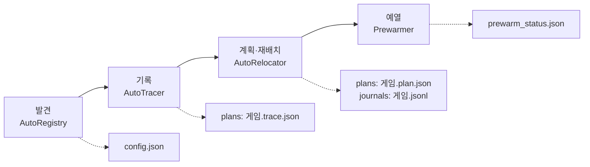

[English](DEVELOPMENT.md) | **한국어**

# 개발

> 개발자용 문서입니다. 빌드, 시험, 코드 구성을 설명합니다. 사용자는 [README](../README.ko.md)에서 시작하십시오.

## 직접 빌드

.NET 10 SDK 로 세 실행 파일을 게시합니다. 게시 결과는 `csharp\publish\` 아래에 생기며 Git 에서 무시합니다. 저장소의 `csharp/global.json` 은 SDK 10.0.400 을 씁니다(latestPatch).

```bat
dotnet publish csharp\src\AsterCache.Cli\AsterCache.Cli.csproj -c Release -r win-x64 --self-contained -o csharp\publish\cli
dotnet publish csharp\src\AsterCache.Service\AsterCache.Service.csproj -c Release -r win-x64 --self-contained -o csharp\publish\service
dotnet publish csharp\src\AsterCache.Tray\AsterCache.Tray.csproj -c Release -r win-x64 --self-contained -o csharp\publish\gui
```

- `csharp\publish\cli\aster.exe` 는 명령행 도구입니다.
- `csharp\publish\gui\AsterCache.Tray.exe` 는 관리 창입니다.
- 서비스는 관리자 PowerShell 에서 설치합니다.

```powershell
csharp\scripts\cs_service.ps1 -Action install
```

## 설치 프로그램 빌드

릴리스 워크플로가 설치 프로그램을 GitHub 릴리스에 `.exe` 로 첨부합니다. 설치본 정의는 [csharp/README.ko.md](../csharp/README.ko.md) 에 있습니다. 직접 빌드할 때는 다음과 같이 합니다.

```bat
ISCC.exe /DAppDir=<관리 창 publish 경로> /DAppVersion=<버전> csharp\packaging\windows\aster.iss
```

## 빌드와 시험

```bat
dotnet build csharp/AsterCache.sln -c Release
dotnet test csharp/AsterCache.sln -c Release --filter "Category!=Live"
dotnet format csharp/AsterCache.sln --verify-no-changes
py -3.12 -m unittest discover -s tests
```

- `Category=Live` 시험은 `D:\AsterBench` 와 Python 참조 구현이 필요하므로 위에서 제외했습니다.
- Python 참조 구현은 Python 3.11 이상이며 외부 패키지가 없습니다. Python 3.11.4 와 3.12.10 에서 검증했습니다. 명령과 구성은 [PYTHON_TOOLS.ko.md](PYTHON_TOOLS.ko.md) 를 보십시오.
- README 스크린샷을 다시 만들려면 `AsterCache.Tray.exe --smoke --screenshot <png> [--tab 0..3] [--theme light|dark] [--lang ko|en] [--data-dir <폴더>]` 를 실행합니다. 자세한 내용은 [csharp/README.ko.md](../csharp/README.ko.md) 에 있습니다.

## 프로젝트

`csharp/AsterCache.sln` 의 C# 프로젝트가 최종 구현입니다. `csharp/src/` 아래에 있으며, Core ← Windows ← Tracer·Prefetch ← Service ← Cli·Tray 순서로 참조합니다. 시험은 `csharp/tests/AsterCache.Tests` 에 있습니다.

| 프로젝트 | 산출물 | 역할과 주요 파일 |
|---|---|---|
| `AsterCache.Core` | 라이브러리 | 플랫폼과 무관한 규칙입니다. 계획(`Plan/HotSet.cs`, `ZoneAllocator.cs`, `PlanFile.cs`), 읽기 전용 재배치 추정(`Plan/RelocationEstimate.cs`), ORBIT 계획기(`Plan/Orbit/OrbitPlanner.cs`), 재배치 실행·저널·되돌리기(`Apply/Applier.cs`, `Journal.cs`, `Reverter.cs`, `LayoutVerifier.cs`), 설정(`Settings/SettingsStore.cs`, `ConfigEditor.cs`), 안티치트 판정과 기능별 정책표(`Discovery/AntiCheat.cs`, `Capabilities.cs`), 엔진 프로필(`Profiles/engines.json`), SSD 보조 저장(`Tier/`), 화면 문구(`I18n/`) |
| `AsterCache.Windows` | 라이브러리 | Win32 호출입니다. NTFS 클러스터 이동(`NtfsVolume.cs`, `FSCTL_MOVE_FILE`), 파일 물리 배치 조회(`FileLayout.cs`), 읽기 전용 매핑과 `PrefetchVirtualMemory`(`FileMapping.cs`, `FilePin.cs`), 캐시를 거치지 않는 읽기(`UnbufferedReader.cs`), 캐시 적중 표본(`CacheProbe.cs`), 디스크 종류와 볼륨의 물리 디스크(`DiskInfo.cs`, `VolumeDisks.cs`), Windows 프리페치 `.pf`(`PrefetchFiles.cs`), 런처 라이브러리(`LauncherScan.cs`) |
| `AsterCache.Tracer` | 라이브러리 | ETW 기록입니다. 실시간 커널 세션(`LiveSession.cs`, `KernelCollector.cs`), `.etl` 변환(`EtlReader.cs`), 트레이스 생성·저장(`TraceBuilder.cs`, `TraceWriter.cs`) |
| `AsterCache.Prefetch` | 라이브러리 | 읽기 엔진입니다. 존(기록된 블록을 옮겨 모은 연속 영역) 스트림(`ZoneStreamer.cs`), 폴더 통째 예열(`FolderWarm.cs`), 첫 실행 선행 읽기(`ReadAhead.cs`, 실험 기능, 기본 꺼짐) |
| `AsterCache.Service` | `AsterCache.Service.exe` | Windows 서비스입니다. 자동으로 도는 모든 일이 여기에 있습니다. |
| `AsterCache.Cli` | `aster.exe` | 명령행입니다. `Commands/` 에 plan, trace, apply, revert, prefetch, prewarm, status, discover, tier, orbit, profile 등이 있습니다. `plan estimate` 는 물리 배치 조회 결과를 Core 추정기에 연결합니다. |
| `AsterCache.Tray` | `AsterCache.Tray.exe` | Avalonia 관리 창과 트레이 아이콘, 알림, 자동 업데이트(`Update/`)입니다. |

## 읽기 전용 재배치 추정

`aster plan estimate --io-summary <파일> [--io-summary <파일> ...] --origin-root <게임 폴더> [--plan <파일>] [--zone-mib 2048,4096,...] [--zone-start-lcn N] [--evaluate-io-summary <파일> ...] [--position-base-ms 6] [--position-full-ms 12] [--transfer-mbps 150] [--session-decay 0.7]` 은 지정한 게임 폴더에 대해 안티치트 표시와 게임 실행 여부를 확인한 뒤 물리 집계와 현재 파일 메타데이터·배치를 조회합니다. 폴더 밖 집계 파일은 사용하지 않고 건수를 냅니다. Windows 배치 스냅샷은 `IoLayoutScan` 의 재해석 지점·NTFS 조건과 `FileLayout`, `VolumeDisks`, `FileGuards` 를 재사용합니다. 스파스 속성만 있는 파일은 재배치와 같게 옮길 수 있는 파일로 보고 할당 구간만 세므로, 구멍에 걸친 블록은 위치가 없어 구간 없음으로 분류합니다. 스파스 속성에 다른 제외 속성이 함께 있으면 옮길 수 없는 파일로 둡니다. 세션 중복 제거·블록 합계·선정·순서 계산은 파일 시스템에 접근하지 않는 `Plan/RelocationEstimate.cs`(읽기 구간과 위치 잡는 시간 모형은 `RelocationEstimateSegments.cs`, 이음 이득 선정은 `RelocationEstimateLinkGain.cs`)에서 합니다. 게임 파일 내용은 읽지 않으며 계획이나 저널도 쓰지 않습니다.

JSON 의 `inputs` 는 집계별 결과이고 `combined` 는 세션 중복을 제거한 합친 결과입니다. `files_outside_origin_root` 는 게임 폴더 밖 파일 수입니다. `classification` 에는 이동 가능, 사유별 이동 불가, 세션 중 변경, 없는 파일·구간, 배치 조회 불가 블록 수치가 있습니다. `plan_coverage` 는 `PlanFile.Order` 의 파일 논리 범위와 블록 범위의 겹침으로 안·밖·알 수 없음을 냅니다. `zones[].current_zone_coverage` 는 존 크기별 현재 물리 배치를 따로 집계하고, 블록의 모든 물리 조각이 존 안에 있을 때만 안으로 셉니다. 각 범위는 블록 수·요청 수·읽기 바이트·지연 합을 포함합니다. `current_policy` 는 속성상 이동 가능한 합계에서 정책 후보, 사유별 제외, 판정 불가를 나눕니다. `paging` 은 `requests > paging_requests` 인 블록과 페이징 전용 블록을 분류하며 읽기 방식은 `unknown` 으로 표시합니다. `sequence` 는 블록별 물리 조각의 논리 순서로 이동 거리를 계산하고 블록 내부 조각 사이 거리도 포함합니다. `zones` 의 선정 예산·이동량·필요 연속 공간·가상 배치 간격은 짧은 마지막 블록도 클러스터 점유 길이를 씁니다. 선정 결과에는 읽기 바이트·지연 비율이 있습니다. `policy_exclusion_source` 는 `trace_marks`, `plan`, `unavailable` 중 정보 출처를 표시합니다. `zone_starts` 는 볼륨 기준 LCN, 조회 가능한 경우 디스크 바이트 위치, 시작점을 인자·계획·기본 LCN 0 중 어디서 가져왔는지 보여 줍니다. 볼륨의 클러스터 크기와 존 시작은 그 볼륨에서 처음 얻은 유효한 조회 결과(클러스터 크기 0 초과, 디스크 구간 1개)로 정하며, 그런 결과가 없는 볼륨은 목록에 없습니다. `plan_zone_clusters` 는 계획이 그 볼륨의 것일 때 계획의 존 클러스터 수입니다. `notes` 에는 존이 시작 위치에서 연속으로 비어 있다고 가정하며 계획의 고정 목표 위치는 존 안으로 세지 않는다는 점을 적습니다. 클러스터가 64 KiB 블록보다 큰 볼륨의 파일 블록은 `layout_unavailable`(사유 `cluster_larger_than_block`)로 분류합니다. `--origin-root` 는 존재하는 폴더여야 합니다.

이음 이득 선정(`by_link_gain`)은 장치마다 플레이를 최근 것부터 이어 붙인 블록 순서(`RecencyLine`, 아래에서 '줄')에서 블록을 읽기 구간으로 묶습니다. 이음은 한 구간의 끝에서 다음 구간의 시작으로 가는 헤드 이동입니다. 위치를 모르는 블록이나 볼륨 변경이 줄을 끊고, 한 블록 안의 조각이 이어지지 않는 곳에서도 구간이 나뉩니다. 한 블록 안의 끊김으로 이어진 구간들은 선정 단위 하나이며 그 단위를 고르면 그 이음의 이득은 항상 실현됩니다. `LinkGainSolver` 는 값 λ 에 대해 `넣음[i] = max(뺌[i-1], 넣음[i-1] + g_i) - λ × s_i`, `뺌[i] = max(뺌[i-1], 넣음[i-1])` 를 앞에서 한 번 훑고, λ 를 고정 48회 이분 탐색해 예산 안에 드는 가장 작은 λ 의 집합을 냅니다. 예산이 고를 수 있는 구간 전체 이상이면 그 전체를 고릅니다. 같은 값이면 단위를 빼는 쪽을 택하므로 해시나 입력 순서와 무관하게 결과가 같습니다. 한계: 예산에 맞춰 찾은 집합이 예산을 다 쓰지 못할 수 있고(구간이 길수록 바이트당 이득이 커지면 최적 집합이 바이트당 값 곡선 밖에 있을 수 있으며, 시험은 전수 탐색과 견줘 상한을 확인합니다), `CalibrationReader` 는 파일 모양을 확인한 뒤 `OrbitCalibration` 이 다시 읽게 하므로 두 번 읽는 사이에 깨진 내용으로 바뀐 파일은 걸러내지 못합니다(서비스는 다 쓴 임시 파일을 옮겨 바꾸므로 드뭅니다). 세 기준은 후보 조건(`IsSelectable`)이 같고, 모든 선정은 `by_link_gain` 이 쓰는 최근 순 한 줄의 순서로 존에 놓여 학습 쪽 모형 값과 `Evaluate` 가 같은 위치를 씁니다. 구간의 가중치 합과 블록 수는 그 구간에 물리적으로 든 모든 블록을 세며, 블록 안에서 조각이 끊긴 블록은 앞뒤 두 구간에 들어 있으므로 그 끊김 이음의 평균에서만 한 번 뺍니다. 플레이는 최근 것부터 이어 붙이고(`RecencyLine`), 블록 가중치는 플레이 가중치(1, 감쇠, 감쇠², …)의 합, 이음 가중치는 양쪽 구간 블록 가중치의 평균입니다. `--evaluate-io-summary` 플레이는 `Evaluate` 가 학습 선정의 가상 위치를 블록에 놓아 지표만 내고 선정에는 돌려주지 않습니다. 위치 잡는 시간 모형은 `RelocationEstimateModel` 이며, 보정 전송률은 `CalibrationReader` 가 `disk_model.json` 의 모양을 먼저 확인한 뒤 읽으므로 형식이 맞지 않는 파일은 보정 로더가 `.bad` 이름으로 옮기지 않도록 이 읽기에서는 건너뜁니다.

## 서비스 안의 구성

`csharp/src/AsterCache.Service/` 의 파일입니다.

| 구성 | 주요 파일 | 하는 일 |
|---|---|---|
| 서비스 본체 | `Program.cs`, `Worker.cs` | Windows 서비스 `AsterCache` 로 상주합니다. 게임 시작 감지, 정기 배치 검사와 재적용, 설정 다시 읽기(5초마다)를 돌리고 아래 구성을 붙입니다. 외부 명령을 받는 통로(IPC)는 없고 설정 파일과 계획 폴더만 읽습니다. |
| 시작 감지 | `ProcessWatching.cs`, `EtwProcessWatcher.cs` | 폴링(기본)이나 ETW 로 등록 게임과 런처의 실행을 알아챕니다. 안티치트 게임이 등록돼 있으면 설정이 `etw` 여도 폴링을 씁니다. |
| 자동 모드 | `AutoMode.cs` | 발견, 트레이서, 재배치, SSD 보조 저장을 묶습니다. |
| 발견 | `AutoRegistry.cs`, `ProfileFeed.cs`, `ProfileSupplement.cs` | 런처 라이브러리(1시간마다)와 읽기량 휴리스틱(2초마다)으로 게임을 찾아 `config.json` 에 등록합니다. 기록이 없는 게임의 배치 정보는 공유 프로필, Windows 프리페치 기록, 엔진 프로필, 폴더 전체 순으로 찾습니다. |
| 트레이서 | `AutoTracer.cs`, `TracePhases.cs`, `LoadTiers.cs` | 등록 게임의 첫 실행부터 ETW 세션으로 읽기를 기록하고, 여러 번의 플레이를 합칩니다. 모든 플레이에서 반복해 읽힌 구간(common)을 따로 계산하고, 로딩 앞부분(tier0, 로딩 초반에 읽는 블록)을 정합니다. |
| 재배치 | `AutoRelocator.cs`, `DriveRecovery.cs` | 기록으로 계획을 만들고, PC 가 한가하고 게임이 꺼져 있을 때 이동·검증합니다. 재배치 뒤에는 디스크 회복을 확인하고 곧바로 예열합니다. |
| 예열·스트리머 | `Prewarm.cs`, `Streaming.cs`, `Rewarm.cs`, `Pinning.cs`, `KeepAwake.cs` | `Prewarmer` 가 서비스 시작·런처 실행·게임 종료 뒤에 예열 순서와 RAM 예산을 정하고, `PrefetchStreamer` 가 `ZoneStreamer` 로 읽습니다. `GameDispatcher` 는 게임이 시작될 때의 시작 스트림을 맡습니다. `Rewarmer` 는 주기적으로 캐시 적중을 표본으로 확인해 식었으면 다시 예열하고, `PinKeeper` 는 예열한 페이지를 읽기 전용 매핑으로 열어 두며(고정, 선택), `KeepAwake` 는 HDD 가 꺼지지 않게 작게 읽습니다. |
| ORBIT | `OrbitModel.cs`, `OrbitCalibration.cs`, `OrbitRuntime.cs`, `OrbitShadow.cs` | 에피소드(함께 읽히는 데이터 묶음) 모형(`<게임>.orbit.json`)과 디스크 보정(`disk_model.json`)을 만들고, 모드(`orbit_mode.json`)에 따라 `Core/Plan/Orbit/OrbitPlanner.cs` 의 결정을 예열 순서에 반영합니다. `shadow` 모드는 기록만 합니다. |
| 디스크 임대·취소 | `DiskReadCoordinator.cs`, `GameExits.cs`, `BootQuiet.cs` | 배경 읽기는 물리 디스크마다 임대(Lease)를 받아야 합니다. 같은 디스크에서 등록 게임이 실행 중이거나 종료 직후 유예 중이면 임대를 내주지 않고, 이미 받은 임대는 취소 토큰으로 멈춥니다. 부팅 직후에는 디스크 작업을 잠시 보류합니다. |
| 게임 시작·종료 규칙 | `GameDispatcher.Stage.cs`, `StageStreamRule.cs`, `StageStreamPlans.cs`, `PrefetchStreamer.Stage.cs`, `QueuedStarts.cs`, `QuickExitGuard.cs`, `QuickExitRule.cs`, `PlayRecorder.cs`, `PlayPeriods.cs`, `Core/Trace/TraceStages.cs`, `Windows/KernelDrivers.cs` | 단계 스트림(트레이스와 같은 폴더에 만든 단계 색인으로, 게임이 띄우는 실행 파일마다 읽음), 실행 직후 종료 감지(짧은 세션을 세고, 정상 세션으로 연속이 초기화될 때까지 한 번 부가 작업을 건너뛰며, 새 커널 드라이버를 알림. 상태는 `quick_exit.json`), 실행 파일별·10분 단위 요약이 있는 플레이 기록입니다. |
| 캐시 유지(SOLAR) | `Solar.cs`, `SolarPolicy.cs`, `Rewarm.Ladder.cs`, `StreamRequeue.cs`, `Prewarm.Solar.cs`, `Prewarm.PlayTouch.cs`, `Prewarm.PlayHold.cs`, `WarmEstimateCache.cs`, `Windows/StandbyTouch.cs`, `Windows/CacheProbe.cs`, `Windows/FileGuards.cs` | 예열한 캐시를 메모리에서 다시 참조하고(스파스 파일은 건너뜀), 밀려나기 전에 새로 고치며, 다른 게임의 캐시를 지킵니다. 게임이 실행되는 동안에는 유지 목록을 다시 참조하거나(`Prewarm.PlayTouch.cs`) 서비스 프로세스의 읽기 전용 매핑 뷰로 붙들어 그 페이지가 대기 목록에서 밀려나지 않게 합니다(`Prewarm.PlayHold.cs`, `memory.keep_hold`). `WarmEstimateCache.cs` 는 예산 계산이 쓰는 게임별 크기 추정값을 최대 10분 보관합니다. [SOLAR](SOLAR.ko.md)를 보십시오. |
| 안티치트 판정 | `Core/Discovery/AntiCheat.cs`, `Capabilities.cs` | 설치 폴더의 파일·폴더 이름만 보고 안티치트 종류를 짐작합니다(파일을 열지 않음). 기능별 정책표가 트레이스·고정·SSD 보조 저장의 허용 여부를 정합니다. 서비스(`AutoTracer`, `PinKeeper`, `AutoTier`)와 명령행(`Commands/AntiCheatGuard.cs`)이 같은 규칙을 씁니다. 탐지에 실패하면(`unknown`) 금지 쪽으로 봅니다. 종류별 정책은 [ANTICHEAT.ko.md](ANTICHEAT.ko.md)에 있습니다. |
| SSD 보조 저장 | `AutoTier.cs`, `Core/Tier/` | 선택 기능입니다. 핫 파일 사본을 SSD 에 두고 원래 자리에 심볼릭 링크를 둡니다. 저널은 `tier\<게임>.json` 입니다. |

## 자료 흐름

기록에서 예열까지 이어지는 흐름입니다. 각 단계의 산출물은 데이터 폴더에 파일로 남고, 다음 단계가 그 파일을 읽습니다.



1. **발견.** `AutoRegistry` 가 게임을 `config.json` 의 `games[]` 에 `source: auto` 로 등록합니다.
2. **기록.** 등록 게임이 처음 실행되면 `AutoTracer` 가 `Tracer` 의 실시간 ETW 세션으로 읽기를 기록해 `plans\<게임>.trace.json` 에 씁니다. 이후 플레이는 `.trace.runN.json` 으로 모아 합칩니다. 자동 추적은 디스크 읽기 완료를 요청별로 더하고(`IoSummaryCollector`), 게임이 끝난 뒤 파일 배치로 (파일, 블록) 행으로 바꿔(`IoLayoutScan` 이 배치를 조회하고 `IoBlockMapper` 가 대응) 각 회차 트레이스 옆에 두는 파일 `.trace.runN.json.io.json` 에 씁니다.
3. **계획.** `AutoRelocator` 가 트레이스에서 핫 집합(`HotSet`, 로딩 때 읽힌 블록 전체)을 뽑고 `PlanFile`(안에서 `ZoneAllocator` 가 존을 배치)로 `plans\<게임>.plan.json` 과 읽기 순서 파일 `.plan.json.prefetch.json` 을 씁니다. 수동 `aster plan` 과 같은 코드입니다.
4. **재배치.** 게임이 꺼져 있고 PC 가 한가하면 수동 재배치와 같은 `Applier` 가 `NtfsVolume` 의 `FSCTL_MOVE_FILE` 로 조각을 옮깁니다. 이동마다 `journals\<게임>.jsonl` 에 기록하고, 검증이 실패하면 `Reverter` 가 저널대로 되돌립니다.
5. **예열.** `Prewarmer` 가 `ZoneStreamer` 로 존의 파일을 읽기 전용으로 매핑해 `PrefetchVirtualMemory` 로 요청하고, 결과를 `prewarm_status.json` 에 씁니다. 스파스 속성 파일은 매핑하지 않고 목록 순서대로 파일 캐시를 거치는 보통 읽기(buffered I/O)로 읽습니다. 한 PC(HDD)의 시험 파일에서 스파스 파일은 매핑을 만들면 캐시된 페이지가 버려졌고 보통 읽기만 쓰면 버려지지 않았기 때문입니다([SOLAR](SOLAR.ko.md)). ORBIT 이 켜져 있으면 읽기 전에 예열 순서가 바뀝니다.

## 데이터 폴더

`%ProgramData%\AsterCache` 의 파일입니다. 서비스는 SYSTEM, 설정 편집과 되돌리기는 관리자만 쓸 수 있습니다.

| 파일 | 쓰는 쪽 | 내용 |
|---|---|---|
| `config.json` | 관리 창·서비스 | 설정과 게임 목록입니다. 쓸 때는 `config.json.lock` 으로 잠그고, 서비스가 5초마다 다시 읽습니다. |
| `plans\<게임>.trace.json`, `.trace.runN.json`, `.trace.common.json` | 서비스·`aster trace` | 읽기 기록, 플레이별 기록, 모든 플레이에서 반복된 구간입니다. 프리페치·공유 프로필에서 만든 기록은 `.boot.trace.json` 입니다. |
| `plans\<게임>.trace.runN.json.io.json`, `plans\<게임>.trace.json.io-only.NN.json`, `plans\<게임>.trace.json.io.tried` | 서비스 | 버전 4 디스크 읽기·파일 읽기 방식 집계입니다. `read_modes` 각 행은 `path`, `cache_requests`, `cache_bytes`, `nocache_requests`, `nocache_bytes`, `paging_requests`, `paging_bytes`(알면 `open_options` 도: 대상 프로세스가 파일을 열 때 준 순차·캐시 없음·임의 접근 옵션의 합)를 담습니다. `quality` 에는 `read_modes_files_dropped`, `read_modes_reads_unnamed`, 표시 값 최대 32개의 `read_modes_flag_counts`(`flags`, `reads`), `read_modes_flag_count_other`, `read_modes_observed_until_utc` 가 추가됩니다. `read_modes_dropped_requests` 는 버린 경로 목록 상한을 넘어 경로를 보관하지 못한 요청 수이고, `read_modes_files_dropped_exact` 는 버린 파일 수가 정확한지 표시합니다. 버전 3은 읽을 수 있으며 읽기 방식은 모름입니다. 세션 ID 로 서로 다른 플레이를 구분하고, 측정 전용 요약은 최대 32개까지 둡니다. 계획 입력이 아닌 측정 자료이며 지워도 안전합니다. |
| `plans\<게임>.plan.json`, `.plan.json.prefetch.json`, `.warmonly.json` | 서비스·`aster plan` | 배치 계획, 예열 입력, 예열 전용 목록입니다. |
| `plans\<게임>.orbit.json` | 서비스·`aster orbit` | ORBIT 에피소드 모형입니다. |
| `journals\<게임>.jsonl` | `Applier` | 재배치 저널입니다. 이전 저널은 `.jsonl.<UTC 시각>` 으로 보관합니다. |
| `tier\<게임>.json` | 서비스 | SSD 보조 저장 저널입니다. |
| `auto_status.json` | 서비스 | 게임별 자동 단계(`discovered`, `tracing`, `learning`, `waiting_idle`, `relocating`, `done`, `failed`, `skipped`), 재배치 기록, 플레이 기록, 예열 적중률입니다. |
| `prewarm_status.json` | 서비스 | 게임별 마지막 예열 결과입니다. |
| `play_samples.json` | 서비스 | 게임별 최근 50회 플레이 구간의 디스크 읽기량·지연과 시작 예열·스트림 상태입니다. 플레이에서 뒤에 뜬 실행 파일마다의 스트림 결과와 +30·+60·+120초 구간(`stageStarts`), 10분 단위 요약(`periods`)도 담습니다. |
| `play_series\<게임 키>_<시작 시각>.csv` 와 `.lists.csv` | 서비스 | 플레이의 매초 한 줄(프레임 값, CPU·메모리·그래픽 메모리·디스크 값, 게임의 읽기 바이트와 작업 집합, 로딩 판정(게임이 로딩 중인지), 서비스가 하던 일)과 30초마다의 우선순위별 대기 목록 크기입니다. 게임별 최근 8개 플레이만 보관합니다. 프레임 간격을 재는 동안 `play.series` 가 `true` 일 때만 쓰며, 열은 [자동 모드](AUTO_MODE.ko.md)에 있습니다. |
| `quick_exit.json` | 서비스 | 게임별 연속 짧은 종료 횟수와 실행 길이, 그 연속의 건너뜀 결과, 마지막 정상 실행 때 조회한 커널 드라이버 목록입니다. 지워도 안전합니다(횟수가 다시 시작합니다). |
| `plans\<게임>.trace.json.stages.json`, `.stages.tried` | 서비스 | 병합 트레이스와 같은 폴더에 만든 단계 색인과 그것을 만들려고 추가로 추적해 본 횟수입니다. 지워도 안전합니다. |
| `orbit_mode.json`, `disk_model.json`, `benchmark_samples.json` | 서비스 | ORBIT 모드, 디스크별 보정 표본, 로딩 시간 표본입니다. |
| `tray.json` | 트레이 | 트레이 전용 설정(`notifications.enabled`)입니다. 예전 `update_feed_url` 키는 무시합니다. 업데이트 방식은 `config.json` 의 `update.mode`·`update.prerelease` 입니다. |
| `logs\service.log`, `logs\tray.log` | 서비스, 트레이 | 로그입니다. 트레이가 데이터 폴더에 쓸 수 없으면 `%LocalAppData%\AsterCache\logs` 에 씁니다. |

## 트레이 앱과 서비스의 통신

서비스에 명령을 보내는 통로는 없습니다. 트레이는 파일과 Windows 서비스 관리자(SCM)만 씁니다.

- **설정.** 관리 창이 `ConfigEditor` 로 `config.json` 을 고치면 서비스가 5초 안에 다시 읽습니다.
- **상태.** 서비스가 `auto_status.json` 과 `prewarm_status.json` 을 쓰고, 트레이는 5초마다 읽어 아이콘·툴팁·메뉴·상태 탭을 갱신합니다. 예열 기록과 게임별 배치 판정은 관리 창이 `aster.exe status` 를 자식 프로세스로 실행해 한 줄 JSON 으로 받습니다.
- **작업.** 트레이스 수집, 계획, 재배치, 되돌리기는 관리 창이 `aster.exe` 를 실행합니다. 관리자 권한이 필요하면 UAC 로 승격하고 결과는 `--result-file` 로 받습니다.
- **서비스 제어.** 상태 조회는 SCM 으로 비관리자도 됩니다. 시작·정지·설치·제거는 `sc.exe` 를 승격 실행합니다.
- **지금 예열.** 트레이 프로세스가 같은 `PrefetchStreamer` 로 직접 읽습니다.
- **갱신.** 트레이가 고정 저장소의 GitHub 릴리스를 확인하고, 설치본을 관리자 권한으로 실행 중이면 검증한 설치 파일을 조용히 실행합니다(`Update/AutoUpdater.cs`). 그 밖에는 새 버전만 알립니다. 서비스는 업데이트를 내려받지 않으며, 네트워크를 쓰는 것은 공유 프로필을 HTTPS 로 받을 때(`ProfileFeed.cs`)뿐입니다. 트레이와 서비스 버전이 다르면 트레이가 알립니다.

## 안전 장치

코드가 데이터를 지키는 방법입니다. 게임을 쓰는 방법과 주의사항은 [GAME_GUIDE.ko.md](GAME_GUIDE.ko.md)를 보십시오.

- **내용 검증.** 재배치 전후 SHA-256 을 비교합니다. 내용이 다르면 실패로 기록합니다.
- **저널과 되돌리기.** 이동한 조각마다 저널(JSON Lines)을 남기며, `revert` 로 예전 물리 배치로 되돌립니다. 데이터 내용은 바뀌지 않습니다. 이전 저널은 지우지 않고 `<게임>.jsonl.<UTC 시각>` 이름으로 보관합니다.
- **허용 폴더와 볼륨 고정.** `allowed_roots` 밖의 파일과 `volume_label` 이 다른 볼륨은 건드리지 않습니다.
- **중단 처리.** 재배치 중 게임이 시작되면 이동 중이던 한 조각만 끝내고 멈춥니다. 저널에 재개 지점을 남기고, 게임이 끝난 뒤 같은 계획으로 이어갑니다.
- **여러 날에 나눠 옮기기.** 여러 날에 걸쳐 옮기는 중에 남은 존을 다른 파일이 차지하거나 계획이 바뀌어도, 이미 옮긴 부분은 다시 옮기지 않고 남은 부분만 새 빈 구간에 다시 계획합니다. 같은 디스크의 여러 게임이 같은 빈 구간을 잡지 않습니다.
- **데이터 폴더 권한.** `%ProgramData%\AsterCache` 는 SYSTEM 과 Administrators 만 쓸 수 있고, 일반 사용자는 읽기만 합니다. 서비스를 제거해도 데이터 폴더는 남으며, `cs_service.ps1 -Action uninstall -PurgeData` 를 명시했을 때만 지웁니다.
- **권한 확인.** 관리자 권한이 없으면 재배치와 되돌리기는 아무것도 바꾸지 않고 `not_admin` 으로 끝납니다.

## 저장소 구성

- `csharp/` — 최종 C# 구현. 명령행 도구 `aster`, 서비스, 관리 창, 설치 프로그램 스크립트, 시험
- `kernel/` — 커널 미니필터 AsterFlt 소스. 실험용이며 적재하지 않습니다.
- `prefetch/`, `relayout/`, `bench/` — Python 참조 구현(선읽기(기록된 블록을 순서대로 미리 읽음), 재배치, 측정 도구). C# 의 교차 검증 기준입니다. [PYTHON_TOOLS.ko.md](PYTHON_TOOLS.ko.md)를 보십시오.
- `scripts/` — 참조 구현의 실험용 관리자 PowerShell 스크립트
- `docs/` — 사용자 안내, 설계·연구 기록, 측정 결과 요약
- `tests/` — Python 참조 구현의 단위·회귀 시험
- `results/` — 측정 결과 JSON 과 로그
- `.github/workflows/` — C# 빌드와 시험, 커널 빌드 워크플로
- 루트의 `*.py` — 이전 버전과 SQLite 캐시 참조 구현, 시험·측정 스크립트
- `VALIDATION_REPORT.md` — 검증 보고서
