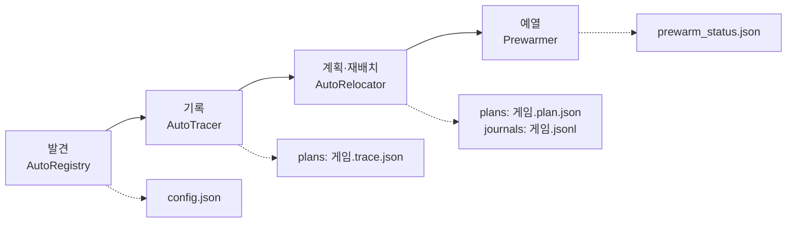

[English](DEVELOPMENT.md) | **한국어**

# 개발

> 개발자용 문서입니다. 빌드, 시험, 코드 구성을 설명합니다. 사용자는 [README](../README.ko.md)에서 시작하십시오.

## 직접 빌드

.NET 10 SDK 로 세 실행 파일을 게시합니다. 게시 결과는 `csharp\publish\` 아래에 생기며 Git 에서 무시합니다. 저장소의 `csharp/global.json` 은 SDK 10.0.400 을 씁니다(latestPatch).

```bat
dotnet publish csharp\src\AsterCache.Cli\AsterCache.Cli.csproj -c Release -r win-x64 --self-contained -o csharp\publish\cli
dotnet publish csharp\src\AsterCache.Service\AsterCache.Service.csproj -c Release -r win-x64 --self-contained -o csharp\publish\service
dotnet publish csharp\src\AsterCache.Tray\AsterCache.Tray.csproj -c Release -r win-x64 --self-contained -o csharp\publish\gui
```

- `csharp\publish\cli\aster.exe` 는 명령행 도구입니다.
- `csharp\publish\gui\AsterCache.Tray.exe` 는 관리 창입니다.
- 서비스는 관리자 PowerShell 에서 설치합니다.

```powershell
csharp\scripts\cs_service.ps1 -Action install
```

## 설치 프로그램 빌드

릴리스 워크플로가 설치 프로그램을 GitHub 릴리스에 `.exe` 로 첨부합니다. 설치본 정의는 [csharp/README.ko.md](../csharp/README.ko.md) 에 있습니다. 직접 빌드할 때는 다음과 같이 합니다.

```bat
ISCC.exe /DAppDir=<관리 창 publish 경로> /DAppVersion=<버전> csharp\packaging\windows\aster.iss
```

## 빌드와 시험

```bat
dotnet build csharp/AsterCache.sln -c Release
dotnet test csharp/AsterCache.sln -c Release --filter "Category!=Live"
dotnet format csharp/AsterCache.sln --verify-no-changes
py -3.12 -m unittest discover -s tests
```

- `Category=Live` 시험은 `D:\AsterBench` 와 Python 참조 구현이 필요하므로 위에서 제외했습니다.
- Python 참조 구현은 Python 3.11 이상이며 외부 패키지가 없습니다. Python 3.11.4 와 3.12.10 에서 검증했습니다. 명령과 구성은 [PYTHON_TOOLS.ko.md](PYTHON_TOOLS.ko.md) 를 보십시오.
- README 스크린샷을 다시 만들려면 `AsterCache.Tray.exe --smoke --screenshot <png> [--tab 0..3] [--theme light|dark] [--lang ko|en] [--data-dir <폴더>]` 를 실행합니다. 자세한 내용은 [csharp/README.ko.md](../csharp/README.ko.md) 에 있습니다.

## 프로젝트

`csharp/AsterCache.sln` 의 C# 프로젝트가 최종 구현입니다. `csharp/src/` 아래에 있으며, Core ← Windows ← Tracer·Prefetch ← Service ← Cli·Tray 순서로 참조합니다. 시험은 `csharp/tests/AsterCache.Tests` 에 있습니다.

| 프로젝트 | 산출물 | 역할과 주요 파일 |
|---|---|---|
| `AsterCache.Core` | 라이브러리 | 플랫폼과 무관한 규칙입니다. 계획(`Plan/HotSet.cs`, `ZoneAllocator.cs`, `PlanFile.cs`), ORBIT 계획기(`Plan/Orbit/OrbitPlanner.cs`), 재배치 실행·저널·되돌리기(`Apply/Applier.cs`, `Journal.cs`, `Reverter.cs`, `LayoutVerifier.cs`), 설정(`Settings/SettingsStore.cs`, `ConfigEditor.cs`), 안티치트 판정과 기능별 정책표(`Discovery/AntiCheat.cs`, `Capabilities.cs`), 엔진 프로필(`Profiles/engines.json`), SSD 보조 저장(`Tier/`), 화면 문구(`I18n/`) |
| `AsterCache.Windows` | 라이브러리 | Win32 호출입니다. NTFS 클러스터 이동(`NtfsVolume.cs`, `FSCTL_MOVE_FILE`), 파일 물리 배치 조회(`FileLayout.cs`), 읽기 전용 매핑과 `PrefetchVirtualMemory`(`FileMapping.cs`, `FilePin.cs`), 캐시를 거치지 않는 읽기(`UnbufferedReader.cs`), 캐시 적중 표본(`CacheProbe.cs`), 디스크 종류와 볼륨의 물리 디스크(`DiskInfo.cs`, `VolumeDisks.cs`), Windows 프리페치 `.pf`(`PrefetchFiles.cs`), 런처 라이브러리(`LauncherScan.cs`) |
| `AsterCache.Tracer` | 라이브러리 | ETW 기록입니다. 실시간 커널 세션(`LiveSession.cs`, `KernelCollector.cs`), `.etl` 변환(`EtlReader.cs`), 트레이스 생성·저장(`TraceBuilder.cs`, `TraceWriter.cs`) |
| `AsterCache.Prefetch` | 라이브러리 | 읽기 엔진입니다. 존 스트림(`ZoneStreamer.cs`), 폴더 통째 예열(`FolderWarm.cs`), 첫 실행 선행 읽기(`ReadAhead.cs`, 실험 기능, 기본 꺼짐) |
| `AsterCache.Service` | `AsterCache.Service.exe` | Windows 서비스입니다. 자동으로 도는 모든 일이 여기에 있습니다. |
| `AsterCache.Cli` | `aster.exe` | 명령행입니다. `Commands/` 에 plan, trace, apply, revert, prefetch, prewarm, status, discover, tier, orbit, profile 등이 있습니다. |
| `AsterCache.Tray` | `AsterCache.Tray.exe` | Avalonia 관리 창과 트레이 아이콘, 알림, Velopack 갱신입니다. |

## 서비스 안의 구성

`csharp/src/AsterCache.Service/` 의 파일입니다.

| 구성 | 주요 파일 | 하는 일 |
|---|---|---|
| 서비스 본체 | `Program.cs`, `Worker.cs` | Windows 서비스 `AsterCache` 로 상주합니다. 게임 시작 감지, 정기 배치 검사와 재적용, 설정 다시 읽기(5초마다)를 돌리고 아래 구성을 붙입니다. 외부 명령을 받는 통로(IPC)는 없고 설정 파일과 계획 폴더만 읽습니다. |
| 시작 감지 | `ProcessWatching.cs`, `EtwProcessWatcher.cs` | 폴링(기본)이나 ETW 로 등록 게임과 런처의 실행을 알아챕니다. 안티치트 게임이 등록돼 있으면 설정이 `etw` 여도 폴링을 씁니다. |
| 자동 모드 | `AutoMode.cs` | 발견, 트레이서, 재배치, SSD 보조 저장을 묶습니다. |
| 발견 | `AutoRegistry.cs`, `ProfileFeed.cs`, `ProfileSupplement.cs` | 런처 라이브러리(1시간마다)와 읽기량 휴리스틱(2초마다)으로 게임을 찾아 `config.json` 에 등록합니다. 기록이 없는 게임의 배치 정보는 공유 프로필, Windows 프리페치 기록, 엔진 프로필, 폴더 전체 순으로 찾습니다. |
| 트레이서 | `AutoTracer.cs`, `TracePhases.cs`, `LoadTiers.cs` | 등록 게임의 첫 실행부터 ETW 세션으로 읽기를 기록하고, 여러 번의 플레이를 합칩니다. 모든 플레이에서 반복해 읽힌 구간(common)을 따로 계산하고, 로딩 앞부분(tier0)을 정합니다. |
| 재배치 | `AutoRelocator.cs`, `DriveRecovery.cs` | 기록으로 계획을 만들고, PC 가 한가하고 게임이 꺼져 있을 때 이동·검증합니다. 재배치 뒤에는 디스크 회복을 확인하고 곧바로 예열합니다. |
| 예열·스트리머 | `Prewarm.cs`, `Streaming.cs`, `Rewarm.cs`, `Pinning.cs`, `KeepAwake.cs` | `Prewarmer` 가 서비스 시작·런처 실행·게임 종료 뒤에 예열 순서와 RAM 예산을 정하고, `PrefetchStreamer` 가 `ZoneStreamer` 로 읽습니다. `GameDispatcher` 는 게임이 시작될 때의 시작 스트림을 맡습니다. `Rewarmer` 는 주기적으로 캐시 적중을 표본으로 확인해 식었으면 다시 예열하고, `PinKeeper` 는 예열한 페이지를 읽기 전용 매핑으로 붙들며(선택), `KeepAwake` 는 HDD 가 꺼지지 않게 작게 읽습니다. |
| ORBIT | `OrbitModel.cs`, `OrbitCalibration.cs`, `OrbitRuntime.cs`, `OrbitShadow.cs` | 에피소드 모형(`<게임>.orbit.json`)과 디스크 보정(`disk_model.json`)을 만들고, 모드(`orbit_mode.json`)에 따라 `Core/Plan/Orbit/OrbitPlanner.cs` 의 결정을 예열 순서에 반영합니다. `shadow` 모드는 기록만 합니다. |
| 디스크 대여·취소 | `DiskReadCoordinator.cs`, `GameExits.cs`, `BootQuiet.cs` | 배경 읽기는 물리 디스크마다 대여(Lease)를 받아야 합니다. 같은 디스크에서 등록 게임이 실행 중이거나 종료 직후 유예 중이면 대여를 내주지 않고, 이미 받은 대여는 취소 토큰으로 멈춥니다. 부팅 직후에는 디스크 작업을 잠시 보류합니다. |
| 안티치트 게이트 | `Core/Discovery/AntiCheat.cs`, `Capabilities.cs` | 설치 폴더의 파일·폴더 이름만 보고 안티치트 종류를 짐작합니다(파일을 열지 않음). 기능별 정책표가 트레이스·고정·SSD 보조 저장의 허용 여부를 정합니다. 서비스(`AutoTracer`, `PinKeeper`, `AutoTier`)와 명령행(`Commands/AntiCheatGuard.cs`)이 같은 규칙을 씁니다. 탐지에 실패하면(`unknown`) 금지 쪽으로 봅니다. 종류별 정책은 [ANTICHEAT.ko.md](ANTICHEAT.ko.md)에 있습니다. |
| SSD 보조 저장 | `AutoTier.cs`, `Core/Tier/` | 선택 기능입니다. 핫 파일 사본을 SSD 에 두고 원래 자리에 심볼릭 링크를 둡니다. 저널은 `tier\<게임>.json` 입니다. |

## 자료 흐름

기록에서 예열까지 이어지는 흐름입니다. 각 단계의 산출물은 데이터 폴더에 파일로 남고, 다음 단계가 그 파일을 읽습니다.



1. **발견.** `AutoRegistry` 가 게임을 `config.json` 의 `games[]` 에 `source: auto` 로 등록합니다.
2. **기록.** 등록 게임이 처음 실행되면 `AutoTracer` 가 `Tracer` 의 실시간 ETW 세션으로 읽기를 기록해 `plans\<게임>.trace.json` 에 씁니다. 이후 플레이는 `.trace.runN.json` 으로 모아 합칩니다.
3. **계획.** `AutoRelocator` 가 트레이스에서 핫 집합(`HotSet`)을 뽑고 `PlanFile`(안에서 `ZoneAllocator` 가 구역을 배치)로 `plans\<게임>.plan.json` 과 읽기 순서 파일 `.plan.json.prefetch.json` 을 씁니다. 수동 `aster plan` 과 같은 코드입니다.
4. **재배치.** 게임이 꺼져 있고 PC 가 한가하면 수동 재배치와 같은 `Applier` 가 `NtfsVolume` 의 `FSCTL_MOVE_FILE` 로 조각을 옮깁니다. 이동마다 `journals\<게임>.jsonl` 에 기록하고, 검증이 실패하면 `Reverter` 가 저널대로 되돌립니다.
5. **예열.** `Prewarmer` 가 `ZoneStreamer` 로 구역의 파일을 읽기 전용으로 매핑해 `PrefetchVirtualMemory` 로 요청하고, 결과를 `prewarm_status.json` 에 씁니다. ORBIT 이 켜져 있으면 읽기 전에 예열 순서가 바뀝니다.

## 데이터 폴더

`%ProgramData%\AsterCache` 의 파일입니다. 서비스는 SYSTEM, 설정 편집과 되돌리기는 관리자만 쓸 수 있습니다.

| 파일 | 쓰는 쪽 | 내용 |
|---|---|---|
| `config.json` | 관리 창·서비스 | 설정과 게임 목록입니다. 쓸 때는 `config.json.lock` 으로 잠그고, 서비스가 5초마다 다시 읽습니다. |
| `plans\<게임>.trace.json`, `.trace.runN.json`, `.trace.common.json` | 서비스·`aster trace` | 읽기 기록, 플레이별 기록, 모든 플레이에서 반복된 구간입니다. 프리페치·공유 프로필에서 만든 기록은 `.boot.trace.json` 입니다. |
| `plans\<게임>.plan.json`, `.plan.json.prefetch.json`, `.warmonly.json` | 서비스·`aster plan` | 배치 계획, 예열 입력, 예열 전용 목록입니다. |
| `plans\<게임>.orbit.json` | 서비스·`aster orbit` | ORBIT 에피소드 모형입니다. |
| `journals\<게임>.jsonl` | `Applier` | 재배치 저널입니다. 이전 저널은 `.jsonl.<UTC 시각>` 으로 보관합니다. |
| `tier\<게임>.json` | 서비스 | SSD 보조 저장 저널입니다. |
| `auto_status.json` | 서비스 | 게임별 자동 단계(`discovered`, `tracing`, `learning`, `waiting_idle`, `relocating`, `done`, `failed`, `skipped`), 재배치 기록, 플레이 기록, 예열 적중률입니다. |
| `prewarm_status.json` | 서비스 | 게임별 마지막 예열 결과입니다. |
| `play_samples.json` | 서비스 | 게임별 최근 50회 플레이 구간의 디스크 읽기량·지연과 시작 예열·스트림 상태입니다. |
| `orbit_mode.json`, `disk_model.json`, `benchmark_samples.json` | 서비스 | ORBIT 모드, 디스크별 보정 표본, 로딩 시간 표본입니다. |
| `logs\service.log`, `logs\tray.log` | 서비스, 트레이 | 로그입니다. 트레이가 데이터 폴더에 쓸 수 없으면 `%LocalAppData%\AsterCache\logs` 에 씁니다. |
| `tray.json` | 사용자 | 트레이 설정(갱신 피드 주소)입니다. |

## 트레이 앱과 서비스의 통신

서비스에 명령을 보내는 통로는 없습니다. 트레이는 파일과 Windows 서비스 관리자(SCM)만 씁니다.

- **설정.** 관리 창이 `ConfigEditor` 로 `config.json` 을 고치면 서비스가 5초 안에 다시 읽습니다.
- **상태.** 서비스가 `auto_status.json` 과 `prewarm_status.json` 을 쓰고, 트레이는 5초마다 읽어 아이콘·툴팁·메뉴·상태 탭을 갱신합니다. 예열 기록과 게임별 배치 판정은 관리 창이 `aster.exe status` 를 자식 프로세스로 실행해 한 줄 JSON 으로 받습니다.
- **작업.** 트레이스 수집, 계획, 재배치, 되돌리기는 관리 창이 `aster.exe` 를 실행합니다. 관리자 권한이 필요하면 UAC 로 승격하고 결과는 `--result-file` 로 받습니다.
- **서비스 제어.** 상태 조회는 SCM 으로 비관리자도 됩니다. 시작·정지·설치·제거는 `sc.exe` 를 승격 실행합니다.
- **지금 예열.** 트레이 프로세스가 같은 `PrefetchStreamer` 로 직접 읽습니다.
- **갱신.** 트레이만 Velopack 으로 갱신하며(`tray.json` 에 피드 주소가 있을 때), 서비스는 설치 프로그램으로 다시 설치합니다. 버전이 다르면 트레이가 알립니다.

## 안전 장치

코드가 데이터를 지키는 방법입니다. 게임을 쓰는 방법과 주의사항은 [GAME_GUIDE.ko.md](GAME_GUIDE.ko.md)를 보십시오.

- **내용 검증.** 재배치 전후 SHA-256 을 비교합니다. 내용이 다르면 실패로 기록합니다.
- **저널과 되돌리기.** 이동한 조각마다 저널(JSON Lines)을 남기며, `revert` 로 예전 물리 배치로 되돌립니다. 데이터 내용은 바뀌지 않습니다. 이전 저널은 지우지 않고 `<게임>.jsonl.<UTC 시각>` 이름으로 보관합니다.
- **허용 폴더와 볼륨 고정.** `allowed_roots` 밖의 파일과 `volume_label` 이 다른 볼륨은 건드리지 않습니다.
- **중단 처리.** 재배치 중 게임이 시작되면 이동 중이던 한 조각만 끝내고 멈춥니다. 저널에 재개 지점을 남기고, 게임이 끝난 뒤 같은 계획으로 이어갑니다.
- **여러 날에 나눠 옮기기.** 여러 날에 걸쳐 옮기는 중에 남은 구역을 다른 파일이 차지하거나 계획이 바뀌어도, 이미 옮긴 부분은 다시 옮기지 않고 남은 부분만 새 빈 구간에 다시 계획합니다. 같은 디스크의 여러 게임이 같은 빈 구간을 잡지 않습니다.
- **데이터 폴더 권한.** `%ProgramData%\AsterCache` 는 SYSTEM 과 Administrators 만 쓸 수 있고, 일반 사용자는 읽기만 합니다. 서비스를 제거해도 데이터 폴더는 남으며, `cs_service.ps1 -Action uninstall -PurgeData` 를 명시했을 때만 지웁니다.
- **권한 확인.** 관리자 권한이 없으면 재배치와 되돌리기는 아무것도 바꾸지 않고 `not_admin` 으로 끝납니다.

## 저장소 구성

- `csharp/` — 최종 C# 구현. 명령행 도구 `aster`, 서비스, 관리 창, 설치 프로그램 스크립트, 시험
- `kernel/` — 커널 미니필터 AsterFlt 소스. 실험용이며 적재하지 않습니다.
- `prefetch/`, `relayout/`, `bench/` — Python 참조 구현(선읽기, 재배치, 측정 도구). C# 의 교차 검증 기준입니다. [PYTHON_TOOLS.ko.md](PYTHON_TOOLS.ko.md)를 보십시오.
- `scripts/` — 참조 구현의 실험용 관리자 PowerShell 스크립트
- `docs/` — 사용자 안내, 설계·연구 기록, 측정 결과 요약
- `tests/` — Python 참조 구현의 단위·회귀 시험
- `results/` — 측정 결과 JSON 과 로그
- `.github/workflows/` — C# 빌드와 시험, 커널 빌드 워크플로
- 루트의 `*.py` — 이전 버전과 SQLite 캐시 참조 구현, 시험·측정 스크립트
- `VALIDATION_REPORT.md` — 검증 보고서
