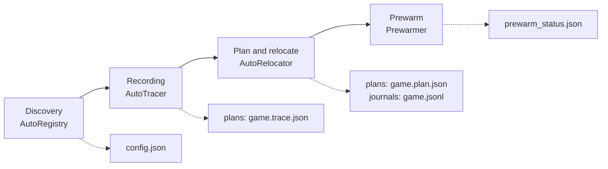

**English** | [한국어](DEVELOPMENT.ko.md)

# Development

> For developers: building, testing, and how the code is organized. Users start at the [README](../README.md).

## Build from source

Publish the three executables with the .NET 10 SDK. The output goes under `csharp\publish\` and is ignored by Git. The repository's `csharp/global.json` uses SDK 10.0.400 (latestPatch).

```bat
dotnet publish csharp\src\AsterCache.Cli\AsterCache.Cli.csproj -c Release -r win-x64 --self-contained -o csharp\publish\cli
dotnet publish csharp\src\AsterCache.Service\AsterCache.Service.csproj -c Release -r win-x64 --self-contained -o csharp\publish\service
dotnet publish csharp\src\AsterCache.Tray\AsterCache.Tray.csproj -c Release -r win-x64 --self-contained -o csharp\publish\gui
```

- `csharp\publish\cli\aster.exe` is the command-line tool.
- `csharp\publish\gui\AsterCache.Tray.exe` is the management window.
- Install the service from an administrator PowerShell.

```powershell
csharp\scripts\cs_service.ps1 -Action install
```

## Build the installer

The release workflow attaches the installer `.exe` to the GitHub release. The installer's defines are listed in [csharp/README.md](../csharp/README.md). To build it yourself:

```bat
ISCC.exe /DAppDir=<gui publish path> /DAppVersion=<version> csharp\packaging\windows\aster.iss
```

## Build and test

```bat
dotnet build csharp/AsterCache.sln -c Release
dotnet test csharp/AsterCache.sln -c Release --filter "Category!=Live"
dotnet format csharp/AsterCache.sln --verify-no-changes
py -3.12 -m unittest discover -s tests
```

- `Category=Live` tests need `D:\AsterBench` and the Python reference implementation, so they are excluded above.
- The Python reference implementation requires Python 3.11 or later and has no external packages. It was validated on Python 3.11.4 and 3.12.10. For commands and layout see [PYTHON_TOOLS.md](PYTHON_TOOLS.md).
- To recreate the README screenshots, run `AsterCache.Tray.exe --smoke --screenshot <png> [--tab 0..3] [--theme light|dark] [--lang ko|en] [--data-dir <folder>]`. Details are in [csharp/README.md](../csharp/README.md).

## Projects

The C# projects in `csharp/AsterCache.sln` are the final implementation. They live under `csharp/src/` and reference each other in this order: Core ← Windows ← Tracer·Prefetch ← Service ← Cli·Tray. The tests are in `csharp/tests/AsterCache.Tests`.

| Project | Output | Role and main files |
|---|---|---|
| `AsterCache.Core` | library | Platform-independent rules. Planning (`Plan/HotSet.cs`, `ZoneAllocator.cs`, `PlanFile.cs`), the ORBIT planner (`Plan/Orbit/OrbitPlanner.cs`), relocation, journal, and revert (`Apply/Applier.cs`, `Journal.cs`, `Reverter.cs`, `LayoutVerifier.cs`), settings (`Settings/SettingsStore.cs`, `ConfigEditor.cs`), anti-cheat detection and the per-feature policy table (`Discovery/AntiCheat.cs`, `Capabilities.cs`), engine profiles (`Profiles/engines.json`), SSD assist storage (`Tier/`), and UI strings (`I18n/`) |
| `AsterCache.Windows` | library | Win32 calls. NTFS cluster moves (`NtfsVolume.cs`, `FSCTL_MOVE_FILE`), physical file layout lookup (`FileLayout.cs`), read-only mappings and `PrefetchVirtualMemory` (`FileMapping.cs`, `FilePin.cs`), reads that bypass the cache (`UnbufferedReader.cs`), cache hit sampling (`CacheProbe.cs`), disk kind and a volume's physical disk (`DiskInfo.cs`, `VolumeDisks.cs`), Windows prefetch `.pf` files (`PrefetchFiles.cs`), and launcher libraries (`LauncherScan.cs`) |
| `AsterCache.Tracer` | library | ETW recording. Real-time kernel session (`LiveSession.cs`, `KernelCollector.cs`), `.etl` conversion (`EtlReader.cs`), and trace building and saving (`TraceBuilder.cs`, `TraceWriter.cs`) |
| `AsterCache.Prefetch` | library | Read engines. The zone stream (`ZoneStreamer.cs`), whole-folder prewarm (`FolderWarm.cs`), and first-run read-ahead (`ReadAhead.cs`, experimental, off by default) |
| `AsterCache.Service` | `AsterCache.Service.exe` | The Windows service. Everything that runs automatically lives here. |
| `AsterCache.Cli` | `aster.exe` | The command line. `Commands/` holds plan, trace, apply, revert, prefetch, prewarm, status, discover, tier, orbit, profile, and more. |
| `AsterCache.Tray` | `AsterCache.Tray.exe` | The Avalonia management window, tray icon, notifications, and Velopack updates. |

## Inside the service

Files in `csharp/src/AsterCache.Service/`.

| Part | Main files | What it does |
|---|---|---|
| Service core | `Program.cs`, `Worker.cs` | Stays resident as the Windows service `AsterCache`. Runs game start detection, the periodic layout check and reapply, and config reloading (every 5 seconds), and attaches the parts below. It has no channel (IPC) for outside commands and reads only the config file and the plans folder. |
| Start detection | `ProcessWatching.cs`, `EtwProcessWatcher.cs` | Notices the start of registered games and launchers by polling (default) or ETW. If an anti-cheat game is registered, polling is used even when the setting is `etw`. |
| Automatic mode | `AutoMode.cs` | Bundles discovery, the tracer, relocation, and SSD assist storage. |
| Discovery | `AutoRegistry.cs`, `ProfileFeed.cs`, `ProfileSupplement.cs` | Finds games through launcher libraries (hourly) and a read-volume heuristic (every 2 seconds) and registers them in `config.json`. Layout information for a game without a recording is looked up in this order: shared profile, Windows prefetch record, engine profile, whole folder. |
| Tracer | `AutoTracer.cs`, `TracePhases.cs`, `LoadTiers.cs` | Records reads with an ETW session from a registered game's first run and merges several plays. Computes the ranges read repeatedly in every play (common) and decides the loading head (tier0). |
| Relocation | `AutoRelocator.cs`, `DriveRecovery.cs` | Makes the plan from the recording, then moves and verifies while the PC is idle and the game is off. After relocation it checks drive recovery and prewarms right away. |
| Prewarm and streamer | `Prewarm.cs`, `Streaming.cs`, `Rewarm.cs`, `Pinning.cs`, `KeepAwake.cs` | `Prewarmer` decides the prewarm order and RAM budget at service start, launcher start, and after a game exits, and `PrefetchStreamer` reads through `ZoneStreamer`. `GameDispatcher` handles the start stream when a game starts. `Rewarmer` samples cache hits periodically and prewarms again if they went cold, `PinKeeper` holds the prewarmed pages with read-only mappings (optional), and `KeepAwake` does small reads so the HDD does not spin down. |
| ORBIT | `OrbitModel.cs`, `OrbitCalibration.cs`, `OrbitRuntime.cs`, `OrbitShadow.cs` | Builds the episode model (`<game>.orbit.json`) and the disk calibration (`disk_model.json`), and applies the decision of `Core/Plan/Orbit/OrbitPlanner.cs` to the prewarm order according to the mode (`orbit_mode.json`). `shadow` mode only records. |
| Disk lease and cancellation | `DiskReadCoordinator.cs`, `GameExits.cs`, `BootQuiet.cs` | Background reads must take a lease on the physical disk. While a registered game runs on the same disk, or is in its post-exit grace period, no lease is given, and leases already held are stopped through a cancellation token. Disk work is held back briefly right after boot. |
| Anti-cheat gate | `Core/Discovery/AntiCheat.cs`, `Capabilities.cs` | Guesses the anti-cheat kind from file and folder names in the install folder alone (it opens no files). The per-feature policy table decides whether trace, pin, and SSD assist storage are allowed. The service (`AutoTracer`, `PinKeeper`, `AutoTier`) and the command line (`Commands/AntiCheatGuard.cs`) follow the same rules. If detection fails (`unknown`), it is treated as forbidden. Per-kind policy: [ANTICHEAT.md](ANTICHEAT.md). |
| SSD assist storage | `AutoTier.cs`, `Core/Tier/` | Optional. Keeps a copy of the hot files on the SSD and puts a symbolic link at the original path. The journal is `tier\<game>.json`. |

## Data flow

The flow from recording to prewarm. Each step leaves its output as a file in the data folder, and the next step reads that file.



1. **Discovery.** `AutoRegistry` registers the game in `games[]` of `config.json` with `source: auto`.
2. **Recording.** When a registered game first runs, `AutoTracer` records its reads through the real-time ETW session of `Tracer` and writes `plans\<game>.trace.json`. Later plays are collected as `.trace.runN.json` and merged.
3. **Plan.** `AutoRelocator` extracts the hot set (`HotSet`) from the trace and builds the plan with `PlanFile` (which lays out the zone through `ZoneAllocator`), writing `plans\<game>.plan.json` and the read-order file `.plan.json.prefetch.json`. It is the same code as the manual `aster plan`.
4. **Relocation.** When the game is off and the PC is idle, the same `Applier` as for manual relocation moves the pieces with `FSCTL_MOVE_FILE` through `NtfsVolume`. Each move is recorded in `journals\<game>.jsonl`, and if verification fails `Reverter` rolls back along the journal.
5. **Prewarm.** `Prewarmer` maps the zone's files read-only through `ZoneStreamer`, requests them with `PrefetchVirtualMemory`, and writes the result to `prewarm_status.json`. If ORBIT is on, the prewarm order is changed before the reads.

## The data folder

Files in `%ProgramData%\AsterCache`. The service runs as SYSTEM, and only administrators can write settings or revert.

| File | Written by | Contents |
|---|---|---|
| `config.json` | management window, service | Settings and the game list. Writes lock `config.json.lock`, and the service re-reads it every 5 seconds. |
| `plans\<game>.trace.json`, `.trace.runN.json`, `.trace.common.json` | service, `aster trace` | The read recording, the per-play recordings, and the ranges repeated in every play. A recording built from prefetch or a shared profile is `.boot.trace.json`. |
| `plans\<game>.plan.json`, `.plan.json.prefetch.json`, `.warmonly.json` | service, `aster plan` | The layout plan, the prewarm input, and the prewarm-only list. |
| `plans\<game>.orbit.json` | service, `aster orbit` | The ORBIT episode model. |
| `journals\<game>.jsonl` | `Applier` | The relocation journal. Earlier journals are kept as `.jsonl.<UTC time>`. |
| `tier\<game>.json` | service | The SSD assist storage journal. |
| `auto_status.json` | service | Per-game automatic stage (`discovered`, `tracing`, `learning`, `waiting_idle`, `relocating`, `done`, `failed`, `skipped`), relocation history, play history, and prewarm hit rate. |
| `prewarm_status.json` | service | The last prewarm result per game. |
| `play_samples.json` | service | Disk read volume and latency per play interval, with the prewarm and start-stream state at game start, for the last 50 plays of each game. |
| `orbit_mode.json`, `disk_model.json`, `benchmark_samples.json` | service | The ORBIT mode, per-disk calibration samples, and loading time samples. |
| `logs\service.log`, `logs\tray.log` | service, tray | Logs. If the tray cannot write to the data folder, it writes to `%LocalAppData%\AsterCache\logs`. |
| `tray.json` | user | Tray settings (the update feed address). |

## How the tray app talks to the service

There is no channel for sending commands to the service. The tray uses only files and the Windows Service Control Manager (SCM).

- **Settings.** When the management window edits `config.json` through `ConfigEditor`, the service re-reads it within 5 seconds.
- **Status.** The service writes `auto_status.json` and `prewarm_status.json`; the tray reads them every 5 seconds to update the icon, tooltip, menu, and Status tab. For the prewarm record and the per-game layout verdict, the management window runs `aster.exe status` as a child process and reads one line of JSON.
- **Actions.** For trace collection, planning, relocation, and revert, the management window runs `aster.exe`. If administrator rights are needed it elevates through UAC and receives the result through `--result-file`.
- **Service control.** Querying the state works without administrator rights through the SCM. Start, stop, install, and uninstall run `sc.exe` elevated.
- **Prewarm now.** The tray process reads directly with the same `PrefetchStreamer`.
- **Updates.** Only the tray updates through Velopack (when `tray.json` has a feed address); the service is reinstalled with the installer. The tray shows a notice when the versions differ.

## Safety measures

How the code protects your data. For using it with a game and the cautions, see [GAME_GUIDE.md](GAME_GUIDE.md).

- **Content verification.** SHA-256 is compared before and after relocation. If the content differs, it is recorded as a failure.
- **Journal and revert.** A journal (JSON Lines) is written for every moved fragment, and `revert` returns to the previous physical layout. The data content does not change. The earlier journal is not deleted; it is kept as `<game>.jsonl.<UTC time>`.
- **Allowed folders and volume pinning.** Files outside `allowed_roots` and volumes whose label differs from `volume_label` are not touched.
- **Interruption handling.** If a game starts during relocation, only the fragment currently being moved is finished and then it stops. A resume point is left in the journal, and the same plan continues after the game exits.
- **Splitting relocation over several days.** If another file takes the zone still to be moved, or the plan changes, the parts already moved are not moved again. Only the remaining part is planned again into a new free area. Games on the same disk do not claim the same free area.
- **Data folder permissions.** Only SYSTEM and Administrators can write to `%ProgramData%\AsterCache`; ordinary users can only read. Uninstalling the service leaves the data folder; it is deleted only when you explicitly pass `cs_service.ps1 -Action uninstall -PurgeData`.
- **Permission check.** Without administrator rights, relocation and revert change nothing and end with `not_admin`.

## Repository layout

- `csharp/` — the final C# implementation: command-line tool `aster`, service, management window, installer script, and tests
- `kernel/` — source of the AsterFlt kernel minifilter. Experimental; it is not loaded.
- `prefetch/`, `relayout/`, `bench/` — Python reference implementation (prefetch, relocation, and measurement tools). It is the cross-validation baseline for the C# code. See [PYTHON_TOOLS.md](PYTHON_TOOLS.md).
- `scripts/` — experimental administrator PowerShell scripts for the reference implementation
- `docs/` — user guides, design and research notes, and the results summary
- `tests/` — unit and regression tests of the Python reference implementation
- `results/` — measurement result JSON and logs
- `.github/workflows/` — C# build and test workflows and the kernel build workflow
- `*.py` in the root — older versions, the SQLite cache reference implementation, and test and measurement scripts
- `VALIDATION_REPORT.md` — validation report
